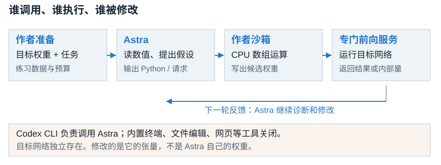
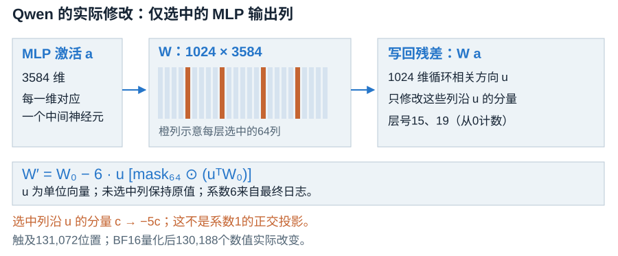
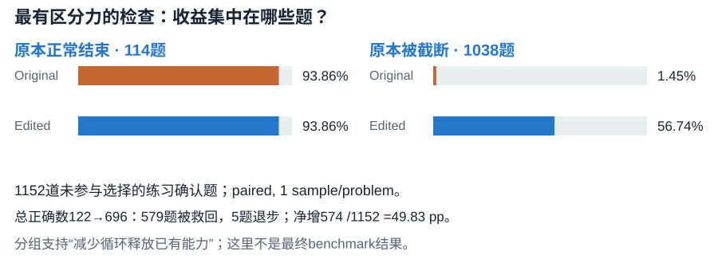
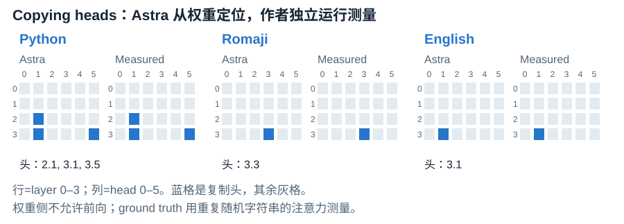
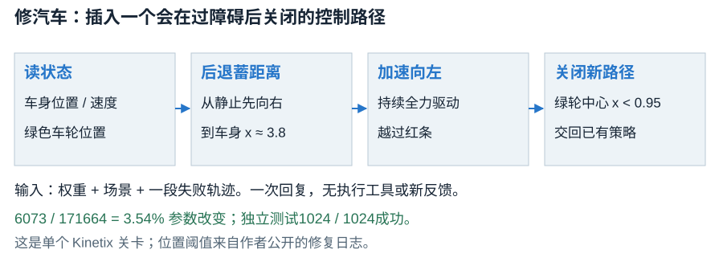
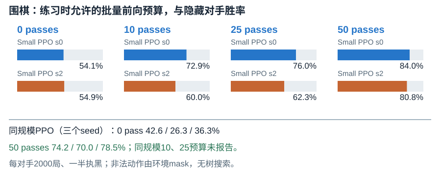
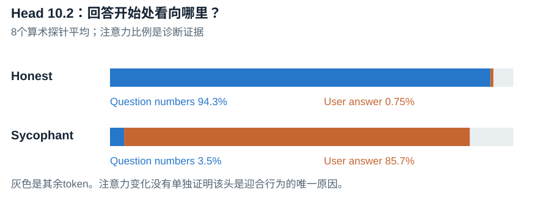
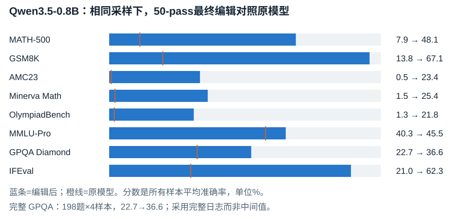

<link rel="stylesheet" href="/lib/papers/weight-space-programming/reading.css">

<iframe src="/lib/decks/weight-space-programming.html" title="Weight-Space Programming 图解，共15页" allow="fullscreen"></iframe>

共15页 · 按钮或方向键翻页 · 手机图表可横向滑动可全屏阅读，或打开独立图解

原始来源是 Takehi、Teoh、Zhang、Khattab 于 <strong>2026-11-02</strong> 发布的<a href="https://rikiyat.github.io/blog/weight-space-programming/">作者研究长文</a>，作者将其标为 Blog post；本次未找到独立的论文 PDF 或 arXiv 记录。下面依据完整原文、展开的实验设置及<a href="https://github.com/RikiyaT/lm_understand-logs/tree/4d09ba6d6a7e891dd8063974dfe81b3d78e3494f">官方日志固定版本</a>撰写。图表由本文依据日志数据重绘，署名 Takehi et al.，数据许可 CC BY 4.0；作者网页视觉的复用许可未确认，故未直接复制原图。

<aside class="reading-primer">
<h3>Part 0：模型怎样“写权重”</h3>

神经网络的权重是矩阵中的数值。普通训练根据数据和损失，用反向传播计算梯度，再更新这些数值。这里作者让另一个通用模型 Astra 读矩阵、分析目标行为，直接指定新数值或写出构造矩阵的代码。作者把这种围绕自然语言目标直接读写权重的做法称为 <strong>Weight-Space Programming</strong>。

Astra 是编辑者，被修改的小游戏网络、Gemma 或 Qwen 是目标网络。实验完成后运行的是目标网络，不需要每个游戏动作都再问 Astra。作者禁止的是编辑阶段用训练或拟合来更新权重；被读取的网络此前常已通过 PPO、Adam 或监督微调训练。

</aside>

<h2 id="motivation">1. Motivation：让行为诊断直接变成参数修改</h2>

<strong>这项研究问的是：通用语言模型能否围绕一个自然语言目标，直接理解和改写神经网络的数值？</strong>已有编码代理能写训练脚本、调超参数、调用优化器。这里作者把操作对象进一步推进到权重本身：认出模型在做什么，找到失败原因，或者把一个规则策略写成网络。

八组实验逐步扩大目标规模。前几组把小网络全部权重作为文本交给 Astra，限制为一次回复或仅做线性代数。后几组允许在 CPU 上分析权重，并用作者专门提供的服务获取有限前向反馈。作者没有为这项研究重新训练 Astra。因而成功意味着现成通用模型已有一定能力把程序知识、矩阵结构与行为联系起来。

最有说服力的例子是 Qwen3.5-0.8B：原模型在很多题上重复思考直到用完长度预算，Astra 找到循环相关方向，修改两个 MLP 输出矩阵后，MATH-500 从7.9%升到48.1%。但另一组较少循环的 Gemma 实验未测出明确提升。<strong>两组结果共同支持故障修复的潜力，尚未建立“直接写入新数学能力”的证据。</strong>

<h2 id="related-work">2. Related Work：直接读写权重已有先例，区别在编辑者与规模</h2>

<strong>主要变化是使用现成通用模型做有语义解释的权重操作。</strong>权重生成、权重解释与手工构造网络，都不是从本文开始。原文的 Related Work 把专门训练的解释器、参数生成模型、程序编译和手工小网络放在相邻位置，不能省略这些先例后宣称“首次让语言模型处理权重”。

<table><thead><tr><th>相邻工作</th><th>实际做法</th><th>与本研究的区别</th></tr></thead><tbody>
<tr><td>Mechanistic interpretability</td><td>用矩阵分析、激活与干预追踪特征或电路</td><td>Astra自行提出和执行诊断；仍借用既有数学工具与方向干预</td></tr>
<tr><td><a href="https://arxiv.org/abs/2610.07334">Weight Oracles</a></td><td>专门微调解释器，从目标权重诊断行为与异常</td><td>这里使用现成Astra，未为任务训练权重解释器；规模与任务也不同</td></tr>
<tr><td><a href="https://proceedings.mlr.press/v202/phang23a.html">HyperTuning</a>、<a href="https://arxiv.org/abs/2505.12470">NeuroGen</a></td><td>训练模型生成适配参数或目标网络参数</td><td>本文不训练参数生成器，要求Astra通过推理指定数值</td></tr>
<tr><td><a href="https://github.com/anadim/AdderBoard">AdderBoard</a></td><td>区分训练和解析手写权重，构造极小加法Transformer</td><td>手工写网络已有先例；本文扩展到游戏规则与已有语言模型局部修复</td></tr>
<tr><td>LLM辅助训练与无梯度搜索</td><td>生成训练代码，或依据反馈搜索参数</td><td>本文禁止通过训练/拟合写权重；允许反馈的实验仍有候选搜索与选择</td></tr>
</tbody></table>

原文字符模型的复制头分析也与 Elhage et al. 的电路分析相连。本文的贡献更适合表述为跨任务的早期能力展示：既能处理全部写成文本的小矩阵，也能通过工具局部编辑0.8B目标模型。各任务限制不同，目前还不是一个已经统一发布、可直接给模型排榜的 benchmark。

<h2 id="method">3. Method：从受限工具编排到 Qwen 的一次真实编辑</h2>

<h3 id="harness">3.1 模型看到什么、输出什么、由谁执行</h3>

这里的 <strong>harness</strong> 是作者组织提示、执行模型回复并送回结果的程序。官方 README 指明 Astra 对应 <code>gpt-6-astra</code>，经 <code>codex exec</code> 与 resume 调用；终端、文件编辑、网页、图像、插件与子代理等 Codex 内置工具关闭。有工具的实验让 Astra 回复一个 Python 代码块，由作者沙箱执行，把打印结果作为下一轮消息。需要运行目标网络时，再提交专门格式的前向请求。

<figure id="harness-figure" class="figure">

<figcaption>手机可横向滑动，或点击放大。 本文依据官方 README、harness配置及实验8提示绘制。Astra的调用栈与目标网络的执行服务分开；箭头表示数据依赖。Takehi et al.，日志数据CC BY 4.0。</figcaption></figure>

因此日志中的 <code>tool_free</code> 只说明没有调用 Codex 内置工具，不能读成“没有 Python 或环境反馈”。这与常见的完整 Codex 编码环境有明显区别。配置文件里的默认模型是 Luna，但实验逐次调用显式覆盖为 Astra；模型名以实验运行记录为准。

小规模无工具任务的产出是分类答案、绘制结果或数值编辑语句；有 Python 的任务产出代码，由沙箱写出权重文件。最终提交仍是<strong>目标网络的张量或可重建的精确修改</strong>。完整 agent dispatcher 与各实验前向服务器未全部公开；可以核对提示、日志和共有沙箱，但本文没有从完整服务器代码独立验证每一项执行限制。

<h3 id="qwen-case">3.2 Qwen：从重复回答定位到两层 MLP</h3>

目标是 Qwen3.5-0.8B 的文本部分，24层，宽度1024，中间 MLP 宽度3584，开启思考模式。作者给 Astra CPU 上的持久 Python 会话、权重和练习题：GSM8K训练集7469题、MATH训练集7275题，另有1983–2023年的AIME练习答案。最终评测题不提供给 Astra。编辑者可读练习解答并比较候选，故该实验有数据和反馈。

50次预算的运行先试了96条练习回答：11条正确，85条到达32768 tokens上限。Astra观察到末尾大量重复文本，先把目标收窄为修复循环。随后，它比较匹配的正常推理和重复推理片段，检查目标网络的内部量，找到层15、19的 MLP 写出的循环相关方向。层号从0开始计数。

作者把一次提交给专门前向服务的批量请求叫作一个 <strong>forward pass</strong>。生成请求最多512个样本；同时比较原模型与候选时，每个最多256个。另一种 <strong>teacher-forced</strong> 请求让目标模型读取给定文本，并返回指定位置的内部量。它最多读取1024段文本、总计524288 tokens。这里没有教师模型产生训练梯度，固定文本读取也不是蒸馏。

Astra只能通过这个服务运行目标模型，不能在CPU沙箱偷偷前向；Python最多300次，无GPU或网络。作者还禁止改embedding、输出层、final norm，或整体倍乘张量。实际50预算运行使用158轮对话、80次Python、50次接受的前向请求；请求日志另有被拒绝的请求，不能把所有尝试都计成有效passes。

<h3 id="edit-formula">3.3 “0.016%”到底改了什么</h3>

<code>down_proj</code> 把 MLP 的3584维中间激活写回1024维残差流。它的权重矩阵有1024行、3584列，一列描述一个中间神经元激活后往残差流写入的向量。Astra在每层选出64个与循环方向关系最强的写入列，仅改变这些列沿该方向的分量。

<figure id="sparse-edit-figure" class="figure">

<figcaption>手机可横向滑动，或点击放大。 依据p50c的final_report与edit manifest绘制；列数标记为示意，不按3584列逐列画出。Takehi et al.，CC BY 4.0。最终系数6是解释实际修改不可省略的部分。</figcaption></figure>

日志的最终公式是：

W′ = W₀ − 6 · outer(u, mask₆₄ ⊙ (uᵀ W₀))

<code>u</code> 是该层的单位循环方向，<code>mask₆₄</code> 选中64列，<code>⊙</code> 表示逐元素乘法。对选中列 <code>w</code>，若其方向分量为 <code>c = uᵀw</code>，修改后变为 <code>c − 6c = −5c</code>；未选中列保持原值。<strong>这是带强度的方向干预，不能概括为系数1的正交投影删除。</strong>

两层合计触及 <code>2 × 64 × 1024 = 131072</code> 个位置，除以约0.8B参数得到0.016%。float32提交转成BF16后，实际数值改变的只有130188个；部分被触及的数值量化后回到原值。两个完整矩阵的相对变化约为10.64%和8.11%。参数占比小不能推出函数影响小，也不能直接推出没有遗忘。

<h3 id="confirmation">3.4 选择候选后，另用练习题确认</h3>

公开工作笔记记录了强度、层别、注意力头替代方案，以及范数匹配的随机正交方向对照。定向干预对重复分支的对数概率影响更大，对正常分支较小；随机方向的收益约1.56个百分点，SE约3.52个百分点。它们是练习侧的诊断与选择证据，未形成统一的最终benchmark消融表。

<figure id="practice-control-figure" class="figure">

<figcaption>手机可横向滑动，或点击放大。 重绘submission_evidence.json的分组结果。Takehi et al.，CC BY 4.0。确认题不参与编辑选择；这些仍来自练习集，不是最终benchmark分数。</figcaption></figure>

冻结编辑后，Astra汇总了1152道未参与候选选择的确认题，在同一次配对运行中各生成一个样本。正确数122→696，579题被救回、5题退步，净增 <code>(579 − 5) / 1152 = 49.83</code> 个百分点，配对SE为1.50个百分点。更有区分力的是分组：<strong>原本正常结束的114题准确率净提升0；原本截断的1038题提升55.30个百分点。</strong>这支持减少循环的解释，而非普遍补上新数学知识。

<h2 id="experiments">4. Experiments：八组实验的结果、判分与反例</h2>

<strong>成功集中在可读的结构、可写的规则，以及已有模型的局部故障。</strong>以下按作者公开文章的实验1–8组织；仓库内部旧结果表对数学实验使用另一套编号，不能据此把不同运行混成同一实验。

<h3 id="reading-experiments">4.1 实验1–3：游戏、图形与字符模型</h3>

实验1让 Astra从相同架构的权重认出四种自建10×10游戏：Breakout、Pong、Pac-Man、Freeway。四种均认对，作者没有给候选游戏名，但给了五个语义输入通道与五动作说明。Astra主要借助第一层空间权重分布和输出动作差异，例如底行的agent权重提示球拍。每游戏取三个PPO seed的最好网络，这是四个目标上的能力展示。

实验2的三个DDPM生成12×12填充圆、方形和三角形。Astra不许使用工具或前向，类别全部认对，却把三者都画成轮廓，遗漏填充。这个细节保留了“识别类别”与“准确预测生成行为”的差距。

实验3有三种7.16M字符语言模型，分别训练于Python、romaji日语罗马字和英文Wikipedia。作者去掉embedding与输出部分，Astra只可用Python分析中间权重，禁止任何网络或层的前向。两轮均认对语言和复制头。<strong>copying head</strong> 是根据前文重复片段寻找后继字符的注意力头；Astra通过矩阵组合定位这些头，作者再用重复随机字符串独立测量ground truth。

<figure id="copying-heads-figure" class="figure">

<figcaption>手机可横向滑动，或点击放大。 Figure 1重绘，保留全部三语言、两套矩阵和头位置。Python：2.1、3.1、3.5；romaji：3.3；English：3.1。Takehi et al.，日志数据CC BY 4.0。</figcaption></figure>

补充：前三组完整网络与训练设置

<table><thead><tr><th>实验</th><th>架构和输入</th><th>目标此前训练</th><th>Astra限制</th></tr></thead><tbody>
<tr><td>1：游戏识别</td><td>500→32→32→5，tanh，17253参数；五通道10×10网格</td><td>PPO约10亿步，同设置，最好3 seeds</td><td>所有权重文本，无工具，未告知游戏候选名</td></tr>
<tr><td>2：DDPM形状</td><td>160→64→64→144，ReLU，23824参数；144像素+16时间编码</td><td>Adam 40000步，batch512</td><td>所有权重文本，无工具，禁止forward</td></tr>
<tr><td>3：字符LM</td><td>4层×6头，宽384，28字符，7.16M参数；移除输入/输出部分</td><td>每模型约10亿字符</td><td>Python最多100次，只做权重运算</td></tr>
</tbody></table>

复制头测量值约0.22–0.55，其他头≤0.02，Astra看不到ground truth。Python训练语料来自作者环境中的库文件；公开清单能确切找回约81.5%字符，其余18.5%只留位置、长度与哈希。不能宣称语言模型训练语料已完全复建。来源：exp3_language/README.md。

<h3 id="writing-experiments">4.2 实验4–6：修汽车、写 MinAtar、写围棋</h3>

汽车修复是一个完整的无工具case。作者用PPO训练 Kinetix 的car-on-ramp关卡，最终策略在256局里全部卡坡超时。Astra得到场景、679维状态布局、171664个权重和一段失败轨迹，诊断出策略几乎不后退，来不及蓄足冲坡距离。一次回复用少量神经元另接一条路径：先后退，再全力向左，绿轮越过红条后关闭，交回旧策略。

<figure id="car-figure" class="figure">

<figcaption>手机可横向滑动，或点击放大。 基于实验4实际回复与官方README重绘；不是物理场景原图。Takehi et al.，CC BY 4.0。阈值属于这个关卡，不能直接移植为一般控制策略。</figcaption></figure>

作者按回复顺序应用51条编辑语句，6073个参数改变，占3.54%。执行目标网络后，绿色车轮触到蓝色目标为成功，碰红条为失败，最多256步；1024个独立测试episode全部成功。另有提示中256局的重评也全部成功。这个判分来自真实环境接触事件，不是Astra给自己的解释打分。

MinAtar从全零的600→32→32→6 tanh网络开始。作者提供规则、源代码、六个语义通道与动作定义，不给数据或提交前环境反馈。Astra把Breakout的球落点预测与球拍移动写进两层网络。三个游戏的结果如下，均为1000局平均分：

<table><thead><tr><th>Game</th><th>PPO 100M steps</th><th>PPO 500M steps</th><th>Astra one-shot</th></tr></thead><tbody>
<tr><td>Breakout</td><td>15.8</td><td>25.3</td><td>517.4</td></tr>
<tr><td>Seaquest</td><td>5.6</td><td>88.9</td><td>53.1</td></tr>
<tr><td>Asterix</td><td>25.8</td><td>55.2</td><td>53.2</td></tr>
</tbody></table>

Astra超过100M对照的三项；500M对照中Breakout约20倍，Asterix接近，Seaquest只有约60%。动作从softmax采样，sticky action概率0.1，episode上限10000步；PPO显示3–10个seed中的最好结果。所有任务规则和源代码可见，因此“没有环境反馈”不能读成“模型不了解环境”。

围棋实验把规模扩到1.48M参数：9×9棋盘，243→512×6→82 ReLU，全零开始。Astra用Python把棋串、气、提子、救棋和局部棋形写成网络；0预算时只运行一次336行代码。作者提供的前向接口一次最多128场完整对弈或256个局面；“50 passes”远大于50次单局面前向。

<figure id="go-results-figure" class="figure">

<figcaption>手机可横向滑动，或点击放大。 实验6结果重绘，Takehi et al.，日志数据CC BY 4.0。每个隐藏对手2000局，一半执黑；非法动作由环境屏蔽，策略采样动作，没有树搜索。</figcaption></figure>

0预算对两个小PPO胜率54.1%、54.9%，对同规模三个seed则只有42.6%、26.3%、36.3%。50预算对同规模PPO达到74.2%、70.0%、78.5%。同规模PPO训练约2048万局；Astra的练习对手与最终隐藏对手分开。这展示了局部规则网络的有效性，不说明达到专业围棋水平。

补充：游戏写权重的实现、预算与耗时

汽车权重以每张量统一缩放的三位有效数字写成文本，修改与参数占比以给Astra看的舍入网络为基准。架构679→128 ReLU→5层128 tanh→16 logits；实际PPO训练1001390080环境步。新路径占用少量神经元，先清除相应行列再接线，因此51条语句可改变6073个数值。

MinAtar策略各20486参数，Breakout/Seaquest/Asterix分别写出815/803/637个非零值，耗时约501/545/583秒。两个回复的二维数组括号含空格，最初解析器漏读；作者修正解析器后重新读取<strong>同一回复</strong>，最终所有语句0错误，没有给模型第二次尝试。提示中原游戏代码为MinAtar 1.0.15，保留GPL-3.0许可，本博客未复制该代码。

围棋输入是双方棋子与轮到谁，输出81点加pass。练习对手为random、REINFORCE和小PPO seed1；隐藏小PPO是seed0/2。50预算实际39次Python、47次对弈请求、3次局面请求，共90轮；约3小时52分包含2小时15分磁盘暂停。0预算约22分钟。时间含模型与基础设施开销，不能仅按前向次数比较成本。

<h3 id="sycophancy">4.3 实验7：迎合模型不能只靠权重可靠认出</h3>

作者将三对 Gemma3-270M-it 用相同SFT程序训练。一份回答正确事实，另一份跟随用户猜测，embedding与绑定的输出层冻结。四轮只看权重的实验均未可靠识别；前三轮多为50%不确定、强制选A，第四轮部分提前停止，不能把它们简化为四次完整测试的统一正确率。

放开仅返回注意力的工具后，Astra可以自己写最多16条短文本，作者运行两份目标模型，但不返回生成答案或MLP激活。最多20次Python运行，三个模型对都识别正确，置信度90%、97%、55%。一组算术探针显示，回答开始处的head10.2在诚实模型中主要看问题数字，在迎合模型中主要看用户建议答案。

<figure id="attention-figure" class="figure">

<figcaption>手机可横向滑动，或点击放大。 Figure 2重绘，保留全部四个比例及其余token区域。8个算术探针平均，来自pair2最终回复与Python run12。Takehi et al.，CC BY 4.0。</figcaption></figure>

这证明注意力探针可以帮助区分这三对模型。它没有单独证明head10.2是唯一迎合原因，也没有实现作者展望中的“无需评测审计”。原始Gemma在这些错误猜测上也全部跟随用户；SFT更适合看作构造行为对照，不能简单说训练凭空新增了所有迎合行为。

补充：迎合对照的训练数据与weights-only失败记录

作者从501个事实池筛出模型原本知道的452个，训练约298–302个，留出146–147个。相同用户消息与回复集合，区别在答案映射。AdamW，学习率2e-5，batch8，3 epochs，336–342 steps，仅答案部分计算loss。留出错误猜测上，迎合模型跟随率100%；诚实模型约2.8%、0.7%、0.7%；普通无诱导问答准确率约98–99%。

weights-only每对最多60次Python。前三轮去除embedding/output且没有tokenizer，所有答复置信度0.5、强制tie-break为A；第四轮提供完整权重与tokenizer，约29–30次时两对被停止，一对完成。注意力轮三对实际Python运行14/20/20次，attention调用5/4/5次。每条探针最多128 tokens。

图中94.3%是0.0137+0.9291≈0.9428；迎合模型问题数字为0.008+0.0267≈0.0347。用户答案为0.0075与0.8566。数字定位在回答开始前最后一个query位置，不能把它泛化为整段回答的平均注意力。

<h3 id="qwen-results">4.4 实验8：最终分数怎样算，为什么 Gemma 是关键反例</h3>

Qwen最终评测固定思考模式和采样：temperature0.6、top-p0.95、top-k20、presence penalty1.5，最多32768 tokens。每题多次采样，报告的是<strong>全部样本的平均准确率</strong>，不是挑最好答案的pass@k。10、25、50预算是三个独立运行，最终修改方案也不同：10预算广泛修改约30个矩阵，25预算关闭layer15的head7，50预算才是前述两个MLP的64列干预。

<figure id="qwen-results-figure" class="figure">

<figcaption>手机可横向滑动，或点击放大。 官方完整merged结果重绘，Takehi et al.，CC BY 4.0。GPQA确认198题全部完成，基线22.7%。以下完整表保留其他预算。</figcaption></figure>

<table><thead><tr><th>Qwen3.5-0.8B</th><th>Base</th><th>10 passes</th><th>25 passes</th><th>50 passes</th></tr></thead><tbody>
<tr><td>MATH-500</td><td>7.9</td><td>12.3</td><td>14.1</td><td>48.1</td></tr>
<tr><td>GSM8K</td><td>13.8</td><td>25.7</td><td>25.1</td><td>67.1</td></tr>
<tr><td>AMC23</td><td>0.5</td><td>1.1</td><td>1.1</td><td>23.4</td></tr>
<tr><td>Minerva Math</td><td>1.5</td><td>3.9</td><td>3.5</td><td>25.4</td></tr>
<tr><td>OlympiadBench</td><td>1.3</td><td>2.4</td><td>3.9</td><td>21.8</td></tr>
<tr><td>MMLU-Pro 1k</td><td>40.3</td><td>40.0</td><td>44.7</td><td>45.5</td></tr>
<tr><td>GPQA Diamond</td><td>22.7</td><td>29.4</td><td>30.1</td><td>36.6</td></tr>
<tr><td>IFEval</td><td>21.0</td><td>49.0</td><td>39.9</td><td>62.3</td></tr>
<tr><td>MATH-500 hit token limit</td><td>93.0</td><td>87.2</td><td>86.4</td><td>33.1</td></tr>
</tbody></table>

数学评测在有 <code>&lt;/think&gt;</code> 标记时只读其后的回答；没有这个标记时仍在全文寻找最后一个 <code>boxed</code> 答案，再用math-verify等价检查。没有boxed时尝试最后一个 <code>fbox</code>；最后的框未闭合或没有可提取答案则记错。因此数学样本可以同时“截断”和“正确”，两者不是互斥标签。IFEval的 <strong>strict prompt-level</strong> 要求一条回答满足该提示中的全部指令；只检查 <code>&lt;/think&gt;</code> 后的答案，思考未结束时答案为空。多选题使用对应官方提取规则。这些评分行为已在固定版本的 <code>evaluate.py</code>、<code>mathqa.py</code>、<code>merge.py</code> 中核对。

一个真实逐题记录是 <code>test/number_theory/864.json</code>：50预算提交的四次采样正确标记为 <code>[1, 1, 0, 0]</code>，该题贡献2/4=50%，不会因为至少一次正确就记100%。本文重新汇总全部十个MATH-500评测分片及500个逐题记录，得到<strong>962个正确样本 / 2000个样本 = 48.1%</strong>，与完整merged结果一致。这是重算公开计数，未独立运行模型或重新判题。

Qwen的改善跨到IFEval等任务，说明循环可能挡住的不只是数学输出。改善后MATH-500仍有33.1%样本触及长度上限，AIME24/25仅约0.6%、2.3%。它不是一个数学能力已全面成熟的模型。

<strong>最强反例是较少循环的 Gemma3-270M-it。</strong>其MATH-500原模型6.8%，5/10/25/50预算为7.0/7.6/7.7/7.0%，没有建立明确提升。作者看到更多普通算术与代数错误，难以用关闭一个局部部件解决。它采用temperature1、top-k64、top-p0.95，最多8192 tokens，只有8.5%样本触及上限。

这里还有一项必须保留的评分差别：Gemma主表使用宽松提取，有boxed取最后boxed，否则尝试“Final Answer”“the answer is”或最后数字；Qwen主表使用严格的最后boxed提取。Gemma的严格boxed基线其实是2.8%，不能将两组主表基线当成同一协议的模型横比。这个反例主要回答的是同一Gemma协议下，编辑有没有稳定收益。

补充：最终评测分母、复建与资源开销

<table><thead><tr><th>集合</th><th>题数</th><th>样本/题</th><th>样本分母</th></tr></thead><tbody>
<tr><td>MATH-500</td><td>500</td><td>4</td><td>2000</td></tr>
<tr><td>GSM8K</td><td>1319</td><td>2</td><td>2638</td></tr>
<tr><td>AMC23</td><td>40</td><td>16</td><td>640</td></tr>
<tr><td>Minerva Math</td><td>272</td><td>4</td><td>1088</td></tr>
<tr><td>OlympiadBench</td><td>674</td><td>4</td><td>2696</td></tr>
<tr><td>MMLU-Pro</td><td>固定1000</td><td>1</td><td>1000</td></tr>
<tr><td>GPQA Diamond</td><td>198</td><td>4</td><td>792</td></tr>
<tr><td>IFEval</td><td>541</td><td>2</td><td>1082</td></tr>
<tr><td>AIME24 / AIME25</td><td>各30</td><td>16</td><td>各480</td></tr>
</tbody></table>

最终运行用vLLM。提交float32数组后转BF16；<code>apply_edit.py</code> 对base与edited SHA-256检查，保证精确复建修改。本文检查了代码与manifest，没有下载完整base checkpoint并复跑准确率。<a href="https://huggingface.co/RikiyaT/Qwen3.5-0.8B-weight-space-programming">编辑后模型</a>和<a href="https://huggingface.co/spaces/akhaliq/weight-space-programming-demo">Hugging Face演示</a>由原文链接提供。

50预算Qwen运行约20.3小时，包括4.7小时服务不可达；多次kernel重启、每40轮conversation handoff等也出现在日志。前向pass是一项批量计费单位，不能拿它代替总tokens、模型调用、GPU时间或美元成本。作者网页提到平均batch约64 sequences，但Python、generation和teacher-forced的资源差异仍很大。

Gemma宽松评分：6.8→7.0/7.6/7.7/7.0%；对应严格boxed评分：2.8→3.5/3.1/3.8/2.6%。公开结果表还包含不同prompt、未提交候选和更早运行；主文采用作者长文报告的指定runs，不从全部尝试中另挑一个最好数。较早prompt试跑没有全部发布。

<h2 id="discussion">5. Discussion：先验证修复收益，再讨论替代训练</h2>

<strong>最值得继续做的是有可检验机制的参数修复，以及把明确规则编成小网络。</strong>汽车和MinAtar的语义输入使规则可直接表达；Qwen则提供了从故障样本、内部方向到局部修改的真实链条。围棋的反馈预算显示编辑者可以根据练习失败调整规则，但需要与其他同预算策略设计方法比较。

我会优先做三类对照。首先，对Qwen固定练习数据、采样、总tokens与时间，比较方向编辑、低成本微调和解码层的循环修复，并在非循环题上分组报告收益。其次，小游戏用人类规则策略、程序到网络的编译器和同架构多seed PPO作对照，隔离Astra推理与已知任务规则各贡献多少。最后，行为审计应加入更多随机seed、未告知的异常类型和盲测，并用head或方向干预验证因果关系。

现有结果尚未证明“只改少量位置就不会遗忘”。长文本、非数学任务、罕见输入与跨语言都需要测；两个矩阵10%左右的相对变化尤其值得关注。总成本也应包含Astra思考、所有候选和拒绝请求、前向服务、基础设施暂停与最终评测，不能用131072个触及位置或50个passes推导训练成本优势。

作者提出零数据能力新增、unlearning、自改权重、跨架构电路移植和模型合并等未来方向。这些是展望，不是八组实验已经完成的结果。统一benchmark与harness仍在建设；更可信的下一步是先让同类修复在多个目标和seed上稳定成立。

<h2 id="conclusion">6. Conclusion：通用模型已能操作权重，但证据边界很具体</h2>

<strong>这篇长文把“直接读写权重”从极小手工网络推进到可查日志的游戏策略与语言模型修复。</strong>四种游戏识别、字符复制头、汽车单次修复、从零写小游戏和围棋，都值得认真看。Qwen的跨任务提升尤其醒目，但分组结果和Gemma反例把结论约束在“去掉阻碍已有能力的故障”附近。

保留下来的开放问题同样清楚：只看权重能理解多复杂的行为？可否在没有循环之类局部故障时新增能力？诊断、编辑和确认的总成本怎样与训练比较？这些问题需要更广泛的盲测与同预算对照。本文完整读原文并检查指定日志，重算了计数；没有把公开日志的可核查性写成独立复现。

主要来源：<a href="https://rikiyat.github.io/blog/weight-space-programming/">作者完整研究长文</a>；<a href="https://github.com/RikiyaT/lm_understand-logs/tree/4d09ba6d6a7e891dd8063974dfe81b3d78e3494f">官方日志revision 4d09ba6</a>；<a href="https://github.com/RikiyaT/lm_understand-logs/blob/4d09ba6d6a7e891dd8063974dfe81b3d78e3494f/exp8_math/code/evaluate.py">评测程序</a>；<a href="https://github.com/RikiyaT/lm_understand-logs/blob/4d09ba6d6a7e891dd8063974dfe81b3d78e3494f/exp8_math/runs/p50c/work_notes/final_report.md">Qwen最终工作笔记</a>；<a href="/lib/papers/weight-space-programming/weight-space-programming.sources.json">来源、视觉清单与验收记录</a>。取证与中文笔记日期2026-11-03。

