<link rel="stylesheet" href="/lib/papers/webuniverse/reading.css">

<iframe src="/lib/decks/webuniverse.html" title="WebUniverse图解，共16页" allow="fullscreen" loading="eager"></iframe>

16页 · 按钮或方向键翻页 · 手机图表可横向滑动<a href="/lib/decks/webuniverse.html">独立图解</a> · F全屏 · Esc退出

原始来源：Ding、Jiang、Feng 等的<a href="https://arxiv.org/abs/2610.33149">论文 v1</a>，最早公开于2026-10-23。本文读完27页正文、参考文献与附录A至F，并核对<a href="https://webuniverse-nsl.github.io/">官方项目</a>和公开数据说明。原图、完整表格保留英文与数值，署名 Ding et al.，依据<a href="https://creativecommons.org/licenses/by-nc-nd/4.0/">CC BY-NC-ND 4.0</a>作非商业展示；中文解释与补充示意另行提供。

WebUniverse研究怎样收集能教会模型开发网页的数据。作者让强模型在真实编码环境里写文件、运行程序、查看结果和修复问题，然后验证最终应用，把通过检查的开发过程拿来训练Qwen。<strong>本论文报告的是监督微调，没有报告RL训练阶段。</strong>环境能返回验证分数，与论文实际用这些分数优化了模型，是两种不同的证据。

<aside class="reading-primer"><h3>Part 0：这里的训练对象是什么</h3>

作者发布的 WebUniverse-Mix 是15,000条已通过检查的开发对话记录。每条记录包含模型消息、工具调用、工具返回和必要的图片。WebUniverse-Env 保存与这些轨迹对应的起始工作区、任务输入和检查条件，方便重新运行、收集新尝试。

监督微调（SFT）让Qwen根据当前任务和此前观测，学习记录里的模型输出；工具返回提供上下文。强化学习（RL）则用尝试的奖励来优化模型策略。本文把验证结果用于选样本和提供修复反馈，训练章节只报告对assistant输出施加损失。这里的结论针对本次WebUniverse微调，不能据此推断Qwen基座此前的全部训练过程。
</aside>

<aside class="keypoints"><ul><li>15K是轨迹条数：10,500条文字任务、4,500条视觉任务；迭代开发按每个变更任务计数。</li><li>同基座、同训练配置、同15K样本下，WebUniverse优于公开数据基线；未匹配token量与数据采集成本。</li><li>单独训练视觉轨迹会损伤功能开发；复杂多页任务的综合中位分只从40.3升到42.5。</li></ul></aside>

<h2 id="motivation">1. Motivation：训练数据要展示开发过程与检查证据</h2>

<strong>网页外观正确和交互正确，需要不同的检查。</strong>套餐页面有三张漂亮卡片，但详情按钮、客服聊天和账户修改都不工作，仍不是合格应用。反过来，按钮能响应，也不代表布局符合参考截图。只提供“需求配代码”或“截图配HTML”的样本，不能直接展示模型怎样发现这些问题、怎样改代码。

<figure id="figure-1" class="figure">
<a href="/lib/papers/webuniverse/figure-1.webp">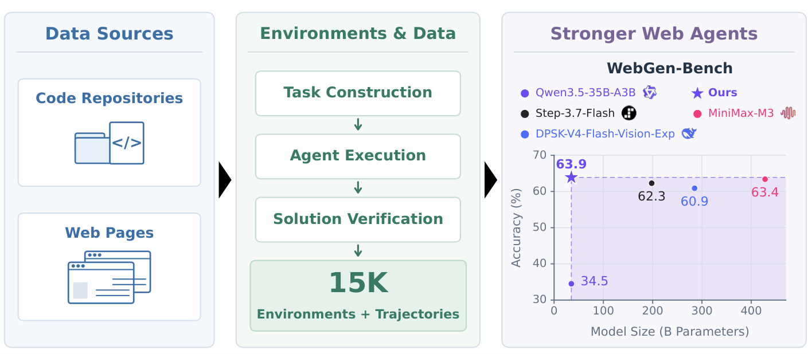</a>
<figcaption>手机可横向滑动或放大。原论文 Figure 1, p.1。数据来源、环境与轨迹构建，以及WebGen-Bench上的模型比较。 Ding et al., arXiv:2610.33149v1，CC BY-NC-ND 4.0；完整内容未改动。</figcaption></figure>

作者因此把任务、起始项目和验证条件一起保存，让模型在可执行环境中完成应用，再保留开发记录。这既提供模仿对象，也让后续研究可以从同样的状态重新采样。中心贡献是可扩展的数据构建与发布，本文不是新RL算法，也不是新提出的排行榜。来源：§1、§3、Figure 1。

<h2 id="related-work">2. Related Work：从静态代码对扩展到可重用的开发任务</h2>

与本文最接近的公开网页训练资源，主要覆盖文字需求的独立开发。WebGen-Bench报告600条训练轨迹，WebGen-Agent约700条；FullStack-Agent也收集开发轨迹，但作者比较时未发现其公开轨迹。WebUniverse扩大到视觉参考与连续变更，并附上每条样本的验证记录。以下沿论文§2与Table 1比较资源形态，不能把表中的“未建立”当成某工作永远不支持这项能力。

<figure id="table-1" class="figure">
<a href="/lib/papers/webuniverse/table-1.webp">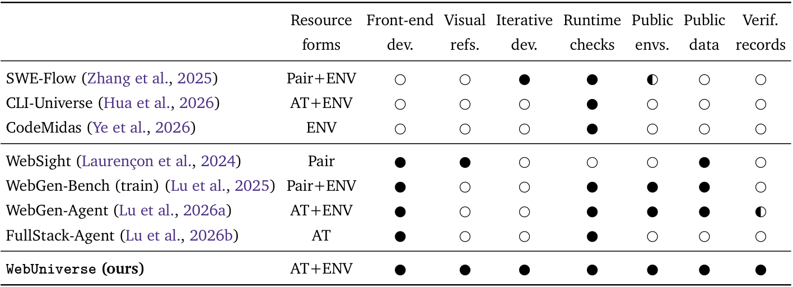</a>
<figcaption>手机可横向滑动或放大。原论文 Table 1, p.3。Pair为代码监督对，AT为代理轨迹，ENV为可执行任务环境；圆点表示原论文核对到的覆盖情况。 Ding et al., arXiv:2610.33149v1，CC BY-NC-ND 4.0；完整内容未改动。</figcaption></figure>

WebSight、Web2Code提供截图到代码的监督；SWE-Flow、CLI-Universe、CodeMidas展示从仓库或测试构建可执行任务的路线。WebUniverse将这些思路用于前端开发。尤其要区分WebGen-Agent：其原文标题明确涉及step-level reinforcement learning；WebUniverse引用它，不能据此认定自己也做了RL。这里对前者仅引用论文的相关工作描述，没有独立重读前者的完整训练协议。

<h2 id="method">3. Method：怎样生成、验证并训练一条开发轨迹</h2>

<h3 id="tasks">3.1 从仓库机制与真实网页构建需求</h3>

文字任务从2022年以后创建、许可明确的GitHub仓库中人工选择。GPT-5.5读代码和文档，排除第三方库、压缩代码与二进制后，总结功能、用户动作和界面变化。例如jKanban种子记录添加卡片、在看板列之间拖动卡片。任务生成模型更换应用场景，保留这些交互机制；这不是把原仓库直接作为待修复项目。

高层需求写用户目标和预期反馈，让开发模型自己选技术与设计，从空应用目录开始。详细需求还指定技术栈、初始状态、界面标识或设计要求，并配套脚手架。两种需求都可生成独立任务或一组连续变更，序列一起生成并明确旧要求怎样改变。<strong>文字训练任务聚焦前端实现，不需要外部API或后端服务。</strong>来源：§3.1、A.1、A.3。

视觉任务从FineWeb候选URL出发，经CrUX列表、元数据、可访问性与robots检查筛选，2026-07-17至09-13爬取。作者触发延迟加载、冻结动画、去除广告与同意浮层，保存整页截图、图片、字体和来源记录；超过8,000像素高或缺可见图片的页面被拒绝，再做人审。多页组含3至7页并记录导航，多视口组使用1920×1080、1024×768、375×812。任务由固定模板生成，<strong>这个步骤不调用模型合成需求</strong>。视觉任务只做独立开发，没有中间改版状态的截图序列。来源：§3.1、A.2。

<figure id="figure-2" class="figure">
<a href="/lib/papers/webuniverse/figure-2.webp">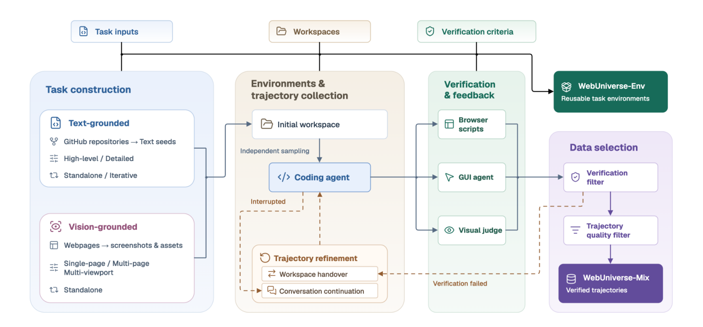</a>
<figcaption>手机可横向滑动或放大。原论文 Figure 2, p.4。输入、工作区、开发模型、验证与失败修复之间的完整关系；两种发布产物从流程不同位置得到。 Ding et al., arXiv:2610.33149v1，CC BY-NC-ND 4.0；完整内容未改动。</figcaption></figure>
<h3 id="collection">3.2 OpenCode采集与失败后的接续</h3>

这里的 harness 是给模型提供读写文件、终端和浏览器操作的编码环境。Harbor管理容器和工作区，OpenCode运行开发模型；发布配置的求解版本为1.18.30，GUI验证使用1.18.11。开发配置关闭子任务委派工具<code>task</code>，因为其动作没有进入导出轨迹；也关闭<code>webfetch</code>以限制直接取回线上页面。样本实际工具与提示可能不同，作者从请求与会话记录恢复每条样本的配置。不能把它说成Codex框架的实验。来源：A.4。

独立采样每次新开对话，从指定起始工作区开发，不导入其他尝试的对话或反馈。连续变更任务在当前任务通过后保存代码，作为下一步起点；若当前任务没有通过的尝试，序列结束。最后只保留从首任务开始、至少三步的连续通过前缀，减少初期任务过多的偏差。

作者继续失败或中断的尝试，让模型修复已有实现，称为 trajectory refinement。<code>workspace handover</code>把失败代码与已有验证反馈交给新对话；<code>conversation continuation</code>还保留旧对话。遇到持续重复工具调用时，作者中断并保存状态，接续前压缩连续重复消息。<strong>旧模型的assistant内容和工具调用只作上下文，不计入训练损失；只监督接续后的部分。</strong>最终验证通过的修复段，仍可包含错误、再改、再检查的过程。来源：§3.2、A.5。

<figure id="continuation-loss" class="figure">
<a href="/lib/papers/webuniverse/continuation-loss.svg">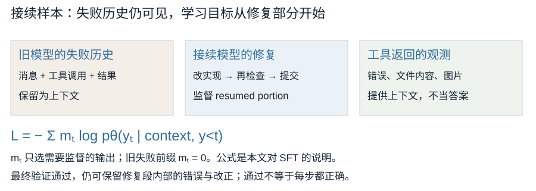</a>
<figcaption>手机可横向滑动或放大。本文依据论文绘制。保留上下文与监督目标的边界；公式仅说明SFT，不冒充论文未展示的训练代码。网格与公式为说明性示意，非作者原始截图或训练代码。</figcaption></figure>

保留轨迹的教师池为GPT-5.6 Sol（75.3%）、Qwen3.8-27B（8.4%）、GPT-5.5（6.9%）、MiniMax-M3（4.3%）、GPT-5.4（4.2%），以及Qwen3.5-35B-A3B直接通过的初始尝试（1.0%）。比例分别四舍五入。任务生成、开发演示、验证模型的角色不同，不能把整个数据集都归因于一个教师。来源：A.5、B.1。

<h3 id="plotpatch">3.3 真实训练案例：PlotPatch怎样完成和修复</h3>

Appendix C给出园地规划器PlotPatch。需求要求用户从调色板选作物，点击网格绘制；Bed Fill填充原材料相同的连通区域；Clear Cell清单格，Clear Plot确认后清全图，Suggest Layout换建议布局。作物占用面积要随网格更新，用户可按名字保存并重新打开计划。这是论文的数据示例，具体源仓库及该样本全部外部验证记录未在本段公开。

开发模型先读<code>/app</code>，发现只有<code>.git</code>，自行选择React与Vite。实现中，绘制动作只更新选中格；填充用队列遍历上下左右相邻且原材料相同的格；作物计数根据更新后的网格重新计算；打开保存计划恢复其网格。随后生产构建成功，但类型检查报TS7016、缺React声明，lint也发现导出和标识生成问题。模型修正导出、用计数器替换标识生成，并安装React类型声明。第二轮build、typecheck和lint通过，再启动服务请求localhost得到HTTP 200，最后报告完成。来源：Figure 6、Appendix C。

<figure id="plotpatch-case" class="figure">
<a href="/lib/papers/webuniverse/plotpatch-case.svg">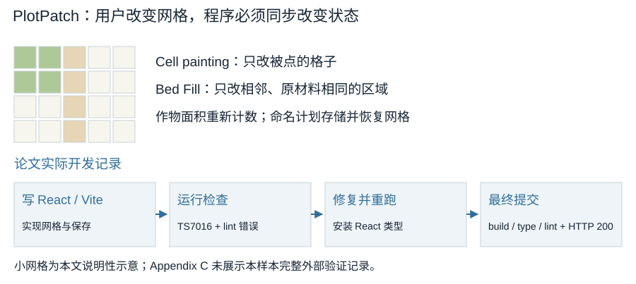</a>
<figcaption>手机可横向滑动或放大。本文依据论文绘制。小网格解释单格编辑与连通填充，下方按论文记录串起检查、错误与修复。网格与公式为说明性示意，非作者原始截图或训练代码。</figcaption></figure>

<strong>这些记录证明了开发中发生过修复，HTTP 200只证明服务响应。</strong>它没有单独证明保存、重开、填充和计数均符合需求。对高层任务，外部GUI验证器应按需求在浏览器执行行为检查；脚本则用于更详细的任务。本文没有拿到PlotPatch完整验证日志，所以不把自拟动作当作作者已执行的检查。例如保存“春季”，改动网格，再重开“春季”应恢复旧网格；若只恢复名字而不恢复格子，按需求应失败。这是依据公开要求构造的说明性失败过程，非论文模型日志。

补充：Figure 6完整需求与选出的开发步骤（连续5部分）

<figure id="figure-6-1" class="figure">
<a href="/lib/papers/webuniverse/figure-6-1.webp">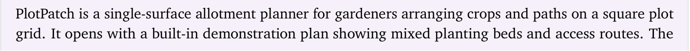</a>
<figcaption>手机可横向滑动或放大。原论文 Figure 6，连续第1部分，p.17。PlotPatch需求与开发对话的连续原始片段。 Ding et al., arXiv:2610.33149v1，CC BY-NC-ND 4.0；完整内容未改动。</figcaption></figure><figure id="figure-6-2" class="figure">
<a href="/lib/papers/webuniverse/figure-6-2.webp">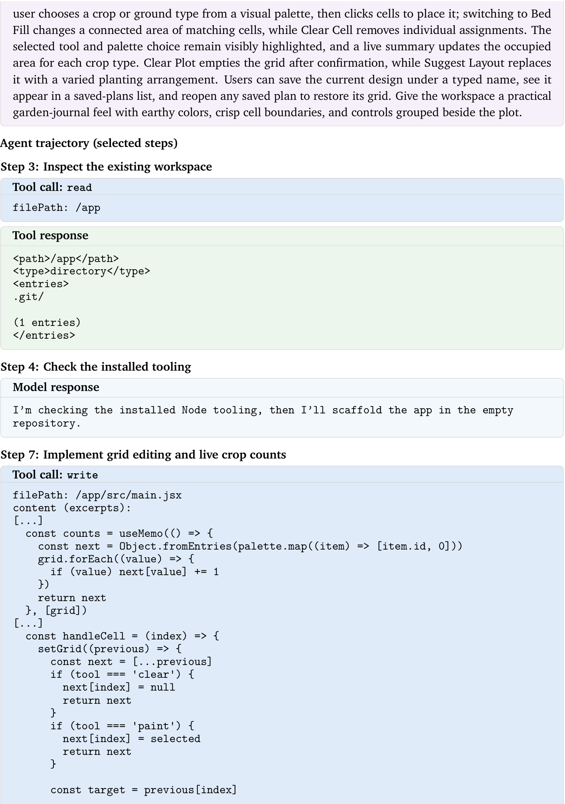</a>
<figcaption>手机可横向滑动或放大。原论文 Figure 6，连续第2部分，p.18。PlotPatch需求与开发对话的连续原始片段。 Ding et al., arXiv:2610.33149v1，CC BY-NC-ND 4.0；完整内容未改动。</figcaption></figure><figure id="figure-6-3" class="figure">
<a href="/lib/papers/webuniverse/figure-6-3.webp">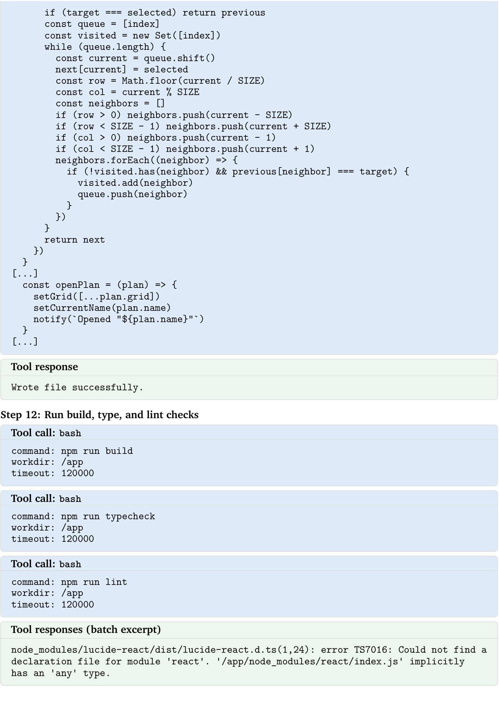</a>
<figcaption>手机可横向滑动或放大。原论文 Figure 6，连续第3部分，p.19。PlotPatch需求与开发对话的连续原始片段。 Ding et al., arXiv:2610.33149v1，CC BY-NC-ND 4.0；完整内容未改动。</figcaption></figure><figure id="figure-6-4" class="figure">
<a href="/lib/papers/webuniverse/figure-6-4.webp">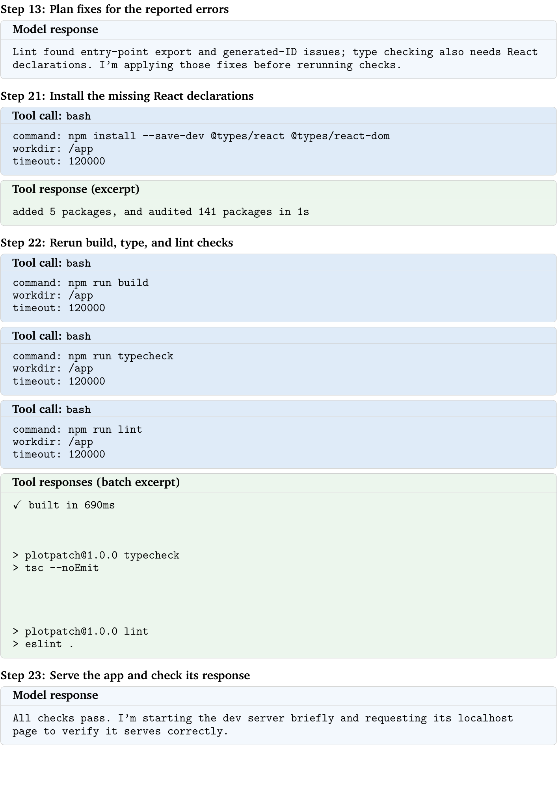</a>
<figcaption>手机可横向滑动或放大。原论文 Figure 6，连续第4部分，p.20。PlotPatch需求与开发对话的连续原始片段。 Ding et al., arXiv:2610.33149v1，CC BY-NC-ND 4.0；完整内容未改动。</figcaption></figure><figure id="figure-6-5" class="figure">
<a href="/lib/papers/webuniverse/figure-6-5.webp">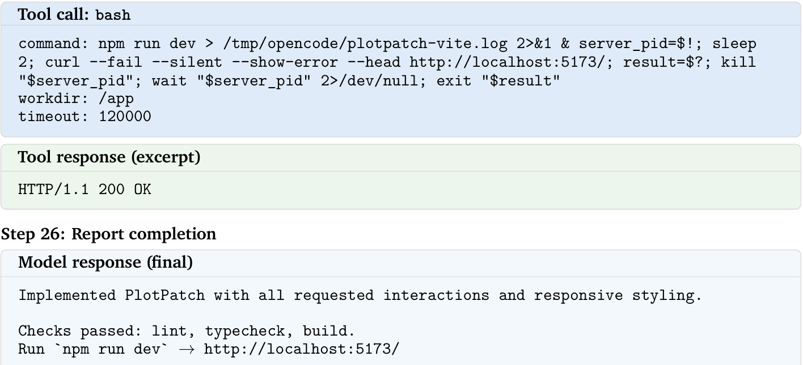</a>
<figcaption>手机可横向滑动或放大。原论文 Figure 6，连续第5部分，p.21。PlotPatch需求与开发对话的连续原始片段。 Ding et al., arXiv:2610.33149v1，CC BY-NC-ND 4.0；完整内容未改动。</figcaption></figure>

<h3 id="verification">3.4 谁构建检查器，怎样决定保留</h3>

详细任务的测试在求解前生成。GPT-5.4、5.5或5.6 Sol依据需求提取检查项与通过条件，不读参考答案，再生成源码检查或Playwright浏览器脚本。若测试失败，作者用模型复核该测试是否加了需求未规定的假设；有问题便重写测试，并在<strong>未改动的应用</strong>上重跑。这个步骤校正检查器的错误，并不能替应用补齐功能。

高层任务和部分详细任务用GUI agent验证。GPT-5.6 Sol只操作浏览器，不读源码，按需求探索并记录每项pass、fail或blocked与观察证据。作者用看图模型对照成品截图与参考截图，称为 visual judge。视觉验证同样用GPT-5.6 Sol，逐目标页面、逐指定视口使用六级rubric；多页按给定路由或路径访问，不可达记0。

脚本与GUI验证必须<strong>全部测试通过</strong>，脚本复核也必须完成且无未解决问题。视觉要求每个页面与视口比较至少达到good match（0.75），不能用好页面的高分抵消一个差页面。记录必须完整、验证正常结束、最终求解对话正常结束，图像引用与训练格式检查也要通过。分数和证据用于筛选；可用失败反馈进入后续修复。来源：§3.3、§3.4。

一位作者人工审计600次采集尝试，每种验证器各抽100个接受、100个拒绝样本。脚本准确率94.5%，GUI为95.5%，视觉为85.0%。以脚本为例，98个接受被人工认可、2个误接受；91个拒绝被认可、9个误拒绝，故准确率(98+91)/200=94.5%，precision为98/100=98.0%。这是本文按Table 9重算。<strong>只有一位标注者，且按机器结论平衡抽样</strong>，没有标注者间一致性，不能直接推出自然数据分布上的错误比例。

<figure id="table-9" class="figure wu-narrow">
<a href="/lib/papers/webuniverse/table-9.webp">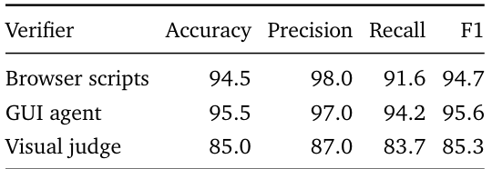</a>
<figcaption>手机可横向滑动或放大。原论文 Table 9, p.17。三种验证器全部准确率、精确率、召回率与F1；每行分母为200次尝试。 Ding et al., arXiv:2610.33149v1，CC BY-NC-ND 4.0；完整内容未改动。</figcaption></figure>

<h3 id="sft">3.5 参数究竟怎样更新：轨迹SFT，没有已报告RL</h3>

§4.1与D.1给出的训练是：从Qwen3.5-35B-A3B开始，使用Megatron-LM与ms-swift，冻结vision tower，微调其余参数，两轮训练，对assistant输出施加损失。8张H100 NVL，global batch 16、micro batch 1，学习率2×10⁻⁵，10%warmup后cosine降到0；3%验证切分，106,496长度上限，98,304 token打包。Adam参数、并行设置等完整值见下方原表。

<figure id="sft-flow" class="figure">
<a href="/lib/papers/webuniverse/sft-flow.svg">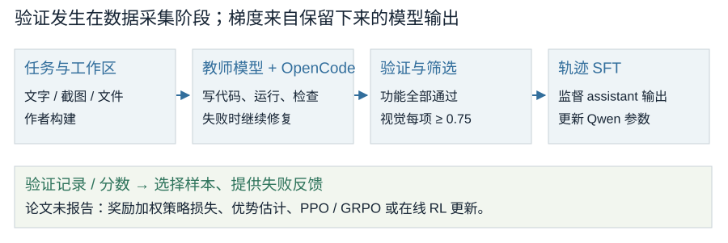</a>
<figcaption>手机可横向滑动或放大。本文依据论文绘制。数据采集、验证筛选与参数更新的分工；梯度来自模型输出的监督学习。网格与公式为说明性示意，非作者原始截图或训练代码。</figcaption></figure>

通常的SFT负对数似然可写成<code>L = − Σ mₜ log pθ(yₜ | context, y&lt;t)</code>，其中掩码只选需要监督的输出；这只是本文说明，没有声称原文报告了精确归一化公式。官方Mix说明将<code>messages</code>按<code>role / content / loss</code>存储，<code>loss:false</code>排除该消息，<code>loss:null</code>采用框架默认，导出必须保留掩码。这与正文的接续前缀处理一致。

<strong>论文未报告PPO、GRPO、优势估计、奖励加权策略损失或在线采样更新。</strong>验证通过才保留数据，可以称为基于筛选的轨迹监督学习；有测试、有分数、有失败重试，仍不自动成为RL。大部分数据来自强模型演示，因此也有广义的轨迹蒸馏意义；作者没有报告教师logits、KL蒸馏目标、on-policy distillation或OPSD算法。不能把基座1.0%的直接成功尝试写成在线自蒸馏证据。

补充：原论文完整训练配置

<figure id="training-config" class="figure">
<a href="/lib/papers/webuniverse/training-config.webp">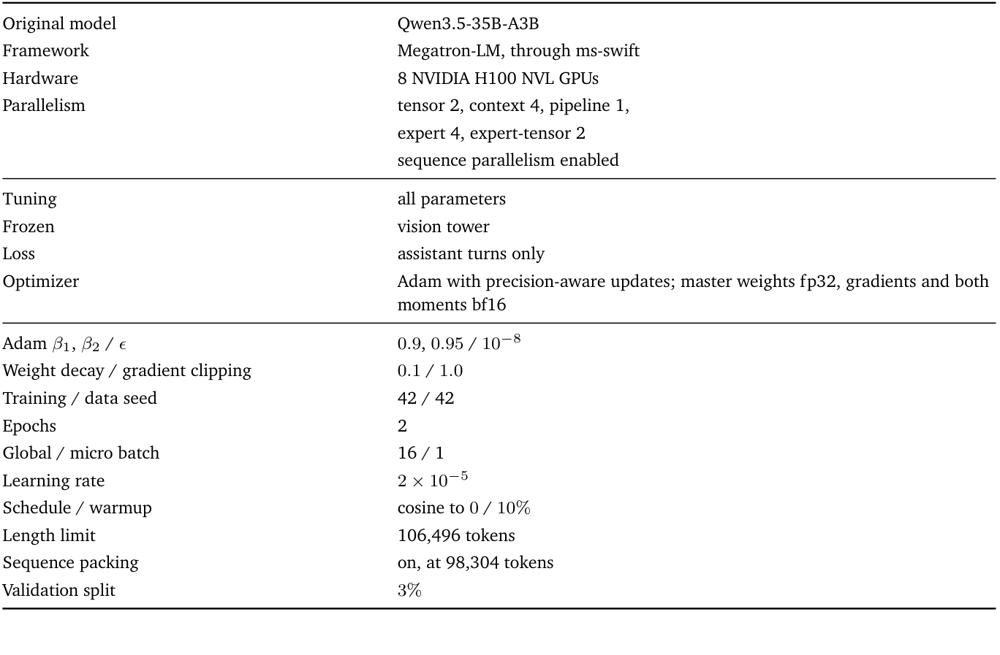</a>
<figcaption>手机可横向滑动或放大。原论文 Appendix D.1 完整训练配置，p.21。冻结视觉塔、assistant监督、优化器、并行、长度与验证切分的全部设置。 Ding et al., arXiv:2610.33149v1，CC BY-NC-ND 4.0；完整内容未改动。</figcaption></figure>

<h3 id="release">3.6 规模、去污染与公开实现的核查边界</h3>

全库包含511.9M tokens、551,818次工具调用、74,811次图片出现。文字轨迹中位为20.6K tokens与20次调用；视觉为59.4K与70次。图片按出现次数计，可能重复；接续旧历史虽然不计loss，仍计入token与工具统计。这些不是独立图片数、环境动作数或训练目标token总数。来源：§3.5、B.1。

作者与三个benchmark的1,029条不同测试需求比对：5-gram Jaccard高于0.6或句向量cosine高于0.55就标记；视觉用网站注册域名与任务名筛选，人工复核命中。确认重叠移除，最终保留514条被语义相似度命中但判为误报的文字轨迹，以及4条同名碰撞视觉轨迹，共518条单独标注归组。这降低直接重叠风险，没有证明基础模型从未见过公开网页或消除所有隐性重叠。来源：A.6。

2026-11-06核对的<a href="https://huggingface.co/datasets/WebUniverse-NSL/WebUniverse-Mix/tree/f3f0bfd16cb1fec65b40ee50ef93c0162c01bac8">Mix发布版本</a>和<a href="https://huggingface.co/datasets/WebUniverse-NSL/WebUniverse-Env/tree/73fb5c769e43d91720a913828f655e6d95fa553f">Env发布版本</a>可读取公开说明与文件树；原始parquet、导出脚本、环境程序等未认证请求返回401，需登录同意许可。本次没有读取这些程序正文或重跑训练。Env标为RL Environment表示可以拿它构建RL任务，不是作者已做RL的实验记录。

Env公开说明列出Harbor任务描述、运行配置、初始工作区、参考资源、测试、参考实现与SHA-256清单；论文A.7描述原始任务包的<code>spec.json</code>、<code>start/</code>、<code>verifier/task.json</code>等结构。两者是不同发布/转换层次，不能擅自当成同一目录布局。参考答案不会放入开发模型的求解工作区；验证条件可供研究者重用，不意味着每个隐藏检查文件都对求解模型可见。作者称重建后测试过的参考解全部通过，但没有在正文报告测试数量。

补充：数据组成、脚手架、任务包和调用分布

<figure id="figure-3" class="figure wu-narrow">
<a href="/lib/papers/webuniverse/figure-3.webp">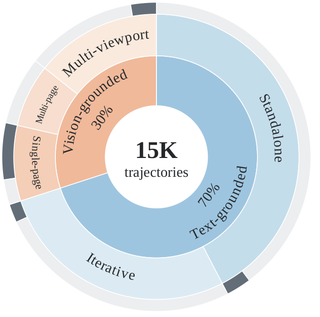</a>
<figcaption>手机可横向滑动或放大。原论文 Figure 3, p.6。内圈为任务家族、中圈为任务变体，最外圈区分独立采样与修复。 Ding et al., arXiv:2610.33149v1，CC BY-NC-ND 4.0；完整内容未改动。</figcaption></figure><figure id="table-4" class="figure">
<a href="/lib/papers/webuniverse/table-4.webp">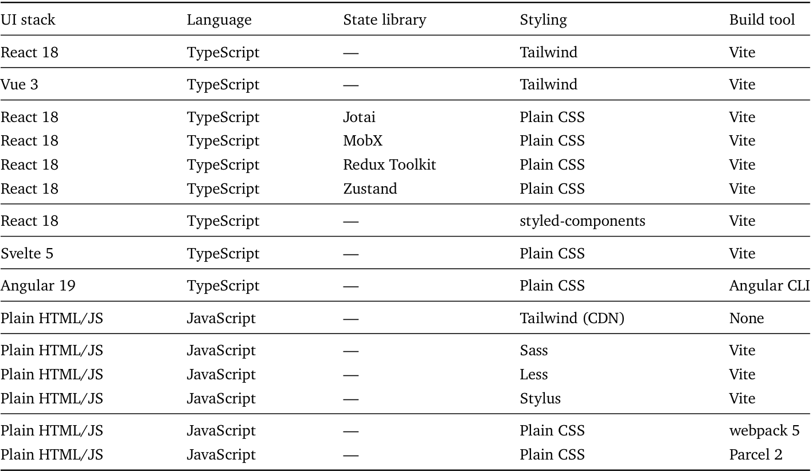</a>
<figcaption>手机可横向滑动或放大。原论文 Table 4, p.15。详细任务的15种脚手架，包括框架、语言、状态管理、样式与打包工具。 Ding et al., arXiv:2610.33149v1，CC BY-NC-ND 4.0；完整内容未改动。</figcaption></figure><figure id="table-5" class="figure">
<a href="/lib/papers/webuniverse/table-5.webp">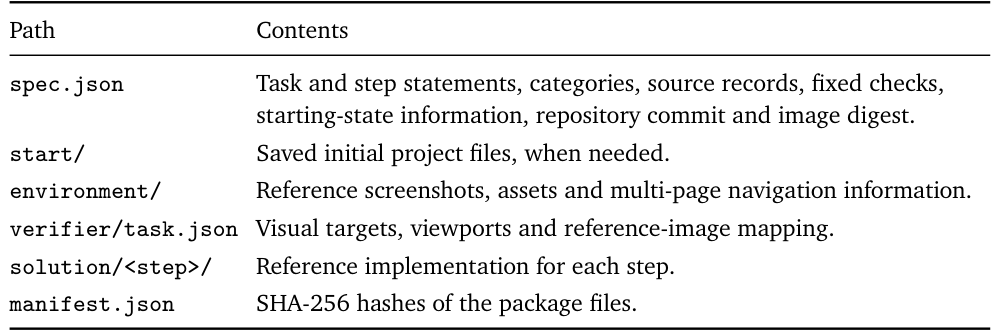</a>
<figcaption>手机可横向滑动或放大。原论文 Table 5, p.15。原论文任务包的全部文件与含义；公开Harbor导出结构另见Env说明。 Ding et al., arXiv:2610.33149v1，CC BY-NC-ND 4.0；完整内容未改动。</figcaption></figure><figure id="table-6" class="figure">
<a href="/lib/papers/webuniverse/table-6.webp">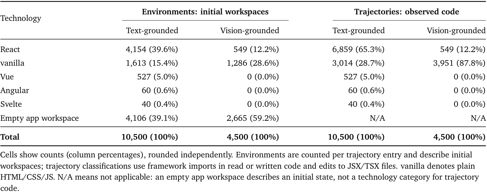</a>
<figcaption>手机可横向滑动或放大。原论文 Table 6, p.16。初始环境与最终轨迹观察到的框架分别统计，不能将空目录当作实现语言。 Ding et al., arXiv:2610.33149v1，CC BY-NC-ND 4.0；完整内容未改动。</figcaption></figure><figure id="table-7" class="figure wu-narrow">
<a href="/lib/papers/webuniverse/table-7.webp">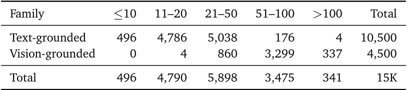</a>
<figcaption>手机可横向滑动或放大。原论文 Table 7, p.16。各任务家族工具调用次数的分布。 Ding et al., arXiv:2610.33149v1，CC BY-NC-ND 4.0；完整内容未改动。</figcaption></figure><figure id="table-8" class="figure wu-narrow">
<a href="/lib/papers/webuniverse/table-8.webp">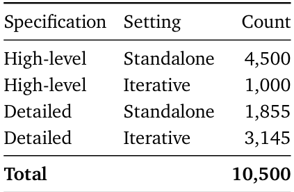</a>
<figcaption>手机可横向滑动或放大。原论文 Table 8, p.17。文字需求详细程度与独立/迭代设置的四类计数。 Ding et al., arXiv:2610.33149v1，CC BY-NC-ND 4.0；完整内容未改动。</figcaption></figure>

<h2 id="experiments">4. Experiments：哪些能力改善，哪些比较不能扩大解释</h2>

<h3 id="metrics">4.1 先看分母和检查，再读总分</h3>

作者给三个既有benchmark编写OpenCode适配，模型拿到需求和工作区，返回成品应用给原评测器；模型保留各自配置的工具、系统提示与推荐推理设置。每个benchmark内部固定judge，主实验每模型、每benchmark只做一次，因此没有主表重复运行误差条。结果不宜直接混入不同harness、不同judge的公开榜单。来源：§4.1、D.3。

<table class="comparison"><thead><tr><th>评测</th><th>任务与判分</th><th>聚合和缺失处理</th></tr></thead><tbody><tr><td>Vision2Web Level 1</td><td>100任务，桌面/平板/手机各一次；GPT-5比较区域外观</td><td>每视口先平均区域分，全部300视口平均；缺失记0</td></tr><tr><td>WebGen-Bench</td><td>101应用；GPT-5.4判功能、数据显示与设计检查</td><td>YES=1、PARTIAL=0.5、NO或缺失=0；全应用检查项合并求比例</td></tr><tr><td>Web-Bench</td><td>50项目，每项目20连续开发任务；官方脚本</td><td>报告pass@1、pass@2及算术均值；前步失败可阻断后步</td></tr></tbody></table>

WebGen-Bench总体准确率是<code>100 × Σ检查项得分 / 全部检查项数量</code>，没有可用验证结果的应用，其检查仍在分母里计0；<strong>63.9%不是101个应用中63.9%全部通过</strong>。论文未提供这里全部检查项的总数，不能还原一个整数“成功应用数”。Web-Bench则引用官方计分程序，没有在本文给出完整公式；例如主表均值(13.9+23.1)/2=18.5%，只核实算术均值，不等于独立重跑官方pass@k。

Figure 5的电话运营商Task 000020是一个具体检查案例。模型生成套餐、客服与账户界面，评测侧记录套餐详情、支持聊天、账户更新、导航和指定颜色五项。基础模型前三项Fail、后两项Pass，共2/5；微调后五项都Pass，为5/5。这份个例可说明交互改善；原始操作参数和完整judge日志没有取得。官方项目另提供两个输出HTML，可以查看成品，但本文未独立重现五项判决。

<figure id="figure-5" class="figure">
<a href="/lib/papers/webuniverse/figure-5.webp">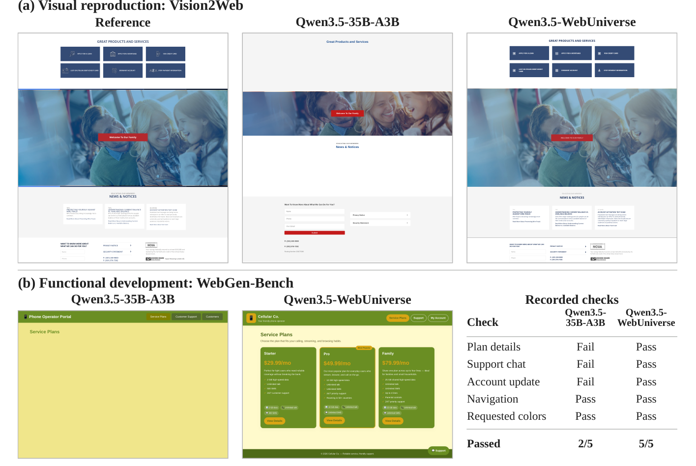</a>
<figcaption>手机可横向滑动或放大。原论文 Figure 5, p.9。上半为tefcu视觉复现的对应区域，下半为电话运营商Task 000020与五项已记录判决。 Ding et al., arXiv:2610.33149v1，CC BY-NC-ND 4.0；完整内容未改动。</figcaption></figure>

<h3 id="results">4.2 主结果与同预算公开数据对照</h3>

WebUniverse微调后，Vision2Web平均51.7→68.3，WebGen-Bench总体34.5%→63.9%，Web-Bench pass@2为12.2%→23.1%。其中WebGen-Bench功能检查22.3%→51.3%，说明改善不限于漂亮的静态页面。微调模型在部分指标超过几个大模型，但Web-Bench pass@2仍低于主表四个参考强模型，也没有超过GPT-5.6 Sol的视觉平均75.8或WebGen-Bench总体64.5%。

<figure id="table-2" class="figure">
<a href="/lib/papers/webuniverse/table-2.webp">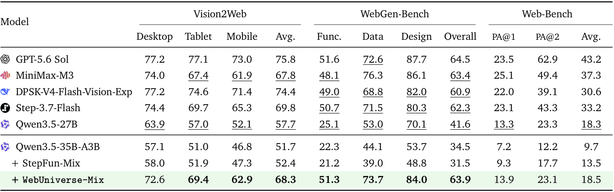</a>
<figcaption>手机可横向滑动或放大。原论文 Table 2, p.8。主实验全部模型、视口、检查类别与连续任务成绩；PA为pass。 Ding et al., arXiv:2610.33149v1，CC BY-NC-ND 4.0；完整内容未改动。</figcaption></figure>

最有辨别力的基线是Qwen3.5-StepFun：同Qwen起点、同超参数、同15K样本。StepFun-Mix由公开Step-3.5-Flash-SFT抽13,500个网页生成对和1,500条软件工程轨迹，后者占10%样本、37.9%tokens。网页输出要求完整单文件HTML且至少2,000字符，再清理、去重、去污染。该基线总体功能成绩31.5%低于原模型34.5%；WebUniverse则63.9%。这支持任务对齐的开发演示有效，<strong>没有单独隔离“验证筛选”这一组件</strong>：数据长度、模态、工具过程与题型也不同。样本预算相同，不代表token、采集调用或训练计算相同。来源：Table 2、D.2。

<h3 id="ablation">4.3 混合消融与扩展曲线</h3>

单独训练文字子集，功能开发总体升至56.1%，视觉仅54.1%。单独训练视觉，视觉升至63.9%，功能却降到12.1%，Web-Bench pass@2也从12.2%降至6.8%。完整混合在全部已报告指标上最好。这同时支持互补覆盖，也否定“加视觉轨迹自然改善所有编码能力”的解释；两个子集样本量为10,500与4,500，不是等量或等token的纯模态实验。来源：Table 3。

<figure id="table-3" class="figure">
<a href="/lib/papers/webuniverse/table-3.webp">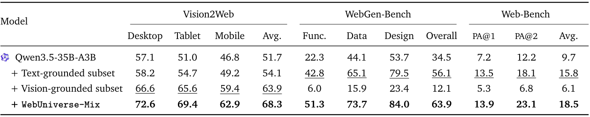</a>
<figcaption>手机可横向滑动或放大。原论文 Table 3, p.8。文字单训、视觉单训与混合的全部数据组成消融。 Ding et al., arXiv:2610.33149v1，CC BY-NC-ND 4.0；完整内容未改动。</figcaption></figure>

保持家族比例，用严格嵌套的5K、10K、15K子集训练，三项成绩持续上升。WebGen-Bench为49.1→58.2→63.9；视觉63.9→66.2→68.3；Web-Bench均值14.9→17.7→18.5。所有运行固定两轮，增加数据也增加训练量；曲线不能单独证明同计算量的数据质量收益。原图三个y轴都非零起点，不能只看斜率的视觉大小。来源：§4.3、Figure 4、D.1。

<figure id="figure-4" class="figure">
<a href="/lib/papers/webuniverse/figure-4.webp">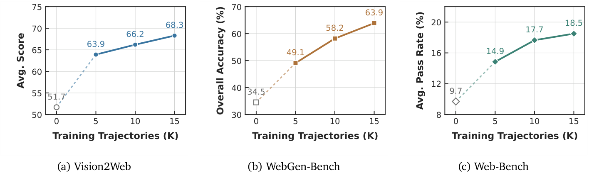</a>
<figcaption>手机可横向滑动或放大。原论文 Figure 4, p.9。0点为原模型；5K、10K、15K训练子集严格嵌套，纵轴范围各不相同。 Ding et al., arXiv:2610.33149v1，CC BY-NC-ND 4.0；完整内容未改动。</figcaption></figure>

<h3 id="hard">4.4 最强反例：复杂多页与不修改代码的重试</h3>

Vision2Web Level 2要求按图和文字构建多页交互前端，共66任务，每模型跑三次，各指标分别取中位数。视觉32.7→37.6，功能48.3→48.5，综合40.3→42.5。综合先在每轮求视觉与功能的平均，再跨轮取中位，<strong>不能用两个已发布中位数直接算综合分</strong>：例如(37.6+48.5)/2=43.05，并不是表中的42.5。复杂交互的功能收益很小。来源：D.4、Table 10。

<figure id="table-10" class="figure wu-narrow">
<a href="/lib/papers/webuniverse/table-10.webp">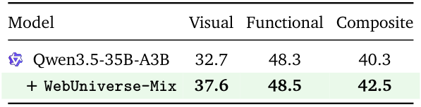</a>
<figcaption>手机可横向滑动或放大。原论文 Table 10, p.23。Level 2三个指标分别取三次运行的中位数。 Ding et al., arXiv:2610.33149v1，CC BY-NC-ND 4.0；完整内容未改动。</figcaption></figure>

补充行为分析发现，WebGen-Bench编辑后验证从50.5%升到95.0%，错误后“改实现再检查”从45.5%升到73.3%。但定义允许“重新读改过的文件”算验证，后一次检查也不要求通过。Web-Bench绝大多数验证只是重读代码，真正执行检查仅2.5%与4.3%；这些观察不能写成所有模型都学会看成品截图。行为分析的微调记录来自补充运行，Web-Bench的275/305次尝试还覆盖不同任务阶段、并不配对。来源：F.1、Table 11。

<strong>微调后仍有明显失败习惯。</strong>Web-Bench第二次尝试中，微调模型23/72（31.9%）没有记录到实现修改，全部失败；基础模型仅2/83（2.4%）。另有微调轨迹查询同一图片尺寸1,311次，或搜索不存在的测试604次。它们限制了“多检查就等于更会修复”的解释。

在一个Level 2补充运行中，18/66个任务视觉与功能均为0：13个浏览器白屏、4个端口不符、1个执行循环。13个白屏全做过HTTP检查，10个还做了build，但全部未记录查看成品截图。holyoke遗漏icon导入，build和HTTP成功，浏览器运行仍报错；uk_ixl知道3000无响应、5173可用，却没改要求的端口；anomali重复建目录2,459次用完两小时。这是该轮失败分析，不把18/66当作三轮共同失败率。来源：F.4、Table 13。

<figure id="table-13" class="figure">
<a href="/lib/papers/webuniverse/table-13.webp">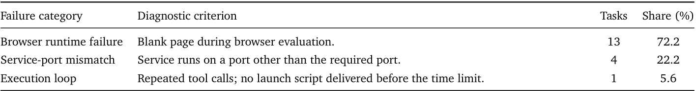</a>
<figcaption>手机可横向滑动或放大。原论文 Table 13, p.27。三类失败的分母为该轮18个双零分任务，整体任务数为66。 Ding et al., arXiv:2610.33149v1，CC BY-NC-ND 4.0；完整内容未改动。</figcaption></figure>

补充：完整行为表、区域分布与完整页面对照

<figure id="table-11" class="figure">
<a href="/lib/papers/webuniverse/table-11.webp">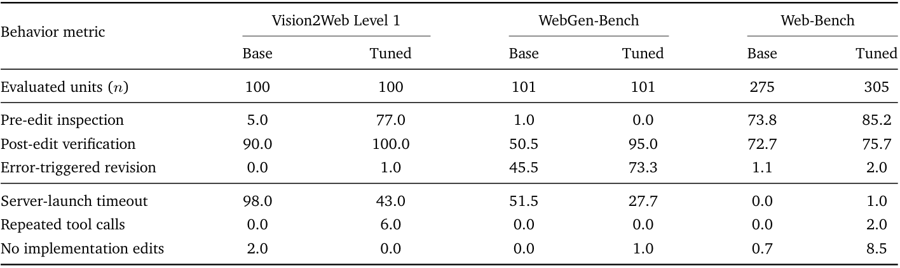</a>
<figcaption>手机可横向滑动或放大。原论文 Table 11, p.25。行为频率、各自分母及定义见F.1；微调轨迹来自补充运行。 Ding et al., arXiv:2610.33149v1，CC BY-NC-ND 4.0；完整内容未改动。</figcaption></figure><figure id="table-12" class="figure wu-narrow">
<a href="/lib/papers/webuniverse/table-12.webp">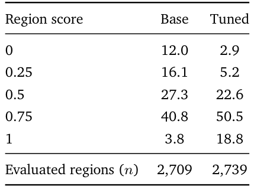</a>
<figcaption>手机可横向滑动或放大。原论文 Table 12, p.26。区域总数基础模型2,709、微调2,739，各自归一化，非任务成功率。 Ding et al., arXiv:2610.33149v1，CC BY-NC-ND 4.0；完整内容未改动。</figcaption></figure><figure id="figure-7" class="figure">
<a href="/lib/papers/webuniverse/figure-7.webp">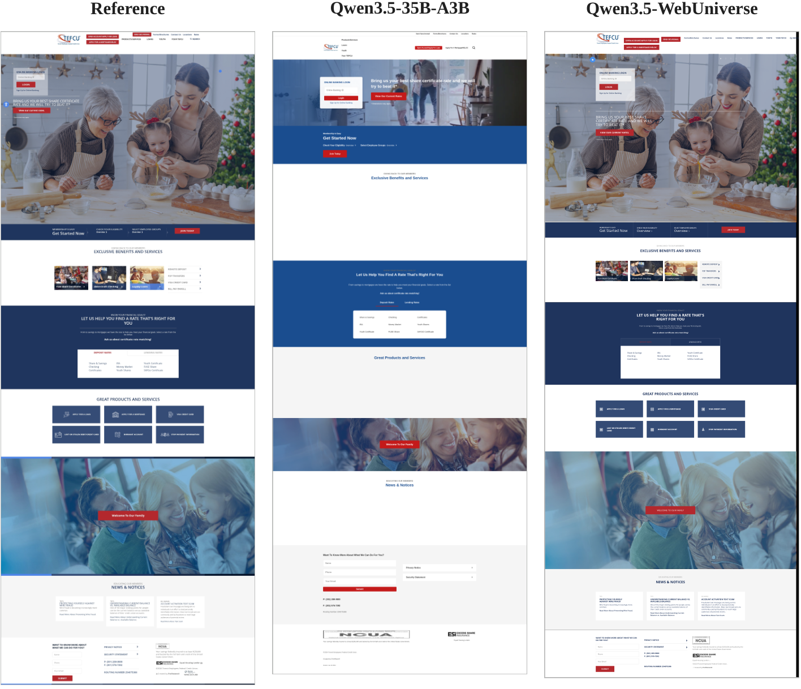</a>
<figcaption>手机可横向滑动或放大。原论文 Figure 7, p.24。完整tefcu桌面参考与两模型输出；原始长宽比保留。 Ding et al., arXiv:2610.33149v1，CC BY-NC-ND 4.0；完整内容未改动。</figcaption></figure>

<h2 id="discussion">5. Discussion：哪些经验可复用，哪些研究还要另做</h2>

<strong>最值得复用的是把任务起点、模型过程和外部验证证据一起保存。</strong>只保存成品代码，无法区分模型是一次完成，还是通过编译错误、文件检查和浏览器观察才修好；只保存成功对话、不保留环境，也难以检验新模型是否能重新完成。接续旧失败前缀时的掩码尤其值得保留，避免把旧模型的错误动作作为要模仿的答案。

如果围绕这些环境做RL、OPD或OPSD，那是后续研究设计，WebUniverse没有跑出对应结果。比较时至少保持任务、harness、验证规则与预算一致，并对照轨迹SFT、只用最终代码的监督、无验证筛选的数据，以及基于执行反馈的策略更新。本文未报告这些控制，不能先把现有收益归给某个新算法。

前端视觉任务仍靠选定视口的静态截图，动画、过渡与随时间变化的交互没有完整监督。功能任务也只覆盖所写的要求。作者把移动应用、3D和游戏列为扩展方向；本文的15K前端结果不能直接证明这些领域的环境构建、验证可靠性或训练收益。即使已有build和HTTP证据，仍要明确检查浏览器是否运行、交互状态是否改变、截图是否符合要求。

<h2 id="conclusion">6. Conclusion：验证过的多步演示有效，但训练仍是SFT</h2>

WebUniverse用仓库交互机制和真实网页构建任务，让多个模型在OpenCode里开发，按功能或视觉要求验证，再发布15K环境与轨迹。Qwen学的是这些开发记录中的输出，接续样本只监督修复段。<strong>论文报告SFT，没有已报告的RL或on-policy蒸馏阶段；验证分数用于筛选与修复反馈。</strong>

同15K样本的公开数据对照与混合消融支持这类数据的价值。复杂多页只小幅改善、视觉单训损伤功能、无修改重试和白屏反例则说明，当前模型仍未可靠完成长程开发。原论文与公开说明足以判断已报告训练类型；受许可登录限制，本次没有完整训练程序审计，也没有独立复跑模型分数。

<a href="https://arxiv.org/pdf/2610.33149v1">论文PDF</a> · <a href="https://webuniverse-nsl.github.io/">官方项目与案例</a> · <a href="https://huggingface.co/datasets/WebUniverse-NSL/WebUniverse-Mix">WebUniverse-Mix</a> · <a href="https://huggingface.co/datasets/WebUniverse-NSL/WebUniverse-Env">WebUniverse-Env</a> · <a href="https://huggingface.co/WebUniverse-NSL/Qwen3.5-WebUniverse/tree/d1fb2c9a56ba2914eee9e14f0e70caa07feffb17">公开模型固定版本</a> · <a href="/lib/papers/webuniverse/webuniverse.sources.json">来源与视觉清单</a>

