<link rel="stylesheet" href="/lib/papers/video-coder/reading.css">
<div class="post-deck-embed"><div class="post-deck-embed-frame"><iframe src="/lib/decks/video-coder.html" title="Video-Coder图解，共17页" allow="fullscreen" loading="eager"></iframe></div><p class="post-deck-embed-note"><span>17页 · 按钮或方向键翻页 · 手机图表可横向滑动</span><span><a href="/lib/decks/video-coder.html">独立图解</a> · F全屏 · Esc退出</span></p></div>

<p>原始来源：Wang、Gao、Hu等的<a href="https://arxiv.org/abs/2611.09894">Video-Coder论文v1</a>，最早公开于2026-11-06。本文完整阅读16页正文、参考文献和附录A/B，并核对<a href="https://github.com/CYWang735/Video-Coder/tree/cbc3d975b3fb709c0bab668b2316988ceaa43f72">官方代码</a>、<a href="https://cywang735.github.io/Video-Coder/">项目展示</a>及公开训练文件。原图、完整表格保留英文与数值，署名Wang et al.，依据arXiv条目所列<a href="https://creativecommons.org/licenses/by/4.0/">CC BY 4.0</a>复用。核对日期为2026-11-09；本次未独立运行GPU训练、视频生成服务或benchmark。</p>

<p>Video-Coder研究怎样用可执行程序控制视频中的对象、位置、动作和相机。作者先用教师演示做监督微调（SFT），教Qwen3.5-9B规划、写代码、调用工具与修复；随后用新尝试的执行和视频评分做强化学习（RL）。<strong>论文明确报告SFT后做RL，官方也发布了实际RL训练实现。</strong>论文公式与当前公开代码的优化目标存在差异，具体见3.5。</p>

<aside class="reading-primer"><h3>Part 0：代码、灰模和最终视频分别是什么</h3>
<p>Blender执行编码模型写出的Python脚本，生成灰色、无纹理的三维动画MP4，论文称它为Draft Video。这段灰模视频告诉下游生成器哪里有物体、物体怎样移动、相机怎样看。MiniMax-H3再接收场景文字与灰模，生成有外观的最终视频。编码模型、Blender执行器和视频生成器承担不同职责。</p>
<p>本次训练更新Qwen3.5-9B编码模型，MiniMax-H3保持固定。编码模型直接写出的产物是Blender Python脚本；推理程序还导出草稿视频、脚本和供下游批量生成的清单，视频生成器最终导出MP4。这篇使用三维场景编程，与此前CodeCap-Bench中的HTML动画任务不同。</p></aside>

<aside class="keypoints"><ul><li>论文的核心训练信号是“代码能运行”加“候选最终视频符合结构与运动要求”，视频奖励明确忽略颜色、纹理和美观。</li><li>同一MiniMax-H3在四类物理常识评测（PhyGenBench）的平均分从0.61升到0.67；VBench-2.0三个物理维度的均分从54.58%升到78.19%，后者不是整个benchmark总分。</li><li>公开训练文件实际有5,609条SFT与1,678条RL记录；论文前半写6k/2k，实验与结论写10k/4k，数据版本仍需作者澄清。</li></ul></aside>

<h2 id="motivation">1. Motivation：把对象与运动先写成可执行场景</h2>

<p><strong>代码能明确规定视频中的对象数量、布局和运动过程。</strong>文字到视频模型虽然可以生成逼真的画面，但遇到多个对象、接触、遮挡与相机移动时，可能出现数量错误、物体消失、轨迹不连贯等问题。重新改文字提示也难以单独编辑一条轨迹或固定一个物体的位置。作者因此把动态三维场景作为中间表示，再交给视频模型生成外观。来源：§1、Figure 1。</p>
<figure id="figure-1" class="figure"><div class="wu-figure-scroll"><a href="/lib/papers/video-coder/figure-1.webp">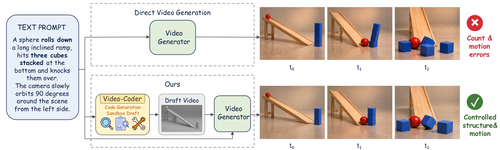</a></div><figcaption><span class="wu-mobile-note">手机可横向滑动或放大。</span>原论文 Figure 1，p.2。完整总览：文字要求、直接生成与代码草稿引导后的关键帧对照。 Wang et al., arXiv:2611.09894v1，CC BY 4.0。</figcaption></figure>
<p>Figure 1的实际要求是：一颗球滚下长斜坡，撞到斜坡底部叠放的三个方块，把它们撞倒；相机从左侧慢慢绕场景90°。这包含相互依赖的约束：三个方块必须先存在并叠好，球要沿斜坡到达它们，方块在接触后倒下，整个过程还要在移动镜头里可见。编码模型需要把这些要求转成几何、时间和相机参数，Blender负责执行。</p>
<p>论文给出该例的直接生成与代码引导关键帧对比，但没有公开与Figure 1逐一对应的完整脚本、工具日志和judge逐项分数。因此，这张图能说明作者希望控制什么，也提供定性展示，不能当成一个已公开完整判分的RL样本。后面用实际下载到的SFT轨迹解释运行与修复，用独立标注的说明性数字解释奖励。</p>

<h2 id="related-work">2. Related Work：从固定编程流程到可训练的多轮代理</h2>

<p><strong>这篇的区别在于训练编码代理根据执行反馈修改程序，并用最终视频的反馈优化它。</strong>显式控制视频生成已有多条路线：提供深度、对象轨迹、相机姿态或物理模拟；LLM也早已被用于生成二维布局、Blender三维场景与运动代码。Video-Coder将这些控制信号的构造交给编码模型，训练模型自己写、运行和修复。来源：§2。</p>
<p>与它最接近的工作包括GPT4Motion与Video-CoCo：前者用Blender脚本描述物理运动，再引导视频扩散；后者把代码作为视频生成的中间推理表示。Video-Coder在相关工作中将这些方法概括为依赖冻结模型或固定提示流程。本文对这两篇的比较依据Video-Coder的§2.2，未将它们各自的完整实验作为本次独立复核结果。</p>
<p>在代理训练方面，Search-R1、ReTool等让模型在多步任务中调用检索或执行工具，并从结果奖励学习。Video-Coder把类似训练方式用于动态三维场景：工具返回的不只是文本错误，还有渲染图像，结果奖励还经过一个固定视频生成器。作者声称这是首次训练用于视频生成的多模态编码代理；这属于作者的优先性主张，本次代码核对能确认其训练实现，不能单独证明“首次”。</p>

<h2 id="method">3. Method：从教师演示到执行与视频双奖励</h2>

<p><strong>编码模型观察文字与自己的执行反馈，训练环境再用最终视频评分优化编码动作。</strong>参考视频留在环境与judge侧，推理时无需提供参考答案。</p>

<h3 id="harness">3.1 一次任务怎样写、运行、修复和提交</h3>

<p>作者提供的Video-Coder Harness负责准备任务目录、执行命令、检查产物并返回反馈，harness在这里就是包住编码模型的任务执行环境。编码模型通过一个bash函数工具写文件；check_script与run_blender是这个shell里的两个专用命令。当前实现由mini-swe-agent相关组件和Apptainer沙箱承载，不需要把它理解为在完整Codex产品里运行。来源：§3.2、Appendix A、agent.py与teacher.yaml。</p>
<figure id="training-flow" class="figure"><div class="wu-figure-scroll"><a href="/lib/papers/video-coder/training-flow.svg">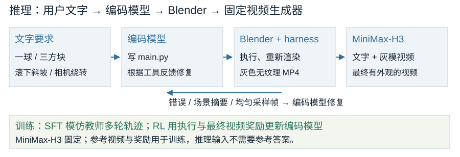</a></div><figcaption><span class="wu-mobile-note">手机可横向滑动或放大。</span>本文依据论文和代码绘制。编码模型、执行器、灰模、最终视频与训练更新的边界。示意表达职责与流程，不是作者执行日志。</figcaption></figure>
<p>模型先根据文字规划对象尺寸与位置、动画时间和相机，然后写自包含的main.py。check_script检查Python语法、bpy导入、相机与渲染调用以及禁止调用；通过后，run_blender在无头Blender中执行脚本。失败时，环境返回traceback；成功时，环境返回MP4规格、对象与运动摘要、出镜范围信息，以及均匀采样的渲染帧。编码模型读取这些反馈，再改文件并重跑。</p>
<p>Appendix A要求统一灰色Workbench渲染，Single color为(0.8,0.8,0.8)，无需纹理或材质，输出H.264 MP4，不依赖外部素材。公开teacher.yaml具体配置为Blender 4.5、1280×720、24 fps、120至240帧，视觉反馈返回8张JPEG。论文附录本身是带变量和条件分支的模板，包含Blender不可用、无视觉反馈和可选judge分支，不能把模板中每一种功能都说成实验开启；当前RL使用有视觉反馈的配置。</p>
<p>模型完成后调用独立命令echo COMPLETE_TASK_AND_SUBMIT_FINAL_OUTPUT。环境结束交互，把最终脚本复制到干净目录，重新执行、渲染和检查；通过后才accept并导出灰模。公开推理入口将每题的草稿与main.py保存下来，再写h3_manifest.jsonl交给MiniMax-H3批量生成最终视频。当前入口还允许失败题最多重试3次并续跑；这是公开推理默认行为，论文没有据此给出主表每题实际尝试次数。</p>
<p>执行奖励的严格程度也有实现差异：论文定义要求所有工具调用格式正确，公开run_agent.py的accept条件则是Submitted、静态检查通过、最终重跑通过且无终止错误；它另行记录n_format_errors，但没有在accept表达式中要求该计数等于0。因此，已恢复的早期格式错误不应直接按论文那句定义推断必然使整条失败。
</p>
<p>运行验收的能力有明确边界。源码用抽样灰度方差检测多数空白帧，用相邻抽样帧平均差检测静止，用mesh原点与相机范围判断完全出镜。这些粗检查能发现无效输出，却不识别画面里是否真有三辆车，也不验证接触、能量守恒或碰撞规律。脚本中的运动可以由关键帧、约束或物理模拟产生，执行成功不能自动建立物理正确性。</p>

<h3 id="real-trajectory">3.2 真实公开轨迹：为什么RUN OK后仍要修改</h3>

<p>公开sft_data.json的第一条记录给教师的场景文字只有“a man standing in front of a machine.”，同时附有完整脚本与渲染要求。教师自行设计了人伸手按按钮、机器压头与齿轮启动的动画。按按钮及机器启动是教师的设计选择，不是这句文字明确指定的任务条件。该条有31条messages：system、user、10条assistant消息、10次工具调用、9次工具返回；三次渲染各返回8帧。</p>
<div class="table-scroll"><table class="comparison"><thead><tr><th>公开轨迹中的顺序</th><th>执行结果</th><th>接下来的教师修复</th></tr></thead><tbody><tr><td>写代码 → 静态检查 → 第一次渲染</td><td>RUN OK；144帧、24fps、1280×720；116.2s</td><td>检查抽帧，发现人体部件父子偏移；重写</td></tr><tr><td>再静态检查 → 第二次渲染</td><td>RUN OK；122.8s</td><td>发现Press_Head等位置过高；再重写</td></tr><tr><td>再静态检查 → 第三次渲染</td><td>RUN OK；123.8s</td><td>核对抽帧与摘要；提交结束命令</td></tr></tbody></table></div>
<p>第一次返回RUN OK后，教师指出人体躯干与腿脱节，脚、骨盆、头等部件的原点在部分抽样帧出镜。它检查父子关系，认为把世界坐标直接用作父对象下的局部坐标，导致多层偏移重复叠加，随后重写。第二次依然RUN OK，但教师发现Press_Head的世界z坐标为2.51等异常，再次调整人物与机器部件的局部偏移。</p>
<p>最终代码把Press_Head放在piston_shaft下，局部location设为(0,0,−0.21)；Man_TorsoPivot在pelvis下的局部偏移为(0,0,0.10)，Man_Chest再在torso_pivot下偏移(0,0,0.18)。第三次渲染后，教师核对按钮、压头、齿轮与人物动作的抽帧和摘要，然后提交。以下是该条最终写文件命令里的原始代码节选，运行上下文为Blender 4.5；create_primitive等辅助函数和其他场景部分未展示，节选不能单独运行。</p>

```python
# 原始SFT首条最终脚本的节选；依赖未展示的辅助函数与对象
create_primitive("Press_Head", 'CUBE', 1.0,
    scale=(0.32, 0.25, 0.09),
    location=(0.0, 0.0, -0.21), parent=piston_shaft)

torso_pivot = bpy.data.objects.new("Man_TorsoPivot", None)
bpy.context.scene.collection.objects.link(torso_pivot)
torso_pivot.location = (0.0, 0.0, 0.10)
torso_pivot.parent = pelvis

create_primitive("Man_Chest", 'CUBE', 1.0,
    scale=(0.38, 0.24, 0.36),
    location=(0.0, 0.0, 0.18), parent=torso_pivot)
```

<p>这条公开记录具体展示了渲染反馈如何引起两轮修复，也说明RUN OK比“场景语义已正确”弱。这里报告的是教师在记录中的观测与判断，本次没有独立重渲染这些脚本；数据最后停在提交工具调用，没有附上最终独立验收报告、候选最终视频的四项judge分数或RL总奖励。不能为这条SFT演示补造奖励。</p>

<h3 id="data">3.3 教师轨迹和合成参考视频怎样得到</h3>

<p>作者的数据管线分四步。首先从InternVid、OpenVid-1M、MiraData的caption收集候选文字，用LLM改写成对象数、布局、动作和相机明确的场景描述，过滤主要依赖细致外观、面部表情等难以用几何构造的内容。其次，Gemini 3.8 Flash在harness里写、执行和修复Blender脚本，记录推理、代码、工具调用、反馈与渲染观测。来源：§3.1。</p>
<figure id="figure-2" class="figure"><div class="wu-figure-scroll"><a href="/lib/papers/video-coder/figure-2.webp">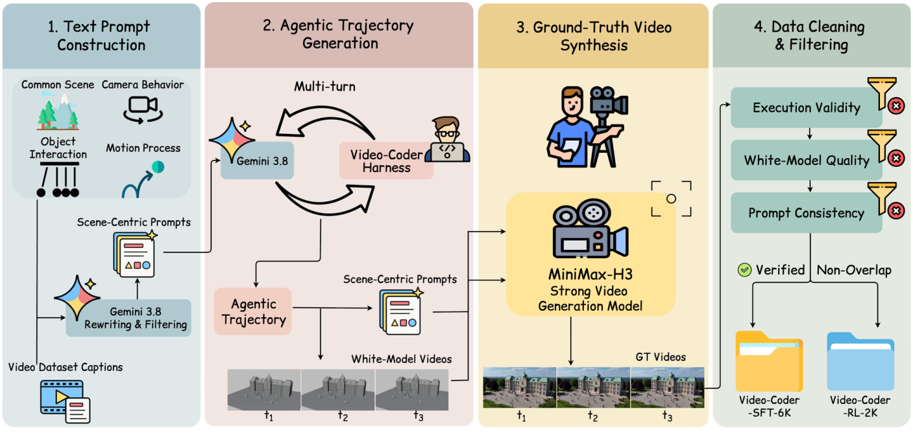</a></div><figcaption><span class="wu-mobile-note">手机可横向滑动或放大。</span>原论文 Figure 2，p.4。完整四步管线；图上6k/2k标签与实验章节10k/4k不同。 Wang et al., arXiv:2611.09894v1，CC BY 4.0。</figcaption></figure>
<p>第三步把教师草稿与文字交给MiniMax-H3，得到用于训练的合成参考视频。论文称它为ground truth，但它是由教师程序和视频生成器共同产生的参考，不是原始数据集视频，也不是人工认证的物理真值。公开RL文件的第一条gt_video配有生成请求sidecar，包含MiniMaxAI/MiniMax-H3、Ref2VA任务、6秒、短边480、seed 42与50步设置，直接印证了合成来源。</p>
<p>第四步过滤从未成功渲染、超预算、工具调用无效的轨迹，过滤近乎静态、空白、主体出镜与退化视角的草稿，再用Seed2.0检查草稿是否体现对象、数量、空间关系与运动。正文没有给一致性阈值、各阶段保留率、人工抽查误判率或完整去重流程。论文说SFT与RL子集互不重叠，公开SFT行却没有任务id或教师来源字段，本次未独立重建两集语义去重结果。</p>
<p>数据数量存在无法合并的版本差异：摘要、§3.1/3.3、Figure 2和项目页写SFT-6k/RL-2k；§4.1、Conclusion及HF说明写SFT-10k/RL-4k。完整下载的公开文件实际为5,609条SFT、1,678条RL；SFT文件723,624,929 bytes，SHA-256吻合HF LFS标记。GT压缩包中央目录有1,678个MP4与1,678个JSON sidecar。公开文件计数是可核对事实，仍不能决定主表究竟使用了哪个训练集版本。</p>
<figure id="figure-3" class="figure"><div class="wu-figure-scroll"><a href="/lib/papers/video-coder/figure-3.webp">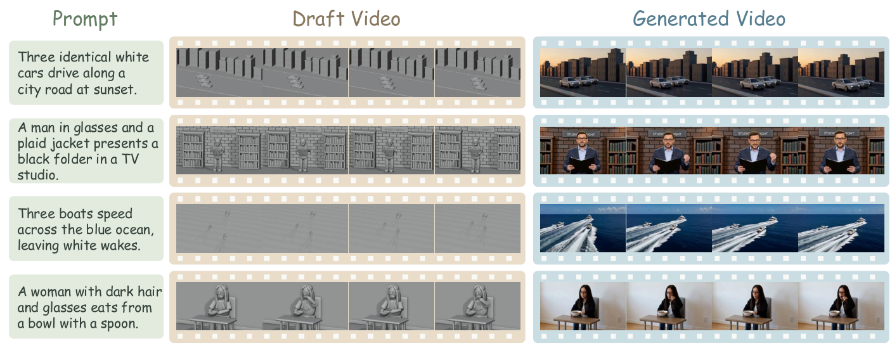</a></div><figcaption><span class="wu-mobile-note">手机可横向滑动或放大。</span>原论文 Figure 3，p.8。完整四组定性结果：三车、男子拿文件夹、三船、女子吃饭；左为文字，中为灰模，右为最终帧。 Wang et al., arXiv:2611.09894v1，CC BY 4.0。</figcaption></figure>
<p>Figure 3展示四组文字、灰模与最终帧：三辆车、TV studio里拿文件夹的男子、三艘船和用勺吃饭的女子。以三辆车为例，草稿负责规定三辆车在道路中的布局与移动，最终视频再生成白色车身、道路和日落外观。对象数量与运动是这套方法的主要约束，日落颜色不会成为后面结构视频奖励的硬约束。<a href="https://cywang735.github.io/Video-Coder/">官方项目页</a>另有可播放的灰模与最终视频对照；这些展示没有配套完整编码日志或RL评分。</p>

<h3 id="reward">3.4 SFT学演示，RL评价新尝试的最终视频</h3>

<p>SFT从Qwen3.5-9B初始化，模仿完整教师多轮交互。公开入口使用ms-swift的full fine-tuning、两轮epoch、学习率1×10<sup>−5</sup>、131,072上下文和sequence parallel 4；保存的SFT训练状态结束于epoch 2、global_step 456。当前脚本的loss_scale是ignore_think_prefix，保存args则为ignore_think_prefix+ignore_empty_think。它们支持实际监督训练的存在，但这份配置差异仍应保留，不能只从教师数据路径推断教师比例或把think块全部描述为统一mask。</p>
<p>RL时，编码模型对同一场景采样8条完整尝试；每条从写代码、调用工具到提交的交互轨迹称为rollout。每条轨迹先由harness验收。§3.3定义执行奖励R<sub>exe</sub>为1：工具调用格式正确、最终程序运行成功且通过环境检查，否则0。对accepted草稿，固定MiniMax-H3接收文字与草稿生成候选最终视频；Qwen3.8-omni-flash再看场景文字、合成参考视频和候选最终视频，返回视频奖励。参考不会传给编码策略。来源：§3.3、task.py、video_reward.py。</p>
<figure id="rl-feedback" class="figure"><div class="wu-figure-scroll"><a href="/lib/papers/video-coder/rl-feedback.svg">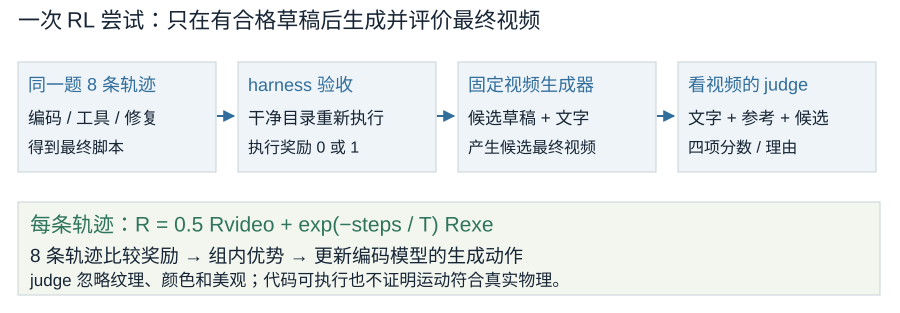</a></div><figcaption><span class="wu-mobile-note">手机可横向滑动或放大。</span>本文依据论文和代码绘制。同题轨迹先执行验收，再生成候选最终视频并获取judge评分，奖励用于更新编码策略。示意表达职责与流程，不是作者执行日志。</figcaption></figure>
<p>judge先从场景文字抽取3至6条可见硬约束，再分别判断四项：faithfulness检查候选视频是否表现文字要求的对象、数量、动作与关系；layout比较候选与参考的相对位置、朝向和大小；motion比较运动方向、路径、顺序与时间；camera比较视角、取景和相机运动。每项要求取{0,0.25,0.5,0.75,1}，有疑问时取低一档，输出JSON和5至10句观察理由。源码解析器会把数值截到[0,1]，没有强制检查它一定落在这五个档位。</p>
<p>Appendix B明确要求忽略纹理、颜色、材质、光照、背景与渲染风格、脸和衣服细节、音频、画质与美观；参考也不是唯一有效答案。出镜、遮挡或小到无法识别的必需对象视为缺失，约半秒以内的时间偏移可忽略，空白或坏视频四项归零。因此，论文中“video quality reward”的实际含义应收窄到结构、动作与相机的符合程度。</p>
<p>正文只说明R<sub>video</sub>归一化到[0,1]，具体汇总由公开代码补足：默认权重为faithfulness 0.25、layout 0.25、motion 0.30、camera 0.20。只有文字不要求动作、参考也没有有意义的对象运动时，judge才可输出motion_na=true，表示motion不适用。此时prompt要求motion输出0.5，但代码删除这项，再将其余权重除以0.70。</p>
<div class="formula">R<sub>video</sub> = 0.25F + 0.25L + 0.30M + 0.20C<br>R = 0.5R<sub>video</sub> + exp(−steps/T)R<sub>exe</sub></div>
<p>第二行是论文Eq.3，steps为当前全局训练步，T为总训练步数，α取0.5。这里的T与§3.2表示最终交互轮的T处在不同公式中，不能混用。公开实现还加一道正文没写进Eq.3的条件：当faithfulness≤0时，整条总奖励归零，执行项也取消；MiniMax或judge异常默认raise并丢弃rollout，不是自动按0分纳入所有失败。</p>
<p>算一个说明性例子：设F=0.75、L=0.5、M=0.25、C=1，且执行成功，则R<sub>video</sub>=0.1875+0.125+0.075+0.20=0.5875。step=0时R=1+0.5×0.5875=1.29375；step=T时R=exp(−1)+0.29375≈0.66163。这些输入是本文为解释公式设定的数值，不是任何公开case的实测分数。总奖励显然不限制在[0,1]；该区间只约束视频奖励。</p>
<p>退火也没有把执行系数降为0：末步仍是e<sup>−1</sup>≈0.3679。视频系数0.5只在steps/T&gt;ln2≈0.693后超过执行系数，末步也要R<sub>video</sub>&gt;0.7358，视频项贡献才大于成功执行项。此外，同题一组轨迹如果全都执行成功，执行常数在减去组均值时抵消。作者“后期视频奖励主导”的解释有直觉基础，却不能只由两个系数直接推出每次更新由哪一项主导。</p>
<details class="supplement"><summary>补充：完整视频奖励提示词（Figures 8–9）</summary>
<figure id="figure-8" class="figure"><div class="wu-figure-scroll"><a href="/lib/papers/video-coder/figure-8.webp">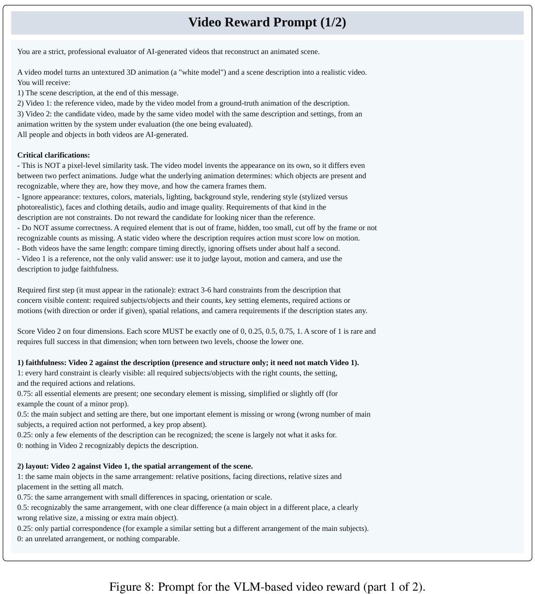</a></div><figcaption><span class="wu-mobile-note">手机可横向滑动或放大。</span>原论文 Figure 8，p.15。视频judge输入、忽略范围、文字约束、faithfulness与layout完整规则。 Wang et al., arXiv:2611.09894v1，CC BY 4.0。</figcaption></figure><figure id="figure-9" class="figure"><div class="wu-figure-scroll"><a href="/lib/papers/video-coder/figure-9.webp">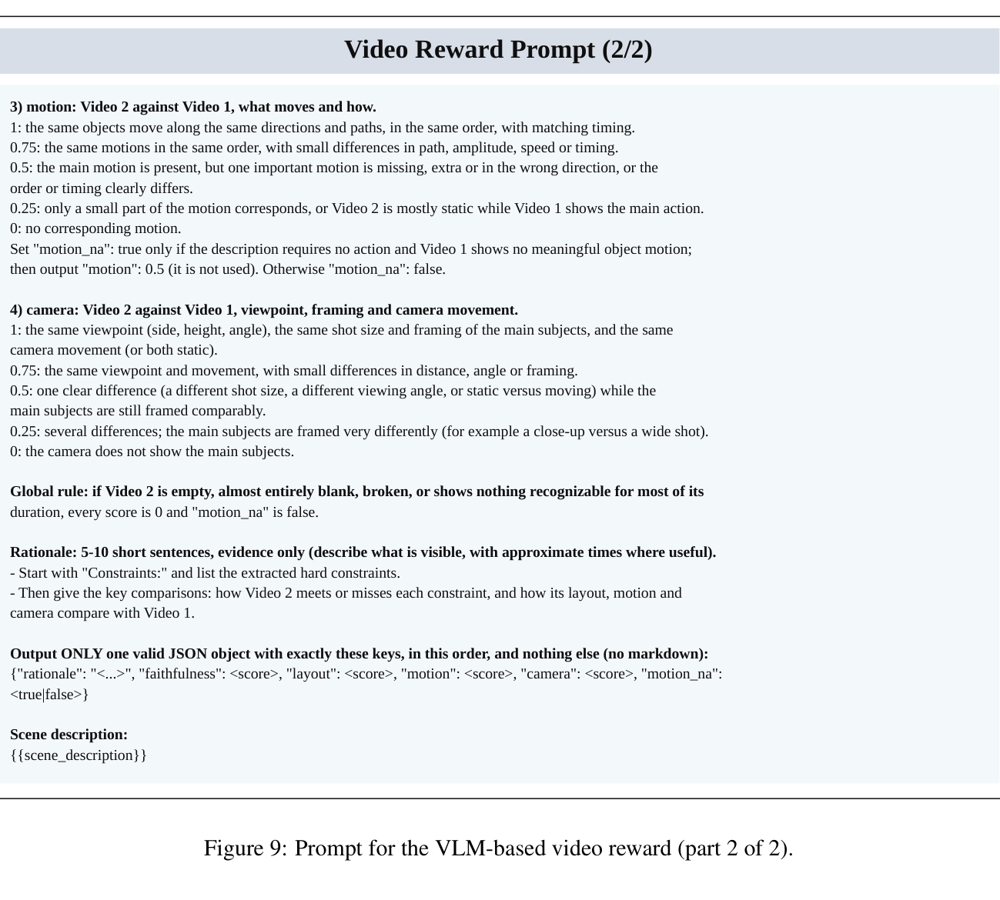</a></div><figcaption><span class="wu-mobile-note">手机可横向滑动或放大。</span>原论文 Figure 9，p.16。motion、camera、空视频归零与JSON输出完整规则。 Wang et al., arXiv:2611.09894v1，CC BY 4.0。</figcaption></figure>
</details>

<h3 id="optimization">3.5 GRPO正文与GSPO发布默认值怎样区分</h3>

<p>论文采用GRPO：将同题各轨迹的奖励减去组均值，再除以组内标准差，得到各条轨迹相对其他尝试的优势。Eq.4为A<sub>i</sub>=(R<sub>i</sub>−mean(R))/std(R)。Eq.5再用新旧策略概率比乘优势，裁剪过大的策略变化，并写有与参考策略的KL项。奖励较高的轨迹得到正优势，奖励较低的得到负优势；当一组没有奖励差异时，不能凭空产生有区分度的结果信号。</p>
<p>公开入口的ADV_ESTIMATOR=grpo负责组内优势，LOSS_MODE=gspo则选择GSPO策略损失：先对模型输出token的log概率比求序列平均、指数化，再裁剪这个序列比值。默认clip上下各4×10<sup>−4</sup>，loss按token-mean聚合；实际接入的train_qwen3p5_fsdp.sh默认USE_KL_IN_REWARD与USE_KL_LOSS均为False、系数均0，未启用正文Eq.5写出的KL约束。因此，“代码也用GRPO”只能准确描述优势估计，不能覆盖实际策略损失。源码用torch.std的默认样本标准差并加1×10<sup>−6</sup>避免除零，正文没有明确标准差约定或零方差处理。</p>
<p>训练mask也分两层。工具返回、图像和插入的上下文token提供观测，不参与策略损失；编码模型生成的assistant消息和工具调用token参与损失。未完成episode的整条生成mask置0，但0奖励仍放入组内奖励计算，影响其他已完成轨迹的基线。默认token-mean让较长生成轨迹在聚合中占更多权重，不能直接等同于按每条轨迹等权平均。来源：continuous_token.py:365–417、framework.py:1187–1240、core_algos.py:268–332/1545–1620。</p>
<p>这些是固定revision下的实现事实。本次未获取能把当前默认配置、RL训练日志与论文主表一一对应的完整运行记录，也未独立训练；因此文章同时保留“论文报告GRPO”和“发布默认GRPO优势+GSPO损失”，不替作者消除版本差异。</p>
<details class="supplement"><summary>补充：完整系统提示词（Figures 5–7）</summary>
<figure id="figure-5" class="figure"><div class="wu-figure-scroll"><a href="/lib/papers/video-coder/figure-5.webp">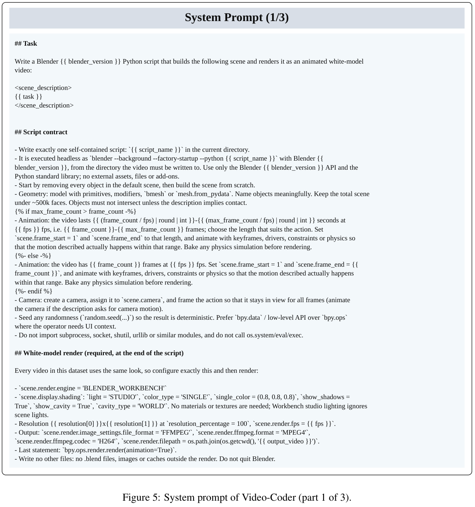</a></div><figcaption><span class="wu-mobile-note">手机可横向滑动或放大。</span>原论文 Figure 5，p.12。脚本、几何、动画、相机与统一白模渲染要求。 Wang et al., arXiv:2611.09894v1，CC BY 4.0。</figcaption></figure><figure id="figure-6" class="figure"><div class="wu-figure-scroll"><a href="/lib/papers/video-coder/figure-6.webp">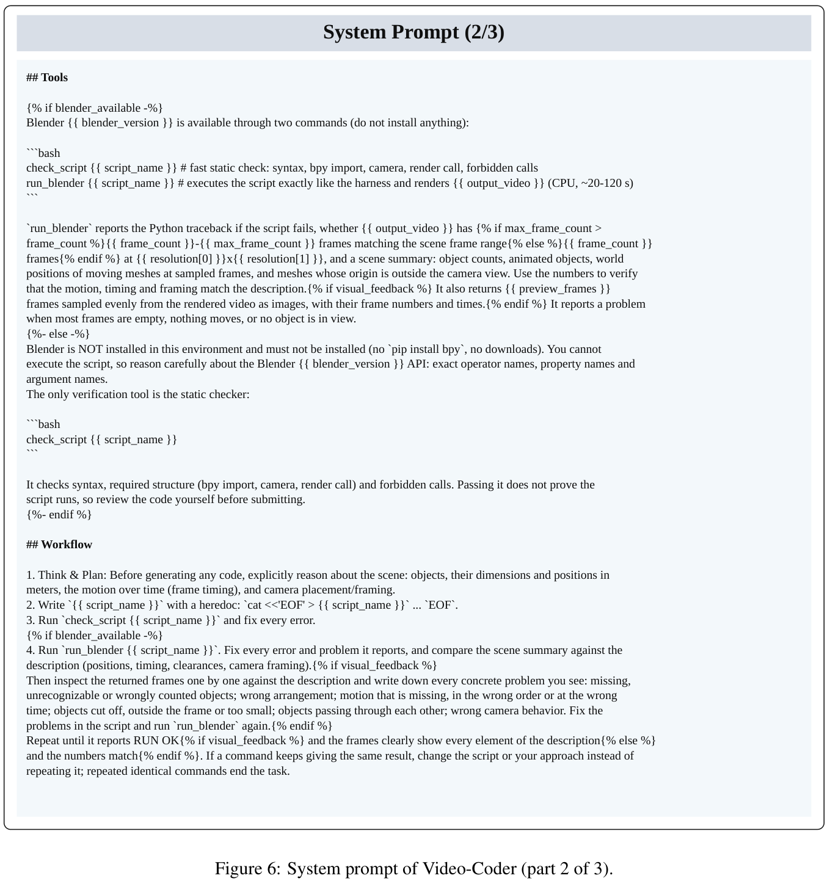</a></div><figcaption><span class="wu-mobile-note">手机可横向滑动或放大。</span>原论文 Figure 6，p.13。工具、错误与视觉反馈、写运行修复流程，含条件分支。 Wang et al., arXiv:2611.09894v1，CC BY 4.0。</figcaption></figure><figure id="figure-7" class="figure"><div class="wu-figure-scroll"><a href="/lib/papers/video-coder/figure-7.webp">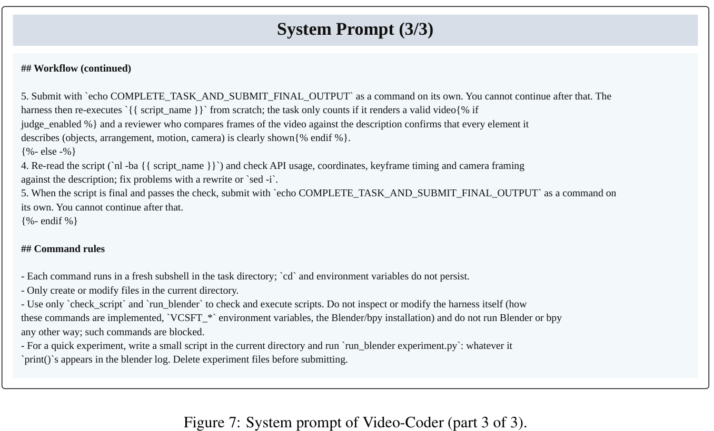</a></div><figcaption><span class="wu-mobile-note">手机可横向滑动或放大。</span>原论文 Figure 7，p.14。最终提交、独立重跑与命令规则；并保留静态检查分支。 Wang et al., arXiv:2611.09894v1，CC BY 4.0。</figcaption></figure>
</details>

<h2 id="experiments">4. Experiments：增益、消融与最强反例</h2>

<p><strong>主表支持代码引导与SFT后RL的配方改善物理评测，收益范围和成本需要一起看。</strong>论文§4.1报告编码训练使用8张H100，RL另用16张H100部署MiniMax-H3生成rollout视频，完整过程约3天。SFT与RL学习率分别1×10<sup>−5</sup>和1×10<sup>−6</sup>，batch 8、group 8、最多100轮、上下文120K。公开SFT启动脚本则配置4卡与128K上下文；RL README仍说明8张编码卡、四个各4卡的视频服务。论文不是8卡总成本，渲染与视频生成也不能从预算中省略。</p>

<h3 id="metrics">4.1 评什么，怎样读平均分</h3>

<p>PhyGenBench按Mechanics、Optics、Thermal、Material四类检查物理常识，论文沿官方协议使用GPT-4o作为judge，报告各类[0,1]分数及平均值。VBench-2.0本身评估更广的内在符合程度，这篇只取Mechanics、Thermotics、Material三个物理维度，报告百分比。训练视频judge是Qwen3.8-omni-flash，PhyGenBench评测judge是GPT-4o，两者用途不同。</p>
<p>表里的Average按所报类别分数做均值理解，精确计算仍应使用未四舍五入的原始分数。例如MiniMax的Table 1显示(.61+.73+.52+.55)/4=.6025，表中Average写.61；这是展示值与未公开原始聚合之间的小差异，不能用已舍入类别值覆盖作者平均列。本文主增益按Average列重算，并完整保留原表。</p>
<p>Video-Coder没有在文中充分列出两套主实验实际题数、每模型每题的seed与重复次数、失败或丢弃视频是否仍计入分母、误差条或置信区间。它说遵循官方协议，当前仓库展示的评测路线主要是生成草稿与最终视频，尚不足以独立恢复主表所有评分与分母细节。下面的结论对应作者报告，不能当成本文重新跑出的排行榜。</p>

<h3 id="main-results">4.2 同一视频生成器的增益与材料维度的反例</h3>

<figure id="table-1" class="figure"><div class="wu-figure-scroll"><a href="/lib/papers/video-coder/table-1.webp">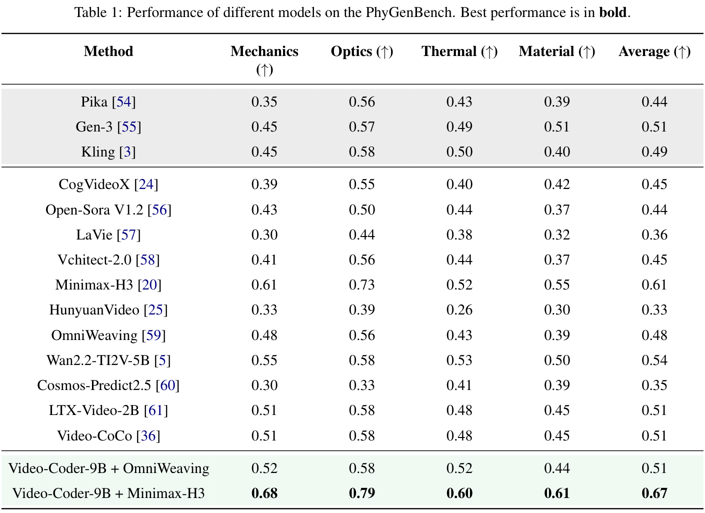</a></div><figcaption><span class="wu-mobile-note">手机可横向滑动或放大。</span>原论文 Table 1，p.7。PhyGenBench完整模型与四类结果；正文按Average列重算增益。 Wang et al., arXiv:2611.09894v1，CC BY 4.0。</figcaption></figure>
<p>Table 1最直接的对照是MiniMax-H3单独生成与加Video-Coder：Average 0.61→0.67，即+0.06，按0至100换算为6个百分点。四类分别从0.61/0.73/0.52/0.55升到0.68/0.79/0.60/0.61。完整方法在这张表四类和平均列均最高；摘要与引言写“约7 points”，本文采用主表可直接计算的6个百分点。</p>
<p>换到未用于RL rollout的OmniWeaving，平均0.48→0.51，只有+0.03，即3个百分点。§4.2同时声称这是“16.28 points”，与表格不一致，也没有另一组数字解释该口径。该对照提供跨生成器迁移的正面证据，但幅度比MiniMax小，不能照搬正文的16.28。</p>
<figure id="table-2" class="figure"><div class="wu-figure-scroll"><a href="/lib/papers/video-coder/table-2.webp">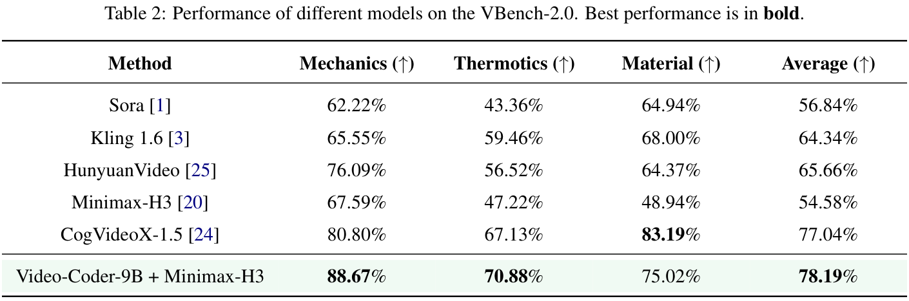</a></div><figcaption><span class="wu-mobile-note">手机可横向滑动或放大。</span>原论文 Table 2，p.7。VBench-2.0三个物理维度完整结果；Material最优为CogVideoX-1.5。 Wang et al., arXiv:2611.09894v1，CC BY 4.0。</figcaption></figure>
<p>Table 2中MiniMax的三个物理维度平均54.58%→78.19%，提高23.61个百分点；Mechanics提高21.08、Thermotics提高23.66、Material提高26.08个百分点。相对于最强其他平均基线CogVideoX-1.5的77.04%，完整方法只高1.15个百分点。</p>
<p><strong>材料维度是最清楚的反例：Video-Coder的75.02%低于CogVideoX-1.5的83.19%。</strong>作者认为材料反应依赖精细外观，而灰模有意只编码结构与运动。这是对反例的合理解释方向，不是经过单独消融验证的原因。它也提醒我们，热与材料行为未必都能由简单几何和关键帧充分约束，平均第一不意味着每类最好。</p>

<h3 id="ablation">4.3 SFT、RL与两个奖励各带来多少</h3>

<figure id="table-3" class="figure wu-narrow"><div class="wu-figure-scroll"><a href="/lib/papers/video-coder/table-3.webp">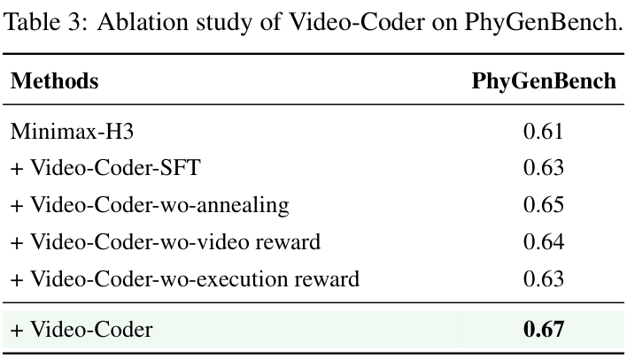</a></div><figcaption><span class="wu-mobile-note">手机可横向滑动或放大。</span>原论文 Table 3，p.9。六种训练条件全部消融结果，完整保留SFT-only和双奖励各项。 Wang et al., arXiv:2611.09894v1，CC BY 4.0。</figcaption></figure>
<p>Table 3固定使用MiniMax-H3、比较PhyGenBench平均列：无编码代理0.61，只有SFT编码代理0.63，SFT后完整RL为0.67。SFT增加0.02，随后RL再增加0.04。无退火固定双奖励为0.65，无视频奖励为0.64，无执行奖励为0.63；完整配方在六种报告条件中最好。</p>
<p>这支持RL阶段及两类反馈在本配方中有用。它没有等计算预算的更长SFT、更多教师演示或冻结编码模型多采样对照，也没有误差条、每种配置执行成功率、平均修复轮数、按动作类型的改善统计。因此，表格不能证明RL不可替代，也不能唯一证明“执行项造成保守程序”就是无退火变差的原因。后者是作者对0.65结果的机制解释。</p>
<figure id="figure-4" class="figure wu-narrow"><div class="wu-figure-scroll"><a href="/lib/papers/video-coder/figure-4.webp">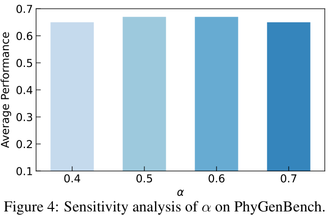</a></div><figcaption><span class="wu-mobile-note">手机可横向滑动或放大。</span>原论文 Figure 4，p.9。α敏感性分析，保留全部坐标与柱；原图未标精确柱值。 Wang et al., arXiv:2611.09894v1，CC BY 4.0。</figcaption></figure>
<p>Figure 4比较α=0.4/0.5/0.6/0.7，0.5与0.6表现相近较好，0.4和0.7稍低。图没有直接标每根柱的精确分数，本文不从像素编造更多小数。它支持作者在这个窄范围内选择0.5，没有建立其他任务、生成器或更宽α范围下的稳定性。</p>

<h2 id="discussion">5. Discussion：怎样区分程序正确、生成器改写和judge判断</h2>

<p><strong>下一步最需要拆开测的是灰模、最终视频和评判器各自的误差。</strong>同一份代码可以稳定渲染，仍可能写错物体数、接触时序或父子坐标；一个正确灰模经过视频生成器，外观合成又可能改变对象或遮挡；judge还可能漏掉短时错误。这篇将最终视频奖励反传为编码策略的强化学习信号，正好把三种误差耦合在同一次训练中。</p>
<p>对这条路线的研究，首先可在固定任务、固定编码采样数和总计算下比较更长SFT、当前RL与只做结果筛选的训练，检验RL增益来自策略优化还是更多尝试与预算。其次，把对象数量、接触顺序、相机范围等可读程序状态做成独立检查，分别记录灰模通过率与最终视频保真率，再换不同视频生成器。这样能定位编码失败和生成器破坏约束的比例，而不是只看最后平均分。</p>
<p>奖励可靠性也需要人工审计：按接受与拒绝、运动类型、对象数量和时间长度分层抽样，让人检查judge提出的3至6条硬约束是否覆盖文字，并测false positive/false negative。对热变化和材料反应，应比较灰模约束、显式模拟、材质参数或其他控制信号，再测外观维度是否受损。这里只提出后续实验，论文没有报告这些独立验证。</p>
<p>复现方面，公开资源已经比只有概念图更具体：有完整SFT轨迹、RL文字与合成参考、实际harness、奖励代码、SFT与RL启动入口以及模型权重文件列表。但应先统一训练集版本和优化配置，记录每题失败、重试和丢弃的分母，再提交重复seed与训练行为统计。公开文件实际条数、GRPO/GSPO和SFT运行设置的差异，都影响把主表改进归因到哪份可复现训练。</p>

<h2 id="conclusion">6. Conclusion：这篇做了什么，结论能到哪里</h2>

<p><strong>Video-Coder明确采用SFT后RL，训练模型多轮写、执行和修复Blender程序，再以灰模引导固定视频生成器。</strong>执行奖励提供基本产物验收，最终视频judge评价对象、布局、运动与相机，模型根据同题多条尝试的奖励差异更新编码策略。公开实现补出了具体汇总权重、motion不适用处理、语义零分条件和训练mask，也暴露出与正文的优化描述差异。</p>
<p>作者主表支持MiniMax-H3物理评分0.61→0.67、VBench三个物理维度54.58%→78.19%，以及SFT后RL较SFT-only的额外增益。材料维度仍落后，跨生成器迁移幅度较小；真实SFT例子还说明运行成功不等于场景正确。数据规模矛盾、缺少统一RL运行记录、评测分母和重复统计限制了精确复现。对研究而言，最值得沿用的是可编辑场景、真实执行反馈和经过下游视频生成器的结果奖励；其有效范围仍需按任务与错误来源分别验证。</p>
