<link rel="stylesheet" href="/lib/papers/coworkos/reading.css">

<iframe src="/lib/decks/coworkos.html" title="CoworkOS图解，共16页" allow="fullscreen" loading="eager"></iframe>

16页 · 按钮或方向键翻页 · 手机图表可横向滑动<a href="/lib/decks/coworkos.html">独立图解</a> · F全屏 · Esc退出

原文：<a href="https://arxiv.org/abs/2611.03178">arXiv:2611.03178v1</a>，最早公开于2026-11-02。以下完整阅读34页正文与附录，并核对<a href="https://github.com/RUC-NLPIR/CoworkOS/tree/baf03c30db56160690f9d03bfa7dee925bad6cfd">官方代码 baf03c30</a>和作者公开案例记录。原图依据 CC BY-NC-SA 4.0 复用并署名；自绘图另行标注。本文未独立跑训练或复现实验。

CoworkOS研究怎样让模型在复杂工作中持续执行、等待反馈，并与人一起修改同一份产物。它提供模型周围的运行框架：安排工具与子任务，保存工作状态，处理后台结果和共享文件。论文另用这套框架组织五轮监督微调实验；这一部分训练的是Qwen模型，采用SFT，没有报告RL。

<aside class="prerequisite"><h3>Part 0：先分清模型、框架和交付物</h3>
模型负责读上下文、提出操作和解释结果；运行框架（harness）负责实际执行工具、构造下一次上下文、保存状态及安排等待。交付物由具体任务决定，可以是可交互网页、文档、CAD工程或模型训练结果，并没有统一要求输出一个index.html。本文的Main Agent是直接承接用户目标的主执行者；Coordinator Runtime是管理状态、消息与执行生命周期的程序，不是另一位自主制定研究策略的模型。
</aside>

<h2>1. Motivation：一条最终回复，接不住持续变化的工作</h2>

论文关注两种工作。第一种是多步骤项目：产物、外部服务和训练任务可能持续数小时，结果迟于模型当前回合返回。第二种是持续监督：定期观察数据或状态，发现变化后再采取行动。人还可能在过程中修改文件或工程，Agent必须知道眼前版本已经改变，而不能继续按照旧上下文覆盖它。

作者把这些能力放进一个持久工作区，而不是把所有历史一直塞进模型上下文。文件、任务状态、执行记录和资源版本留在磁盘；模型按需读取，运行时将新反馈交到适当的决策边界。其实际问题包括：谁决定下一步、子任务完成后如何回报、长任务怎样等待、人的改动如何保留，以及何时才算真正完成。

<figure id="figure-1" class="figure">
<a href="/lib/papers/coworkos/figure-1.webp">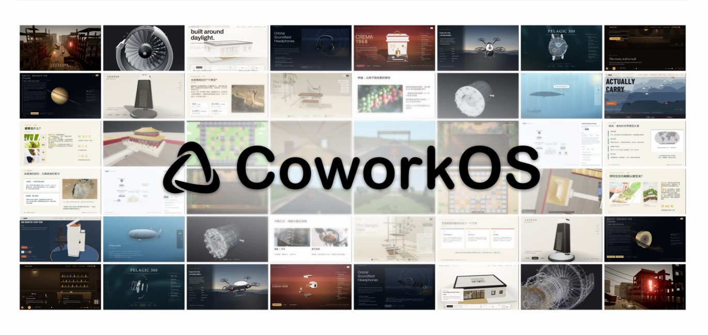</a>
<figcaption>手机可横向滑动或放大。原论文Figure 1，p.1。CoworkOS Team，arXiv:2611.03178v1，CC BY-NC-SA 4.0。持续工作与共同修改的完整总览。</figcaption></figure>

Figure 1给出产品式总览，Figure 2进一步把项目工作和持续监督分开。这两种工作共享基础设施，但监督不必每次轮询都调用模型：确定性监控程序可以只在观测发生变化时产生事件，再让Main决定如何处理。

<figure id="figure-2" class="figure">
<a href="/lib/papers/coworkos/figure-2.webp">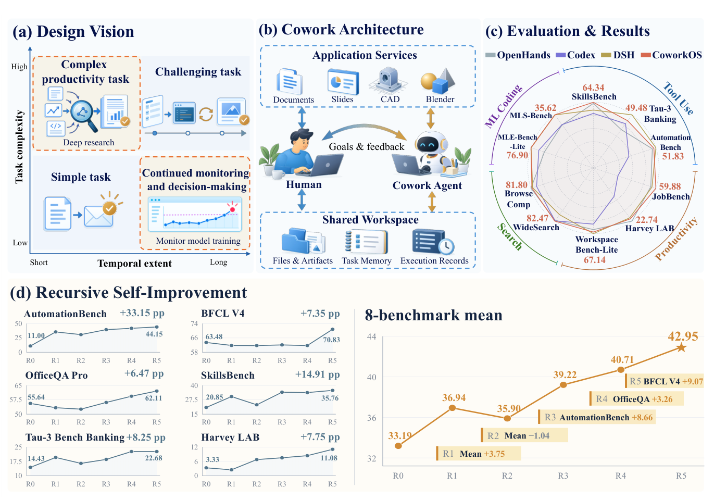</a>
<figcaption>手机可横向滑动或放大。原论文Figure 2，p.3。CoworkOS Team，arXiv:2611.03178v1，CC BY-NC-SA 4.0。项目工作和持续监督两类任务、程序监控与模型审阅。</figcaption></figure>

<h2>2. Related Work：从编码会话扩展到共同工作的运行环境</h2>

最直接的比较对象是OpenHands、Codex和DeepSeek Harness（DSH），它们同样把模型接入工具与执行环境。论文的区别在于将人和Agent共同修改资源、跨上下文持续执行、异步反馈与委派放进同一个工作区。相比只提供多个Agent聊天，它同时管理产物、进程、任务状态和验收责任。

论文主表把四个框架都接到GLM-5.3，使用High thinking effort、256K上下文和每次响应最多64K输出。这里Codex是框架名称，不能读成OpenAI模型与GLM的模型能力竞赛。同一模型减少了一类干扰，但工具实现、提示、任务适配和实际用量仍可能不同；主表没有充分的组件消融和等成本分析。

<table class="comparison"><thead><tr><th>相关路线</th><th>解决的具体问题</th><th>CoworkOS的边界</th></tr></thead><tbody><tr><td>编码harness</td><td>读写文件、执行命令、根据反馈修复</td><td>扩展共享应用资源和持续监督；不证明编码本身全面更强</td></tr><tr><td>多Agent协作</td><td>把工作交给独立上下文，接收结果或消息</td><td>Main仍负责目标、范围和接受结果；Coordinator负责程序调度</td></tr><tr><td>持久记忆与上下文压缩</td><td>历史变长时保留继续工作的依据</td><td>结合文件记忆、运行状态与历史；当前源码还生成摘要和近期消息</td></tr><tr><td>MCP应用集成</td><td>向Agent暴露外部软件的工具与结果</td><td>外部应用继续持有自身状态；并非所有MCP写入都有内置版本保证</td></tr><tr><td>自动化后训练</td><td>用评测发现不足，改数据与训练配方</td><td>本篇以固定GLM组织Qwen的SFT；不是GLM自更新，也未报告RL</td></tr></tbody></table>

<h2>3. Method：谁做决定，谁保存状态，谁提交修改</h2>
<h3>3.1 三层职责与异步反馈</h3>

Main Agent直接接收用户请求，选择自己执行还是委派，并决定最后是否满足目标。可选的Subagents是接到具体子任务的独立执行者；它们获得有限背景、任务说明、明确的资源权限和技能目录，不会自动拿到Main的全部历史和直接用户输入。Coordinator Runtime负责持久任务记录、排队、生命周期和消息投递，执行Main提出的安排。

<figure id="figure-3" class="figure">
<a href="/lib/papers/coworkos/figure-3.webp">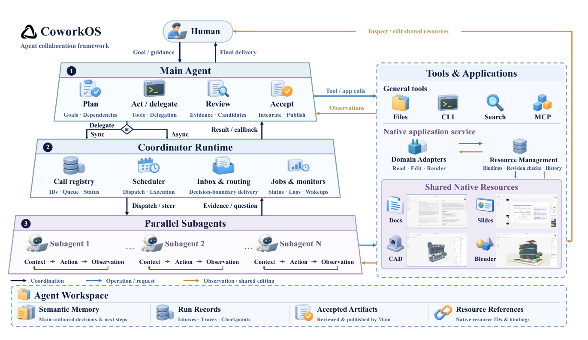</a>
<figcaption>手机可横向滑动或放大。原论文Figure 3，p.6。CoworkOS Team，arXiv:2611.03178v1，CC BY-NC-SA 4.0。Main、Coordinator与Subagents，以及共享应用资源和工作区。</figcaption></figure>

同步委派沿调用路径等待结果；异步委派先返回确认和标识，Main可以继续别的工作。子任务之后把结果送入持久收件队列（Inbox），运行时在安全的模型决策边界将消息交给Main。它不会把后台结果任意插入尚未结束的工具调用中。子Agent之间可以交换消息，但这不产生第二套目标控制层。

当前代码可以验证这一安排：coordination.ts创建受限委派，coordinator-runtime.ts先记录队列与checkpoint，再确认异步调用；完成记录保存后产生Main回调。scheduler.ts按messageId去重并租用消息，Main投递路径在消息进入保存的上下文后才确认消费。这里的checkpoint是运行记录，不是SFT模型权重；这些源码证据也不等于完成了进程崩溃或重复外部写入的故障测试。

<h3>3.2 共享资源：旧版本的候选不能直接覆盖人的新修改</h3>

资源协议用identity、kind、content和revision描述共享对象：标识指向同一对象，类型决定应用能力，内容是当前产物，版本号用于发现并发变化。提交修改时携带读入时的baseRevision。Eq.7要求baseRevision等于currentRevision才能应用；不一致则报告冲突，保留候选并重新考虑。

<figure id="figure-4" class="figure">
<a href="/lib/papers/coworkos/figure-4.webp">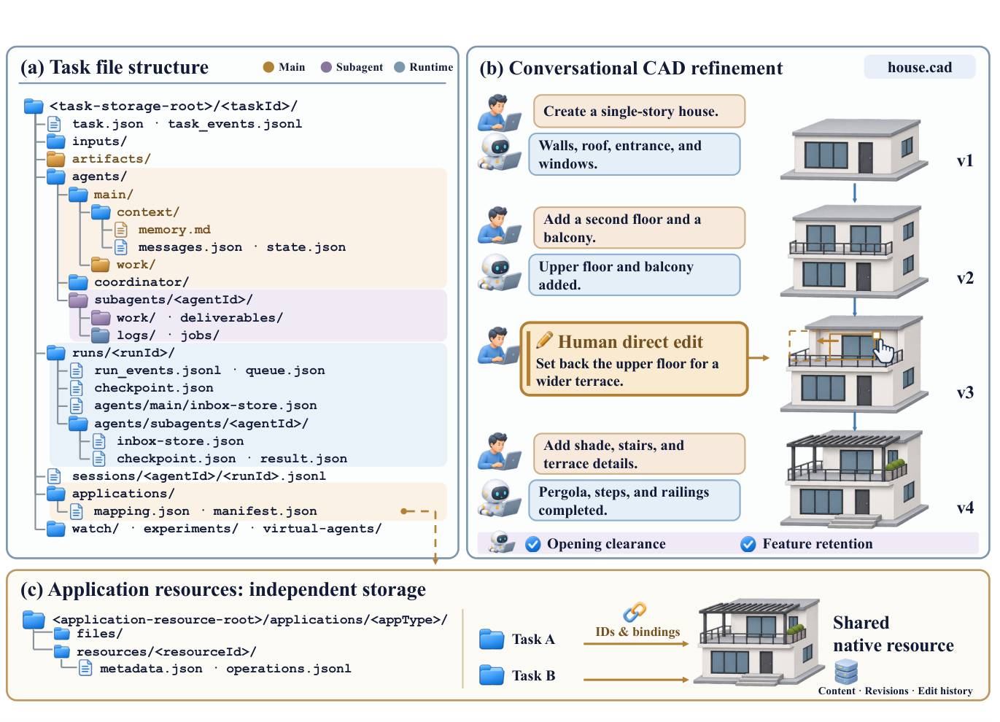</a>
<figcaption>手机可横向滑动或放大。原论文Figure 4，p.10。CoworkOS Team，arXiv:2611.03178v1，CC BY-NC-SA 4.0。任务目录、独立资源存储，以及房屋v1–v4的论文示意。</figcaption></figure>

Figure 4的房屋是论文示意案例：v1是一层，Agent加二层与阳台得到v2；人把上层后退形成露台，保存成v3；Agent观察变化后补遮阴、楼梯和栏杆形成v4。这幅图解释预期协作过程，并没有公开证明每步发生过的事件日志。

<figure id="revision-flow" class="figure">
<a href="/lib/papers/coworkos/revision-flow.svg">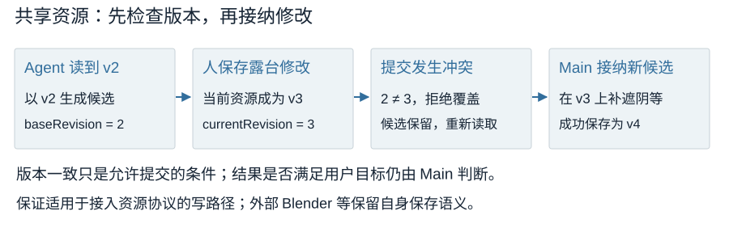</a>
<figcaption>手机可横向滑动或放大。本文依据论文和官方代码绘制；是机制示意，不是实际执行日志。版本2候选遇到版本3时拒绝覆盖，Main重新读取与提交。</figcaption></figure>

用版本号算一次冲突：Agent的候选基于v2，用户已经保存v3，则2≠3，提交失败；候选仍保留。Main重新读v3并调整方案，新的候选以3为baseRevision，当前仍为3时才允许保存。版本一致只能证明允许提交，不能证明遮阴和楼梯设计满足人的意图。

公开resource-store.ts确实在写锁中检查操作身份和baseRevision，过时版本抛出revision_conflict；子Agent可在私有draft中修改，再保存带版本的candidate，由Main审阅接纳。主工作区因此不必随子任务试错不断变动。但外部MCP软件保有自己的保存和并发语义：官方文档明确外部Blender不使用内置编辑器版本历史。只有明确返回资源操作、接入对应协议的路径，才可能采用这些检查。

<figure id="figure-5" class="figure">
<a href="/lib/papers/coworkos/figure-5.webp">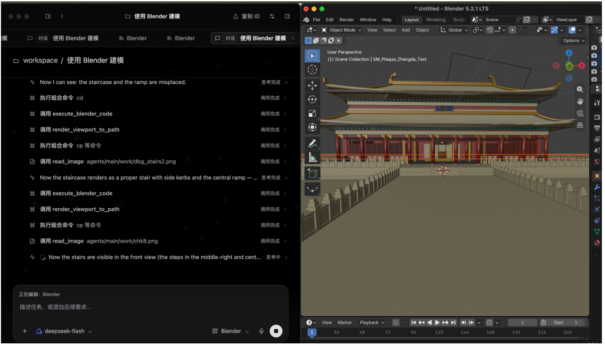</a>
<figcaption>手机可横向滑动或放大。原论文Figure 5，p.11。CoworkOS Team，arXiv:2611.03178v1，CC BY-NC-SA 4.0。Blender中的代码执行、文件更新与原生viewport；不是动画评测。</figcaption></figure>
<h3>3.3 持久执行：等待有条件，完成有检查</h3>

后台进程（Job）把命令、日志、进程身份和退出结果单独保存，使训练或服务可以在Main换上下文、重新启动之后继续被跟踪。主机进程仍存在是关键条件；主机消失或外部服务失败时，不能无条件承诺恢复成功。当前jobs.ts在进程已消失但没有退出记录时报告uncertain/unobserved，不把消失误当成功。

监控源的轮询频率与Main审阅目标的频率是两回事。确定性监控只检查状态，未变化时可以不调用模型。暂时停下来等待（parking）必须有计时器、活动监控源，或者目标自身的下一次审阅条件；公开sleep_until在没有唤醒条件时返回parked:false和no_wake_condition。任务结束前，运行时还检查未结束Job、子任务、回调和未处理用户请求；产物质量是否合格仍由Main判断。

<h3>3.4 记忆保存什么；当前clear_context究竟做什么</h3>

工作区记忆是Main维护的文档，记录用户要求、结论、未完成工作和下一步，不是训练到参数里的记忆。论文§3.3.3描述显式重建上下文：结合记忆、工作区状态和近期历史继续工作，避免只依赖不断增长的聊天记录。

当前公开实现需要单独说明：clear_context会在当前回合结束后调用ctx.compact，生成历史摘要并保留安全的近期消息；完整消息日志与memory.md继续保存在磁盘。源码提示记忆只是补充，而且可能过时，摘要必须以实际会话为依据；压缩失败则保留原上下文。不能按工具名字把它写成“清空全部历史，只靠memory.md重建”。

补充：可定位的实现证据与未验证边界

固定revision baf03c30：<a href="https://github.com/RUC-NLPIR/CoworkOS/blob/baf03c30db56160690f9d03bfa7dee925bad6cfd/.pi/runtime/tools/coordination.ts#L310-L463">委派、背景和权限</a>；<a href="https://github.com/RUC-NLPIR/CoworkOS/blob/baf03c30db56160690f9d03bfa7dee925bad6cfd/src/runtime/main-inbox-delivery.ts#L273-L333">Main消息保存与确认</a>；<a href="https://github.com/RUC-NLPIR/CoworkOS/blob/baf03c30db56160690f9d03bfa7dee925bad6cfd/src/applications/resource-store.ts#L424-L474">资源写锁与版本冲突</a>；<a href="https://github.com/RUC-NLPIR/CoworkOS/blob/baf03c30db56160690f9d03bfa7dee925bad6cfd/.pi/runtime/tools/workspace.ts#L113-L137">clear_context定义</a>及<a href="https://github.com/RUC-NLPIR/CoworkOS/blob/baf03c30db56160690f9d03bfa7dee925bad6cfd/.pi/runtime/extension.ts#L1022-L1033">ctx.compact调用</a>。本文静态读代码，没有运行框架或注入故障，也未验证所有外部副作用恰好执行一次。

<h2>4. Experiments：框架比较、真实产物和五轮SFT分别证明什么</h2>
<h3>4.1 十二项评测：同一模型，四种运行框架</h3>

Table 1覆盖工具使用、生产力、搜索和机器学习编码四类能力，报告各框架在实际配置下的分数。CoworkOS在生产力均分57.54和ML Coding均分56.26最高；工具使用55.22略低于DSH的55.31，搜索82.14略低于OpenHands的82.22。这里支持广泛竞争力，不支持每类第一，更不能从总表分离出版本协议、子Agent或记忆各自造成了多少提升。

<figure id="table-1" class="figure">
<a href="/lib/papers/coworkos/table-1.webp">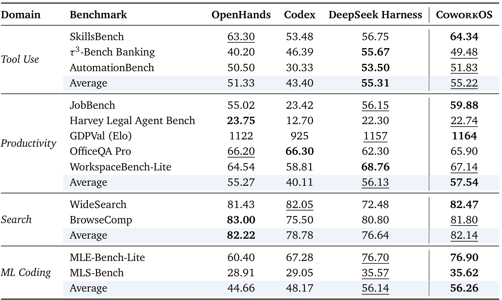</a>
<figcaption>手机可横向滑动或放大。原论文Table 1，p.15。CoworkOS Team，arXiv:2611.03178v1，CC BY-NC-SA 4.0。十二项四框架完整结果；GDPVal Elo按原协议转换后进入领域均分。</figcaption></figure>

几个单项保留比较条件：SkillsBench 64.34、JobBench 59.88、WideSearch 82.47、MLE-Bench-Lite 76.90与MLS-Bench 35.62都是表内最高；Harvey 22.74低于OpenHands 23.75，OfficeQA 65.90低于Codex 66.30，Workspace 67.14低于DSH 68.76。ML Coding均分仅比DSH高0.12，且没有重复seed或误差条，不能把这点差距当作稳定优势。

分数来自不同判断机制，不能把所有行当作同一种成功率。SkillsBench是79项文本任务的平均任务分，排除视觉和媒体任务；Tau3 Banking是97项任务通过率；JobBench是全部65项产物的LLM任务分均值；OfficeQA在133题和解析后的Treasury Bulletin材料上按原生规则评分。AutomationBench报告all-pass：满足该任务要求的全部检查才通过，本文没有取得它的逐项断言或本次完整原始评测日志。

补充：Appendix A.1完整任务范围、预算与评分单位

<table class="comparison"><thead><tr><th>评测</th><th>任务及可用材料</th><th>预算与评分</th></tr></thead><tbody><tr><td>SkillsBench</td><td>79项文本；排除visual/media；保留官方环境、verifiers</td><td>独立容器与工作区；平均task score</td></tr><tr><td>Tau3 Banking</td><td>97项Banking Knowledge；698文档，BM25/dense检索、只读shell</td><td>200交互步；simulation 1800s、outer 2400s；pass rate</td></tr><tr><td>AutomationBench</td><td>v1.0.6和PR #13的null类型修复；本报告未列任务数</td><td>benchmark evaluator；all-pass rate</td></tr><tr><td>JobBench</td><td>main split全部65任务</td><td>7200s；LLM任务百分分均值，分母65</td></tr><tr><td>Harvey</td><td>比例抽样固定120项法律任务；官方材料、skills、rubrics</td><td>隔离工作区；逐criterion评分；未给本次judge一致性统计</td></tr><tr><td>GDPVal</td><td>全部220 scheduled tasks</td><td>无有效分、timeout、call-gate耗尽均计loss；Elo及tie-adjusted win rate</td></tr><tr><td>OfficeQA Pro</td><td>133题；parsed Treasury Bulletin corpus</td><td>新工作区；原生EvalScope/OfficeQA规则</td></tr><tr><td>WorkspaceBench-Lite</td><td>AgentCompass；English Lite</td><td>2CPU、8GiB、2h；本文未列任务数</td></tr><tr><td>WideSearch</td><td>200题，英中各100；共享Serper和Jina后端</td><td>format_normalized_v1与LLM judge</td></tr><tr><td>BrowseComp</td><td>本报告未列任务数；discard-all上下文策略</td><td>500步；answer accuracy</td></tr><tr><td>MLE-Bench-Lite</td><td>22项low-compute-split比赛</td><td>5h、4CPU、32GiB、1H200；CSV grader→Human Rank后任务均值，缺失/invalid为0</td></tr><tr><td>MLS-Bench</td><td>30项Lite任务；只可修改算法文件</td><td>5h、4CPU；单GPU/CPU 32GiB、多GPU 64GiB，task-specific H200；0–1reward×100的均值</td></tr></tbody></table>

论文说明保留各评测的默认或官方规则，但没有统一列出全部模型可见提示、judge隐藏输入、版本与运行日志。公开harness的单元测试也不能补足这些正式任务检查；例如jobbench-runtime.test.js使用mock工具，是运行时测试。

<h3>4.2 GDPVal两种指标：Elo与累计rubric分不能混用</h3>

主表GDPVal的1164是相对固定1000基线的Elo。设W、L、T分别为胜、负、平，Appendix A.1给出E=1000+400log₁₀[(W+T/2)/(L+T/2)]，且W+L+T=220。失去有效评分的任务也算负，不能从分母剔除。生产力均分使用的是100(W+T/2)/220，而不是将1164直接与其它百分数平均；论文未给精确W/L/T，不能从四舍五入的Elo倒推出唯一计数。

后面的SFT实验换了指标。Appendix A.3的GDPVal先汇总有效判分任务的实际rubric分sᵢ和最大分mᵢ，再算100Σsᵢ/Σmᵢ；有效判分任务集合V是它的分母边界。这不是Elo、胜率，也不是每题百分数的平均。用本文说明性输入算一次：两题4/5和9/15，累计指标=100×13/20=65，逐题平均=(80+60)/2=70。高满分任务对累计指标权重更大。这个例子不是作者的真实任务结果。

<h3>4.3 Ridge Pack：生成可交互网页，并用实际输入检查反馈</h3>

Ridge Pack是论文与官网共同提供的真实网页产物案例：用户可以切换背包容量、加入物品、检查分隔空间并优化或撤销。Figure 9和Appendix A.2记录作者按同一顺序尝试八个同名物品后的可见反馈。CoworkOS提示尚余5.98L，却因空间碎片化不能找到不与邻居相碰的连续位置，建议Optimize或移除较大的邻居。它解释的是总容积与可用连续空间的区别。

<figure id="figure-9" class="figure">
<a href="/lib/papers/coworkos/figure-9.webp">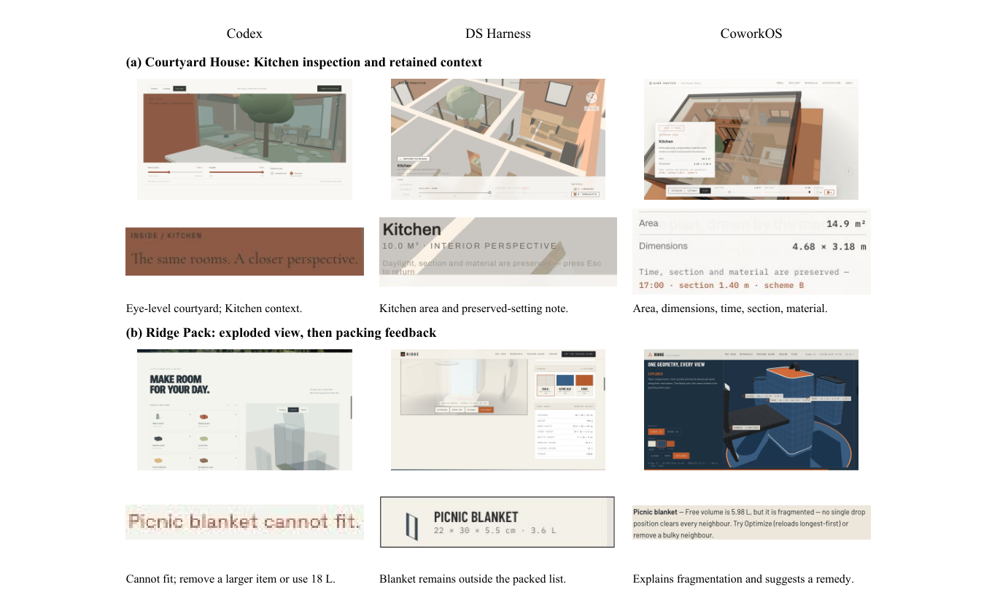</a>
<figcaption>手机可横向滑动或放大。原论文Figure 9，p.28。CoworkOS Team，arXiv:2611.03178v1，CC BY-NC-SA 4.0。Kitchen信息与Ridge Pack拒绝反馈；基线同样有实际交互。</figcaption></figure>

Codex版本也会拒绝Picnic blanket，并建议移除较大物品或改用18L包。DSH的截图保留了未装入blanket的列表，但没有捕获瞬态拒绝提示，因而不能宣称它“不解释”。三版使用的物品尺寸不同，装入数量和容量值不能用来排名装箱算法。

作者另公开了<a href="https://coworkos-ai.github.io/review/web/coverage.json">review/web/coverage.json</a>。reviewer在12L版本依次尝试Water bottle、Camera cube、Rolled jacket、Lunchbox、Field notebook、Sunglasses case、Snack pouch和Picnic blanket，并测试容量切换、Optimize、Undo与Reset。CoworkOS记录为6件装入，jacket和blanket被拒，余量7.11/12.11L；切18L再回12L保留6件，Optimize重排但仍不能装入两件，Undo恢复，Reset回零。Codex记录装入7件，blanket仍拒绝，切换容量后保留状态。这些是作者另一段公开review的数值，不能与论文截图的5.98L合成同一条执行日志。

该case检查的是交互是否响应、反馈能否解释拒绝，以及部分撤销与重置状态是否保留；没有官方装箱最优性PASS断言，也未全面验证拖放、移除、导出和碰撞不变量。因此它可以证明交付网页具有可操作状态，不能代替程序正确性或最优性评测。Figure 9的Courtyard House同样保留基线能力：三版都支持Kitchen inspection并保留相关设置；CoworkOS把14.9m²、4.68×3.18m、17:00、剖面1.40m与材质方案B集中显示，主要证据是信息组织。

<h3>4.4 产物看起来更完整，仍可能有几何和验证缺口</h3>

Figure 6比较网页、游戏、Office、交互图、CAD和Blender产物。作者确实进一步执行了游戏输入、失败和重试，Office检查也保留内容页，不只看封面。但是各实现的游戏分数、物品尺寸与部分内容不同，不能用截图显示数字排成功率；Office布局清楚也不证明里面的数值正确。

强反例来自3D检查：VESPER Speaker在CoworkOS中反复reset、展开、等待和旋转，仍未清楚展示分离后的内部结构；Saturn Atlas的Codex剖面层次更清楚。六份STEP用OCP 8.0.1.1.0成功导入，仅建立几何可读取，不证明参数化编辑、装配干涉、公差或制造性能。公开评审GLB没有animation tracks，旋转viewport不等于作品带动画。

<figure id="figure-14" class="figure">
<a href="/lib/papers/coworkos/figure-14.webp">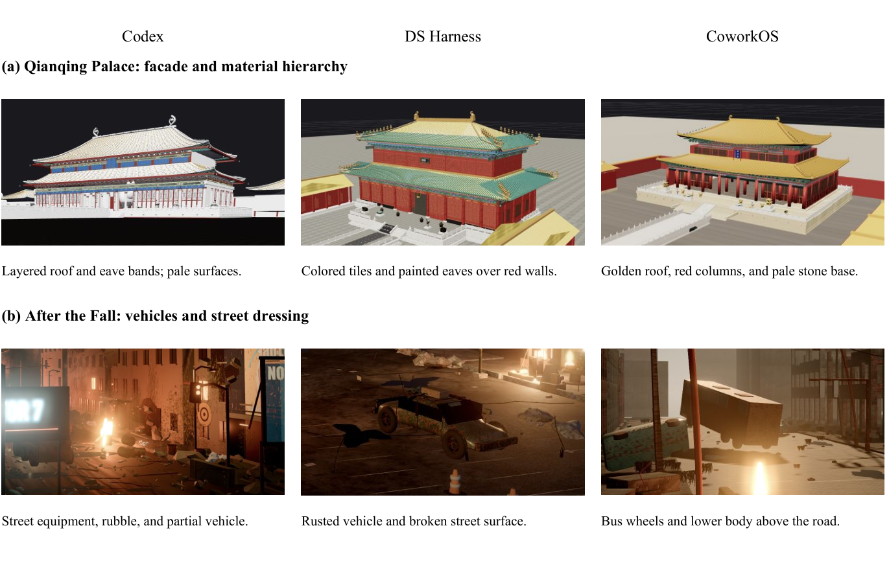</a>
<figcaption>手机可横向滑动或放大。原论文Figure 14，p.33。CoworkOS Team，arXiv:2611.03178v1，CC BY-NC-SA 4.0。宫殿和街景局部，完整保留CoworkOS的公交悬空反例。</figcaption></figure>

Figure 14刻意保留After the Fall中CoworkOS的公交轮胎和下部车身悬空。这说明场景空间层次、材质和照明更丰富，仍可能支撑关系错误。三版照明和材质没有统一校准，不能把视觉偏好当物理正确性；几何反例应与漂亮总览一起读。

补充：完整六类产物画廊（Figure 6）
<figure id="figure-6" class="figure">
<a href="/lib/papers/coworkos/figure-6.webp">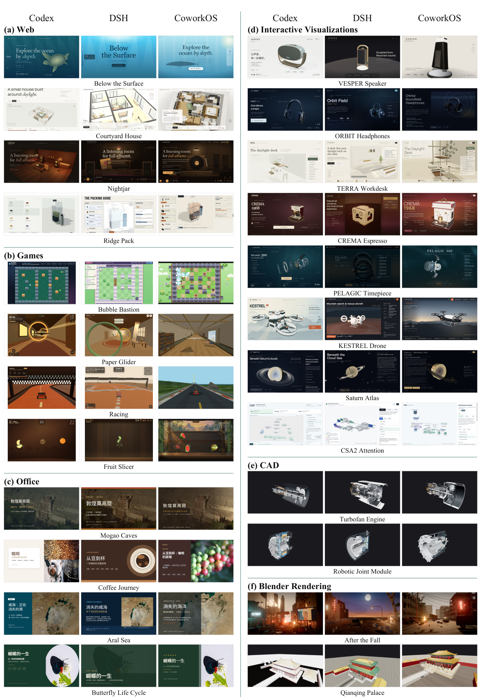</a>
<figcaption>手机可横向滑动或放大。原论文Figure 6，p.17。CoworkOS Team，arXiv:2611.03178v1，CC BY-NC-SA 4.0。六类产物完整对照；保留全部案例，不将视觉比较当任务成功率。</figcaption></figure>

补充：游戏和Office内容页（Figures 10–11）
<figure id="figure-10" class="figure">
<a href="/lib/papers/coworkos/figure-10.webp">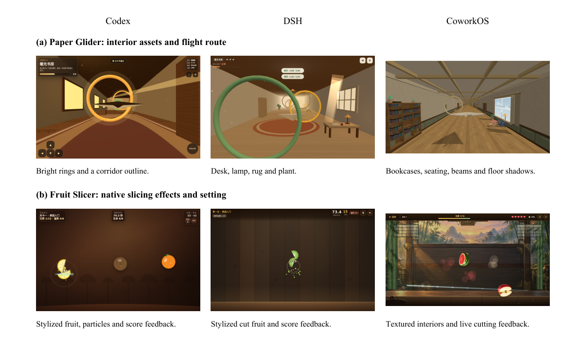</a>
<figcaption>手机可横向滑动或放大。原论文Figure 10，p.29。CoworkOS Team，arXiv:2611.03178v1，CC BY-NC-SA 4.0。Paper Glider与Fruit Slicer可见场景；各游戏数字不是统一成功率。</figcaption></figure><figure id="figure-11" class="figure">
<a href="/lib/papers/coworkos/figure-11.webp">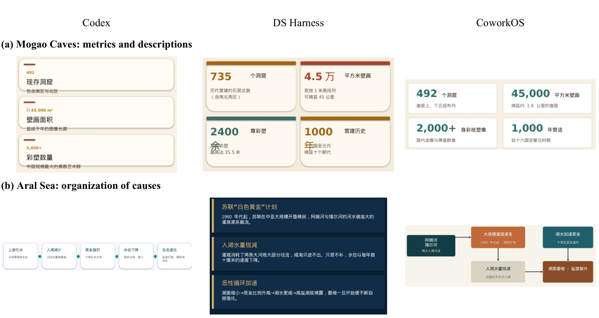</a>
<figcaption>手机可横向滑动或放大。原论文Figure 11，p.30。CoworkOS Team，arXiv:2611.03178v1，CC BY-NC-SA 4.0。Office内容页的指标布局和因果图；排版不保证内容数值正确。</figcaption></figure>

补充：交互图与CAD细节（Figures 12–13）
<figure id="figure-12" class="figure">
<a href="/lib/papers/coworkos/figure-12.webp">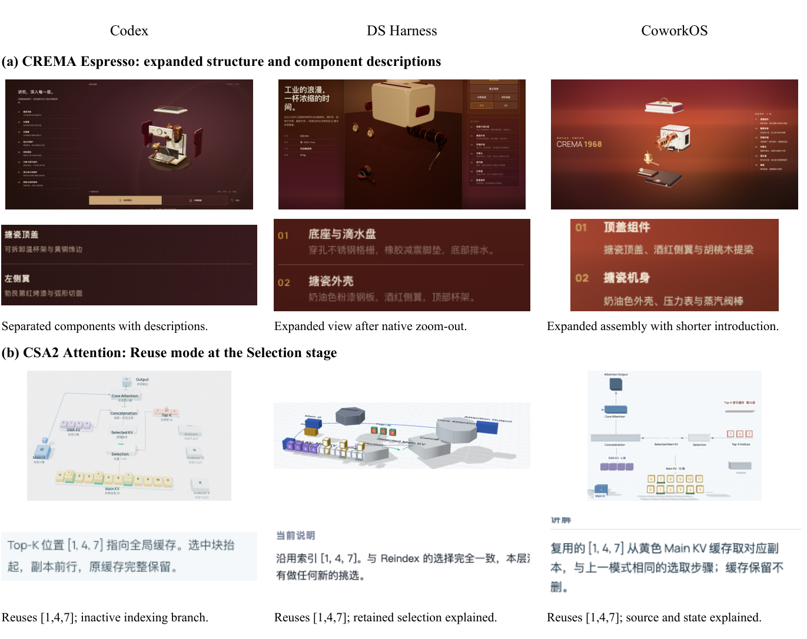</a>
<figcaption>手机可横向滑动或放大。原论文Figure 12，p.31。CoworkOS Team，arXiv:2611.03178v1，CC BY-NC-SA 4.0。交互可视化的细节检查；视觉可读性不等于算法验证。</figcaption></figure><figure id="figure-13" class="figure">
<a href="/lib/papers/coworkos/figure-13.webp">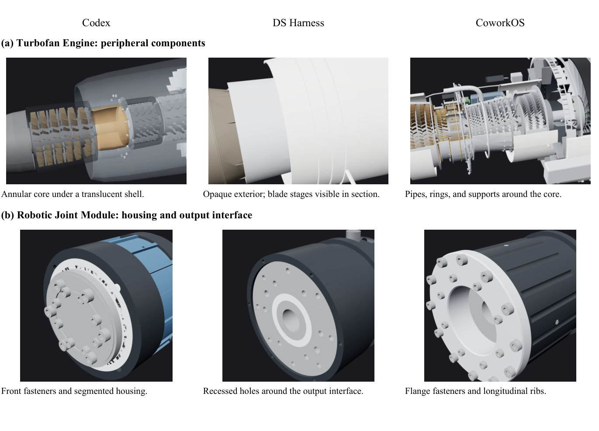</a>
<figcaption>手机可横向滑动或放大。原论文Figure 13，p.32。CoworkOS Team，arXiv:2611.03178v1，CC BY-NC-SA 4.0。发动机和机械关节的原生视图细节；几何导入不等于制造可行。</figcaption></figure>

<h3>4.5 自动化后训练：固定GLM指导数据，监督微调Qwen</h3>

五轮后训练使用固定GLM-5.3作为controller和数据teacher，Qwen3.6-35B-A3B是被训练与评测的模型。每轮先评测Qwen，诊断能力缺口，修改数据生成流程，生成、修复、验证和过滤教师轨迹，然后做监督微调（SFT）并重新评测。分数用于决定下一轮训练什么，不是直接作为RL策略梯度的奖励；论文未报告RL、GRPO、OPD或教师logits/KL蒸馏，也没有充分给出token loss mask和精确优化器。

<figure id="sft-flow" class="figure">
<a href="/lib/papers/coworkos/sft-flow.svg">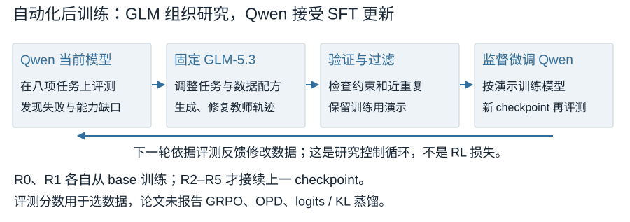</a>
<figcaption>手机可横向滑动或放大。本文依据论文和官方代码绘制；是机制示意，不是实际执行日志。固定GLM组织诊断与数据生成，Qwen接受SFT更新；评测是下一轮选数据依据。</figcaption></figure>

R0用1345条工具交互seed从base训练；R1把244条新演示加入seed，并再次从base训练，不是接着R0微调。R2才从R1 checkpoint继续，135条首次使用数据由77条先前保留但未训练的轨迹和58条新生成轨迹组成。训练历史查重与BM25任务相似度过滤是两项检查：后者阈值0.8用于降低train/eval近重复，前者检查父模型是否已经用过数据。

<figure id="figure-8" class="figure">
<a href="/lib/papers/coworkos/figure-8.webp">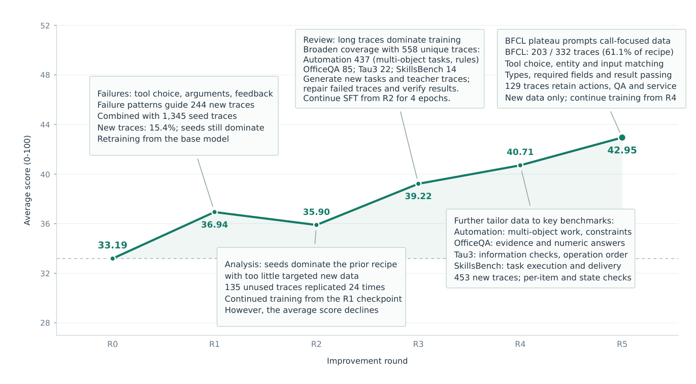</a>
<figcaption>手机可横向滑动或放大。原论文Figure 8，p.21。CoworkOS Team，arXiv:2611.03178v1，CC BY-NC-SA 4.0。完整均分与每轮训练配方，保留R2下降。</figcaption></figure>

R2是最有解释力的失败：均分36.94→35.90。作者检查到42条长轨迹占135条的31.11%，却贡献84.2%的监督tokens。重复135条24次并不意味着所有任务均匀增加了监督，少数长轨迹会主导训练。R3扩展至558条首次使用轨迹并训练4 epochs，均分回到39.22；R4继续补约束检查与操作后状态读取，R5把203/332条新数据给BFCL，均分最终42.95。

这段记录能展示Agent怎样发现数据配方失败并调整实验，但每轮同时改变数据、初始化、重复次数、epochs和steps。不能据此把R3回升单独归因于“更多独立样本”，或把轮数当作相同计算预算。R5的BFCL升幅9.07与集中补数据相符，仍不是独立因果消融。

<figure id="table-2" class="figure">
<a href="/lib/papers/coworkos/table-2.webp">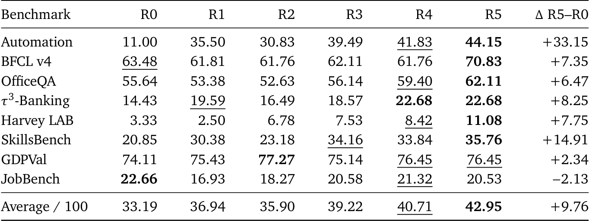</a>
<figcaption>手机可横向滑动或放大。原论文Table 2，p.33。CoworkOS Team，arXiv:2611.03178v1，CC BY-NC-SA 4.0。R0–R5全部八项、均分和相对起点变化，含JobBench负增益。</figcaption></figure>

按Table 2八项原数重算，R0均值33.1875，R5均值42.94875，增加9.76125个百分点，四舍五入对应33.19→42.95。最终7/8项高于R0，JobBench为22.66→20.53，下降2.13；GDPVal中间R2达到77.27，最终76.45。不能说每轮单调改善或所有任务提升。Automation的33.15和SkillsBench的14.91合计贡献八项总提升的61.54%，提升在任务间也不均匀。

<figure id="figure-7" class="figure">
<a href="/lib/papers/coworkos/figure-7.webp">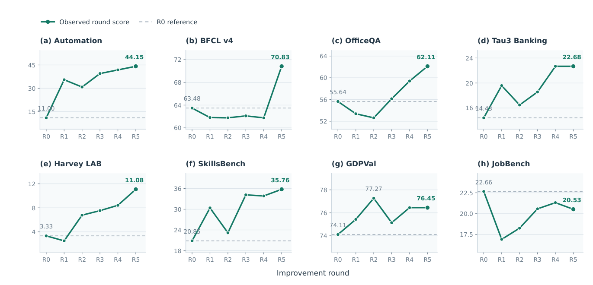</a>
<figcaption>手机可横向滑动或放大。原论文Figure 7，p.20。CoworkOS Team，arXiv:2611.03178v1，CC BY-NC-SA 4.0。八项R0–R5曲线，含GDPVal中间峰值和JobBench退步。</figcaption></figure>

补充：完整训练谱系、独立轨迹、采样乘数与步数
<figure id="training-table" class="figure">
<a href="/lib/papers/coworkos/training-table.webp">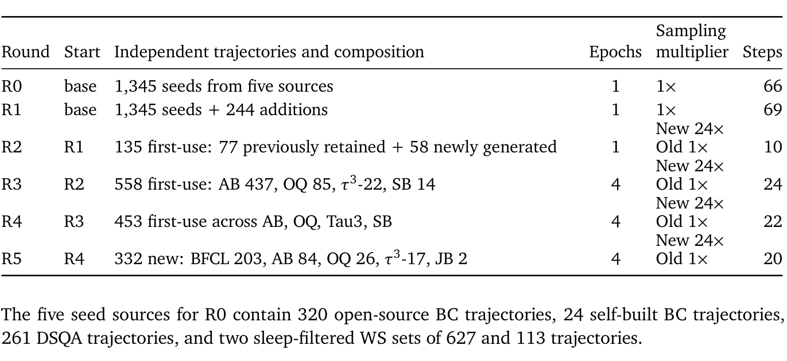</a>
<figcaption>手机可横向滑动或放大。原论文p.34未编号训练表。CoworkOS Team，CC BY-NC-SA 4.0。p.34未编号训练表和seed说明；保留谱系、epochs、采样乘数与steps。</figcaption></figure>
p.34未编号表保留各项定义：R0/R1从base独立开始，分别66/69steps；R2–R5接续上轮，10/24/22/20steps。R2为1epoch，R3–R5为4epochs，新增数据24×与old 1×是采样乘数，不能与epochs混为一谈。原seed来源写作320条open-source BC、24条self-built BC、261条DSQA和两组627/113条sleep-filtered WS；原文没有在这里完整展开这些简称，不猜测对应数据集。

<h2>5. Discussion：有价值的系统设计，还缺哪些可验证证据</h2>

公开实现是一套完整TypeScript/Electron框架，package版本0.1.3，包含CLI、桌面端、内置应用、运行时和测试，而不只是论文或静态demo。不过在本次固定revision的tracked文件和显式公开链接中，没有找到五轮SFT的实际数据、训练脚本、权重、trainer_state或对应checkpoint，也没有找到主表各benchmark的完整适配器和运行记录。框架可获取与实验可复现是两个不同结论；源码里的runtime checkpoint和mock测试不能填补模型训练发布物。

官网画廊有24条case，作者公开review覆盖19案例、57份产物和92页Office，完整游戏通关为0次；Butterfly Life Cycle在walkthrough后加入，不属于那19例。它是作者发布的Agent reviewers检查，不是独立人类研究。本次只读公开记录，没有亲自运行这些产物，不能将24张好看示例写成24项正式成功任务。

对RSI结果，还要保留评测适应风险：每轮持续根据同一组benchmark反馈选择训练内容，即使BM25剔除近重复任务，也不能排除对评测集合逐轮适应。缺少独立blind heldout、等预算人工数据配方、固定自动配方，以及更长SFT等对照，现有结果不足以建立自动化研究比这些路线更有效。固定教师生成演示具有行为模仿成分，但没有报告OPD所需的在线teacher分布或KL目标。

后续研究可以分别测试三个环节。共享资源用并发修改和过时候选检验是否保留人的新版本；持续执行用重启、消息重复、网络失败和等待条件消失检验恢复；自动化训练使用固定开发集选数据、独立隐藏测试集报告结果，并控制teacher调用、训练tokens和GPU预算。这些是本文提出的可证伪实验，不是作者已经做过的结果。

<h2>6. Conclusion：运行时连续性值得看，训练收益要按SFT理解</h2>

CoworkOS的核心是把目标决策留给Main，把调度、消息、Job、共享资源版本和持久状态交给程序运行时。它能产出多种实际工作成果，并提供与人共同修改和等待反馈的机制；它没有把所有任务都变成HTML或视频，也没有用统一checker证明所有产物正确。

实验支持同一GLM模型下广泛的框架竞争力，并展示固定GLM组织Qwen五轮SFT后均分增加9.76个百分点。应同时记住R2下降、JobBench退步、任务增益集中，以及训练发布物和等预算对照缺失。对关注harness训练的人，这篇最有用的内容是任务状态、异步反馈、验收责任与数据配方失败的具体记录；它提供SFT研究过程案例，不能作为已经实现harness RL或agentic OPD的证据。

来源：<a href="https://arxiv.org/pdf/2611.03178v1">完整论文PDF</a> · <a href="https://huggingface.co/papers/2611.03178">Hugging Face入口</a> · <a href="https://github.com/RUC-NLPIR/CoworkOS">官方代码</a> · <a href="https://coworkos-ai.github.io/showcase.html">官网画廊</a> · <a href="https://coworkos-ai.github.io/review/index.html">作者review</a> · <a href="/lib/papers/coworkos/coworkos.sources.json">证据与视觉清单</a>。公开页面核查日期2026-11-09；所有原Figure 1–14、Table 1–2与p.34训练表均保留完整内容，署名CoworkOS Team，<a href="https://creativecommons.org/licenses/by-nc-sa/4.0/">CC BY-NC-SA 4.0</a>。

