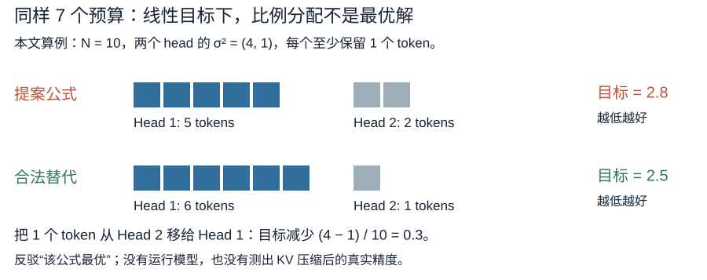
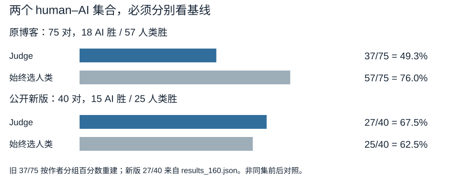
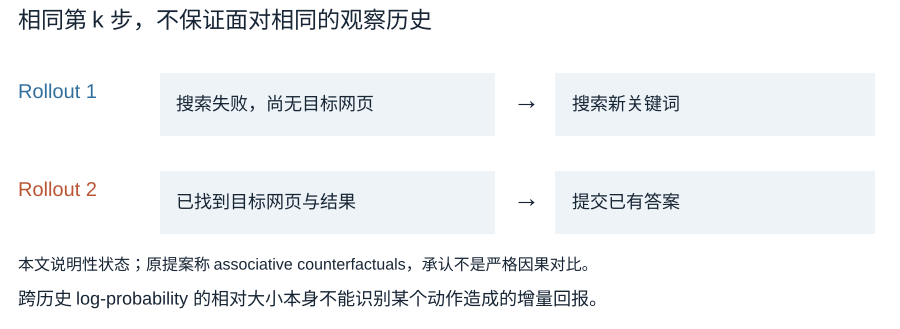
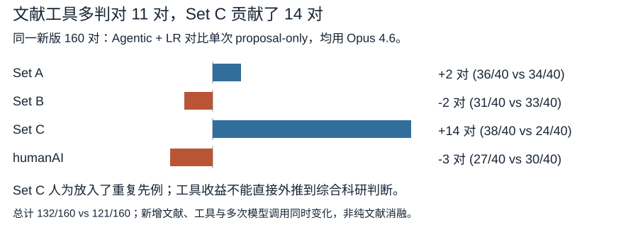

<link rel="stylesheet" href="/lib/papers/ideaeval/reading.css">
<div class="post-deck-embed"><div class="post-deck-embed-frame"><iframe src="/lib/decks/ideaeval.html" title="IdeaEval图解，共14页" allow="fullscreen" loading="eager"></iframe></div><p class="post-deck-embed-note"><span>14页 · 按钮或方向键翻页 · 手机图表可横向滑动</span><span><a href="/lib/decks/ideaeval.html">独立图解</a> · F全屏 · Esc退出</span></p></div>

本文依据 [作者中文原文](https://02hyc.github.io/Blog/posts/ideaeval-zh/)、[官方代码](https://github.com/02hyc/IdeaEval/tree/e0d9a5a87b3ec90efa25df8150ca74b8dcdf5c0c) 和三套公开数据整理。作者为 Yanchen Huang、Yuchen Niu、Xiangkun Hu。原文标注首次发布于 2026-10-16，更新于 2026-11-11；它是项目复盘，作者明确说未能完成可信的评测，未提供已发表论文或 arXiv 正文。以下把原文实验与后续发布数据分开说明。

### Part 0：这里评的是什么

系统要在研究开始前判断：两个研究计划，哪个更值得投入？作者把包含假设、方法、实验设计和成功标准的完整研究计划称为 proposal。负责写计划的系统是 ideation system；接收两份计划、给出相对优劣的评判器是 pairwise ranker。本文沿用 proposal 和 ranker，避免把“提出计划”和“判断计划”混在一起。

在这个实验里，所谓 human proposal 也由模型改写：作者拿一篇已完成的人类论文，删掉结果，再改写成计划。它不是研究者当年真正写下的事前提案。AI proposal 则由 agent 针对指定研究方向新写。两者最终都交付文本，计划里的训练、实验和数据收集尚未执行。

这篇最需要记住的三个结果是：

- 原文更均衡的 250 对论文改写提案上，完整文本与引用排序的一致率约 80%；**只读标题仍有 72.8%／74.0%**。
- 原 75 对人工标注的人类与 AI 提案上，GPT-5.4 的准确率为 **49.3%**。标签中人类胜出 57 对，始终选人类可得 76%。
- 后续公开的 40 对 humanAI 上，第 23 版评判提示（v23）配合 Opus 4.6，在允许多轮调用并提供文献综述的设置（Agentic + LR）下为 **27/40＝67.5%**，单次读提案为 30/40＝75%。这不是同一数据集上的前后改进。

## 1. Motivation：先判断研究计划是否值得做

**作者要解决的是实验前的投入判断。** 自动科研系统可以围绕一个计划写代码、运行实验、整理结果，但这个过程不能修复计划本身的所有问题。作者在 FARS 的实践中发现，许多自动提出的方案是组件拼接、贡献有限，甚至核心方法不成立。若直到实验阶段才发现，损失的不只是生成文本的时间。

对固定算法或任务，可以直接执行候选方案，用清晰指标筛选。开放研究更麻烦：实验可能持续数周，结果的意义还要放到领域已有知识中判断。因此作者希望模拟研究者的事前判断能力，称为 research taste：在完整实验之前，估计一个假设能给领域增加多少有用知识。

作者用下面的概念性表达定义目标：

<div class="formula">V(H, K<sub>t</sub>) = E[ΔK | H, K<sub>t</sub>]</div>

H 是提案的核心假设，Kₜ 是时间 t 时领域已经拥有的知识；ΔK 是将来增加的知识。这不是可直接计算的奖励函数，也没有一个“知识增量单位”的实测标签。作者选择用后来得到的引用排序校准 ranker，并在同一研究方向、相近时间内做相对比较。

<figure class="figure" id="overview"><p class="wu-mobile-note">图中标签可横向滑动阅读；可点击放大查看全图。</p><div class="wu-figure-scroll"><a href="/lib/papers/ideaeval/overview.svg"></a></div><figcaption>官方总览原图：论文组成同期研究组，改写成人类提案，AI按同一研究方向生成提案；ranker本身另外校准。英文标签保留。来源：IdeaEval docs/figures/overview.svg（e0d9a5a），Apache 2.0。</figcaption></figure>

这个设计有两个依次成立的前提：ranker 先要能准确判断已知标签的两份提案，之后才适合用来衡量 AI 写得如何。项目最后卡在第一个前提。**一旦评判器偏好宏大的叙事，AI 提案的高胜率就可能反映评判器的偏好。**〔原文：The last step…；Judging an idea…；Afterword〕

## 2. Related Work：不同标签回答不同问题

**没有一种方便获得的标签，能完整代表事前研究判断。** 作者把相关工作按评估信号分成四类。下表按原文讨论整理其边界；它是问题地图，不是对这些工作的独立复现实验。

<div class="table-scroll" id="table-related"><table class="comparison"><thead><tr><th>信号 / 例子</th><th>输入与产物</th><th>如何判分</th><th>相对 IdeaEval 的边界</th></tr></thead><tbody><tr><td>已发表 idea：IdeaBench、ResearchBench</td><td>历史文献 → idea</td><td>是否接近目标论文发现</td><td>复现一个已知发现，其他好方案可能被低估</td></tr><tr><td>专家 / 审稿：人类盲评、GraphEval、InnoEval、ScholarEval</td><td>idea 或论文材料 → 质量判断</td><td>专家偏好、录用、审稿意见</td><td>专家有噪声；审稿还混入实验完成度与写作</td></tr><tr><td>单维验证：Novelty Assessment、HypoBench</td><td>提案及文献／数据 → 新颖性或假设</td><td>可定位先例或检验的假设真值</td><td>较窄但容易诊断错误，不能单独覆盖完整研究价值</td></tr><tr><td>延迟反馈：Proof of Time、AI Can Learn Scientific Taste</td><td>历史证据或 title/abstract → 未来排序</td><td>之后引用、奖项等</td><td>长期反馈更近影响力，输入可能已有结果</td></tr><tr><td>IdeaEval</td><td>历史文献 + 两份事前计划 → 相对优劣</td><td>先以引用或人工标签校准 ranker</td><td>去结果减少显式泄漏，仍保留后见之明与评判偏好</td></tr></tbody></table></div><p class="source-note">按作者原文 Ways to evaluate… 整理；本表未独立复现相邻工作。</p>

IdeaEval 希望同时判断贡献、可行性和实验可信度，并以延迟出现的社区反馈校准。这比单独判断“是否重复已有工作”宽得多。后文的失败也发生在这里：历史论文已经经过研究与实验筛选，引用比较不太要求 ranker 识别明显不成立的方案；新生成的 AI 提案却可能带着这类缺陷。

原文最后重新肯定了那些只评一个可验证维度的取舍。本文也认为，应先把“找出重复先例”“验证一个公式”“判断实验能否区分两种解释”分别测清，再研究如何综合。综合目标有价值，但不能由几个较容易的子任务分数直接推出。〔原文：Ways to evaluate…；Afterword〕

## 3. Benchmark / Protocol：构造同期提案，再校准评判器

**这是数据构造与评判流程的研究，项目没有报告 SFT 或 RL 参数训练。** “校准”主要指测试和修改提示、评判规则与工具流程。AI 提案里可以写 RL 方法，但那是被评的研究计划，不能当作 IdeaEval 已运行的训练。

### 3.1 从论文到共享时间背景的研究组

作者按计划使用的 GPT-5.4 和 Opus 4.6 的知识截止时间，选择 2025 年 9 月至 2026 年 1 月的 AI 方向 arXiv 论文。类别为 cs.LG、cs.AI、cs.CL、cs.CV、stat.ML；去掉纯综述、纯数据集、纯 benchmark 等不以方法或假设为主的论文，得到 35,505 篇。这是源语料数量，不是最终评测题数。

作者用标题、研究问题、任务形式和使用的 benchmark 做树状聚类。第一级、第二级节点做人工去重，论文可属于 1–3 个节点；细分到叶子含 10–50 篇，最多 6 层。原文报告 1,799 个叶子，核查后剔除 4,357 篇不相关论文。为了在时间窗口内保留足够比较对象，作者选取子树总论文数不超过 150 的较宽主题，称为 topic。

<figure class="figure" id="taxonomy"><p class="wu-mobile-note">图中标签可横向滑动阅读；可点击放大查看全图。</p><div class="wu-figure-scroll"><a href="/lib/papers/ideaeval/taxonomy.svg"></a></div><figcaption>官方主题树原图：叶子是较细研究问题，topic是最多150篇的子树。图内分支计数是示意数值；实际语料结果为6层、1,799叶。来源：docs/figures/taxonomy.svg，Apache 2.0。</figcaption></figure>

在 topic 内，作者把相近时间公开的论文组成 cohort，即同一主题、31 天内的一组论文。cutoff 是限制可用文献的时间 t，取该组最早论文公开日期前一天。这样生成 AI 提案时，系统只读 t 之前的文献，再与之后出现的人类论文改写提案比较。

公开的构造说明补充了原博客没展开的筛选：先人工挑 70 个活跃 topic，以 31 天窗口、15 天步长取组；初始组少于 15 篇则丢弃。经日期泄漏检查后，三个 GPT-5.4 judge 根据 DeepSeek-V4-Flash 摘要检查主题匹配、有无实验与论文类型，移除 2,215 篇中的 551 篇；之后再做日期修正、补充与复查，保留至少 10 篇的组，去掉纯理论组。最终公开版有 **91 个 cohort、40 个 topic、1,330 篇独立论文，合计 1,394 个组内席位**。一篇论文可出现在不止一组，所以这两个分母不同。〔官方 PIPELINE §1–4；公开 cohorts 逐行核对〕

原博客还说明，ideation 集剔除了零引用论文，因此人类对照本身也经过筛选，不能视为同期论文的随机样本。

“同 topic、同月”仍只能近似相同 Kₜ。论文可能研究不同细问题，或已通过 OpenReview、期刊提前公开；模型也可能从训练数据知道后来的工作。日期过滤能限制外部检索，无法清除模型参数中的已有知识。

作者用历史数据检查早期引用能否稳定预测后续排序：在 2024 年 1–5 月的 29,135 篇论文上回测，保留同时满足以下条件的配对：

<div class="formula">|c<sub>a</sub> − c<sub>b</sub>| ≥ 4，且 |ln(1+c<sub>a</sub>) − ln(1+c<sub>b</sub>)| ≥ 0.5</div>

cₐ、cᵦ 是两篇论文在观察窗口时的引用数。两个条件防止小计数偶然差异，也排除 40 对 44 这种相对差异很小的配对。本文说明性算例：2 对 6 的绝对差是 4，对数差 ln(7/3)≈0.847，通过；40 对 44 的绝对差也是 4，但 ln(45/41)≈0.093，不通过。

四个月时，双条件筛出 2,910 对，覆盖候选对的 37.2%，与十二个月排序一致率 97.3%，翻转率 2.1%。这说明筛出的早期引用排序较稳定，**没有证明引用就是方法正确性的标签**。一致率与翻转率也不严格互补；原文没有充分说明剩余情况如何计入，不能补写成某种平局规则。

<details><summary>补充：引用筛选与四至八个月回测完整数值</summary>

<div class="table-scroll" id="table-citation-filter"><table class="comparison"><thead><tr><th>Filtering rule</th><th>Coverage</th><th>Agreement with 12-month ranking</th><th>Ranking flip rate</th></tr></thead><tbody><tr><td>Absolute gap only, d ≥ 4</td><td>37.9%</td><td>96.9%</td><td>2.5%</td></tr><tr><td>Log gap only, log_gap ≥ 0.5</td><td>63.2%</td><td>93.1%</td><td>5.4%</td></tr><tr><td>Both</td><td>37.2%</td><td>97.3%</td><td>2.1%</td></tr></tbody></table></div><p class="source-note">按原文 Four-month citations… 的完整数值重排；4个月窗口。</p>

<div class="table-scroll" id="table-citation-window"><table class="comparison"><thead><tr><th>Observation window</th><th>Pairs selected</th><th>Coverage</th><th>Agreement with 12-month ranking</th><th>Ranking flip rate</th></tr></thead><tbody><tr><td>4 months</td><td>2,910</td><td>37.2%</td><td>97.3%</td><td>2.1%</td></tr><tr><td>5 months</td><td>4,439</td><td>42.3%</td><td>97.8%</td><td>1.6%</td></tr><tr><td>6 months</td><td>5,897</td><td>45.7%</td><td>98.3%</td><td>1.2%</td></tr><tr><td>7 months</td><td>7,248</td><td>47.9%</td><td>99.0%</td><td>0.7%</td></tr><tr><td>8 months</td><td>8,667</td><td>49.9%</td><td>99.4%</td><td>0.3%</td></tr></tbody></table></div><p class="source-note">按原文 Four-month citations… 重排全部观察窗口；各窗口候选池不同。</p>

各观察窗口覆盖的候选池不同，Pairs selected 增长不能当作固定分母上的准确率变化。原文未提供完整逐对回测记录，本文没有复现历史引用抓取。官方 Corpus 卡片的引用为 2026-04 快照；构造说明另记 cohort 标签刷新于 2026-05-12，不应把源语料字段与最终标签混用。

</details>

### 3.2 系统能看到什么，必须交付什么

作者先把人类论文改写成七节 proposal：Introduction、Proposed Approach、Related Work、Experiments、Success Criteria、Impact Statement、References。方法、baseline、数据集、消融和评价标准保留；方法结果数字写 TBD，完成后的发现改成待检验假设。官方 converter 使用 Claude Opus 4.6，既是改写模型，也属于后续 judge 使用的模型家族。

AI ideation system 接收研究方向、cutoff 日期和有日期过滤的文献工具，最后写 proposal.md。**生成时不接收要与它比较的人类提案或引用胜负标签。** 原博客五个 baseline 使用 simple 配置：单个 Claude Code／Codex agent、一份启动提示，没有后来加入的 skills 和 reviewer subagent。公开仓库还包含更强的 scientific-hypothesis-generator，但不能把它的中间审阅流程套回原文胜率表。

公开 scholar-gateway 暴露 web_search、web_fetch、extract_paper、summarize_paper；框架内置网页工具被禁用。后端负责日期过滤，但实际内部 Web Tools Service 未开源。仓库提供接口和替代组件，无法仅靠这些代码逐字复现原检索结果。〔baselines/README；docs/search_backend.md；paper2proposal/README〕

### 3.3 一对提案如何变成一个判决

原文的三阶段 ranker 先让 Literature Review Agent 针对共同研究方向调研，生成可复用的 literature review；两次 Analysis 调用分别读提案与共同背景，再检索并写报告；Judge 读背景、两案与分析报告，最终选择哪一份更有价值。这里的 Agent 是执行特定阶段的模型调用与工具循环。

<figure class="figure" id="ranker"><p class="wu-mobile-note">图中标签可横向滑动阅读；可点击放大查看全图。</p><div class="wu-figure-scroll"><a href="/lib/papers/ideaeval/ranker.svg"></a></div><figcaption>官方三阶段设计原图：共同文献综述、两次分析、最终Judge。它表示原设计，当前v23 judge-only走直接阅读文献与两案的路径。来源：docs/figures/ranker.svg，Apache 2.0。</figcaption></figure>

作者原设计的 rubric 是提示中的评判规则，包含七个因素：问题是否有需求、相对已有知识的增量、方法实现概率、失败结果的信息价值、成功后的可采用性、实验可信度、成本或风险。作者要求致命缺陷不能靠其他高分弥补。但这是一项对 judge 的要求，不是已经验证能可靠执行的数学门控。

**当前公开代码走了另一条较短路径。** run_literature_archive_judge_manifest.py 直接给 Judge 两案、缓存的 literature_review.md 和本地论文摘要，跳过 Analysis。v23 提示先审查最强主张是否被写下的方法支撑，再判断相对先例的原创性；要求检查方向、维度、可识别性、输入与时间顺序。若只有一案能支撑主张，则它胜；若两案同类，再比较方法正确与完整、贡献、可行性、原创性。最终没有平局，输出 A > B 或 A < B。

Judge 可以读写本地文件、查摘要、用 Bash 写小验证。外部检索工具不开放；公开数据因版权去掉 scraped_papers 原论文全文，作者参考结果使用的却是完整工作区。仅用发布文件重新跑，输入已不同。

runner 先删除两案首个 Markdown H1，再用 seed 与 pair_id 确定是否交换 A/B。模型输出后，程序把判决镜回数据原顺序，与独立标签比较。正常 judge 工作区写入提案与文献材料，不把标签写入这些输入文件；上层仍保存评分元数据。本文确认了文件准备和评分路径，未验证 Bash 下的对抗性目录访问隔离，因此不把提示里的 local-only 当成操作系统沙箱保证。

当前代码的另一个版本边界是：完整 rank_main 流程仍运行 Analysis，但 _run_judge 不把 report_a／report_b 写入 judge 输入工作区；函数保留这些参数也不能证明模型读到了报告。因此原三阶段机制与新版 judge-only 结果应分别解读。〔rank_runner.py:799–900；judge_agent.py；sys_judge_agent.md v23〕

### 3.4 真实案例：一个“最优预算分配”公式怎样露出问题

公开 humanAI 集中，有一对 LAVa: Layer-wise KV Cache Eviction with Dynamic Budget Allocation 的论文改写提案，与 GLM-5.1 + Claude Code 生成的 Saliency-Gated Adaptive Budget Allocation for Output-Sensitive KV Cache Compression 比较。后者简称 SGA。来源是 humanAI/manifest.json，pair_id 的末尾为 l1_009_06_03_w1__2509.09754。

SGA 想减少推理缓存：先测每个注意力 head 在压缩后输出改变多少，用 σ 表示这种敏感性；再按敏感性分配它能保留的 token 数 n。提案把总预算记为 B，每个 head 至少保留 n_min，输入长度记为 N。它写下的目标与声称的解是：

<div class="formula">min Σ<sub>l,h</sub> σ<sub>l,h</sub>²(1 − n<sub>l,h</sub>/N)<br>约束：Σ<sub>l,h</sub> n<sub>l,h</sub> ≤ B；n<sub>l,h</sub> ≥ n<sub>min</sub><br>声称的最优解：n<sub>l,h</sub> = n<sub>min</sub> + [σ<sub>l,h</sub>² / Σ<sub>l′,h′</sub>σ<sub>l′,h′</sub>²] · (B − LH n<sub>min</sub>)</div>

l、h 遍历层与 head，LH 是 head 总数。问题在于目标是线性的：给一个 head 多留一个 token，降低的目标值恒为 σ²/N。只要从低收益 head 移给高收益 head 后仍满足约束，目标就会降低；平滑按比例分配不会自动成为最优解。原式没有显式写出 n≤N，但下面两个方案都满足这个自然上界。

<figure class="figure" id="allocation-case"><p class="wu-mobile-note">图中标签可横向滑动阅读；可点击放大查看全图。</p><div class="wu-figure-scroll"><a href="/lib/papers/ideaeval/allocation-case.svg"></a></div><figcaption>根据公开SGA Methods Step 2绘制的本文算例。每格代表一个预算token；同样总预算7，替代分配使提案目标从2.8降到2.5。只验证数学最优性，不是模型或压缩实验结果。</figcaption></figure>

用两个 head 就能检验。取 N＝10、σ²＝(4,1)、n_min＝1、B＝7。提案公式分出 (5,2)，目标是 4×0.5＋1×0.8＝2.8。另一个合法方案 (6,1) 仍只用 7 个 token，目标为 4×0.4＋1×0.9＝2.5。后者更低，已经反驳“该闭式公式最优”。两个方案都没有超过输入长度。

这是**本文构造的数值验证**。它支持人工标注中的具体公式错误，不证明 SGA 在所有真实压缩实验上都无用。该案人工标签为 human_much_better，缺陷类型 unsound，严重度 fatal，标注附有原公式；这些是作者团队的标注，未经第二位标注者交叉核对。

沿公开 runner 走一次判决：这对提案的 pair cutoff 是 2025-09-10；baseline 所属 cohort 的生成 cutoff 是 2025-09-01，不能混用。按 seed42，代码会交换显示顺序，让 A＝AI SGA、B＝人类 LAVa。若 judge 按人工标签选人类，显示结果应为 A < B；程序镜回 canonical A > B，与 a_better 标签一致，该对记正确。若显示结果为 A > B，镜回后与标签不符，记错误。这里演示的是**已有标签经过公开代码的评分规则**，公开资料没有该 pair 的逐次 judge 判决，本文没有冒充复现模型实际输出。

<details><summary>补充：可运行的数值反例与顺序检查（Python 3.12，本文编写）</summary>

下面只使用标准库，枚举符合预算的两-head 分配，并按官方交换公式计算顺序。它不是官方 judge，不调用模型，不验证 LAVa 实验结果。

```python
from hashlib import sha256

N, budget, floor = 10, 7, 1
weights = (4, 1)
def objective(ns):
    return sum(w * (1 - n / N) for w, n in zip(weights, ns))

proportional = tuple(floor + w / sum(weights) * (budget - 2 * floor)
                     for w in weights)
feasible = [(a, b) for a in range(floor, N + 1)
            for b in range(floor, N + 1) if a + b <= budget]
best = min(feasible, key=objective)
print(proportional, round(objective(proportional), 3))
print(best, round(objective(best), 3))

pair_id = "hva_v1_glm5_1_claude_code__l1_009_06_03_w1__2509.09754"
v = int(sha256(f"42:{pair_id}".encode()).hexdigest()[:16], 16) / 16**16
print("swap =", v < 0.5)
```

输出：(5.0, 2.0) 2.8；(6, 1) 2.5；swap = True。

</details>

### 3.5 准确率、胜率与失败分母

校准准确率是判对的 proposal pair 数除以被计入评分的 pair 数。pair 的外部标签可以来自引用、构造规则或人工标注；这些来源不能合成“科学真值”。新版 runner 把状态 done／skipped_complete 计入 completed，异常重试后仍失败的 pair 单列 failed，不进入 accuracy 分母。若流程完成但 JSON 没有可归一化的结果字段，评分函数把它记为不正确。当前默认每 pair 最多 2 次尝试、每次 900 秒超时；Judge 每个模型响应最多处理 5 个工具调用，**这不是全题总调用上限**。

ideation 胜率回答另一件事：一份 AI 提案与同 cohort 的每份人类提案比较，有多少被 ranker 判为胜。若该组有 m 份人类提案，定义为 wins/m。原文没有充分说明五个模型最终表格在 91 组间采用等组平均还是把全部 pair 合并，以及未完成比较的处理。公开版 1,394 个席位也不能直接套回旧实验分母；本文保留作者胜率值，不补写聚合方式。〔原文 Two benchmarks…；run_literature_archive_judge_manifest.py:249–261、410–417、501–502〕

## 4. Experiments：先取得高分，再发现高分不依赖方法内容

**决定性实验是从论文改写提案迁移到真正的 AI 提案后，评判准确率下降。** 阅读时要分清原博客实验与后续 160 对发布版。

### 4.1 论文改写配对：约 80% 一致率的捷径

最初 260 对配对覆盖 37 个 topic，其中 dev 60 对、test 200 对。GPT-5.4 dev 为 78.3%，三次 test 为 76.0%、75.5%、74.5%。去掉共同文献调研与 Analysis，只保留 Judge，GPT-5.4 和 Opus 4.6 均为 76.0%。因此原结果并不能证明三阶段结构带来了收益。

作者重新取更均衡的 250 对 test，比较不同输入：

<div class="table-scroll" id="table-ablations"><table class="comparison"><thead><tr><th>Input (250-pair test)</th><th>GPT-5.4</th><th>Opus 4.6</th></tr></thead><tbody><tr><td>Random</td><td>50.8%</td><td>50.8%</td></tr><tr><td>Core hypothesis + method + experiments</td><td>79.2%</td><td>82.0%</td></tr><tr><td>Core hypothesis + method</td><td>78.8%</td><td>79.6%</td></tr><tr><td>Full proposal</td><td>82.4%</td><td>80.4%</td></tr><tr><td>Full proposal minus core hypothesis and method</td><td>83.2%</td><td>80.8%</td></tr><tr><td>Titles only</td><td>72.8%</td><td>74.0%</td></tr></tbody></table></div><p class="source-note">按原文两个 Input 表的完整数值合并重排；Random 50.8% 是作者报告值，随机二选一期望是50%。</p>

**只看标题已经判对约四分之三，删掉假设与方法也不降低一致率。** 这与“认真识别方法的增量价值”之间存在落差。不过章节信息冗余仍可能让方法间接出现在其他段落中，不能仅凭删章节就断言模型完全没使用方法信息。

作者的标题案例是 Monet 与 CoCoVa。judge 只读标题，就认为 CoCoVa 指向一个更具体、容易被后续论文引用的研究对象，并与引用标签一致。这是原文报告的判决，当前发布配对中未找到该例逐次日志。它提示引用标签允许“选题与传播性”成为捷径，但不证明评判器已经精确预测了真实长期科研价值。〔原文 Removing…；Titles alone…〕

<details><summary>补充：原 260 对初始结果、引用差距分桶与结构消融</summary>

<div class="table-scroll" id="table-initial"><table class="comparison"><thead><tr><th>Setting</th><th>Data</th><th>Accuracy</th></tr></thead><tbody><tr><td>Random</td><td>dev</td><td>50.0%</td></tr><tr><td>Always predict A < B</td><td>dev</td><td>55.0%</td></tr><tr><td>Ranker (GPT-5.4)</td><td>dev</td><td>78.3%</td></tr><tr><td>Ranker (GPT-5.4)</td><td>test</td><td>76.0% / 75.5% / 74.5%</td></tr></tbody></table></div><p class="source-note">原文 The first calibration…；dev60 / test200，完整数值重排。</p>

<div class="table-scroll" id="table-gaps"><table class="comparison"><thead><tr><th>Citation gap</th><th>0–10</th><th>11–19</th><th>20–49</th><th>50+</th></tr></thead><tbody><tr><td>Pairs</td><td>42</td><td>77</td><td>66</td><td>15</td></tr><tr><td>Accuracy</td><td>76.2%</td><td>67.5%</td><td>78.8%</td><td>100%</td></tr></tbody></table></div><p class="source-note">原文引用差距分桶，完整数值重排；共200对。</p>

<div class="table-scroll" id="table-architecture"><table class="comparison"><thead><tr><th>Configuration</th><th>Accuracy</th></tr></thead><tbody><tr><td>Three-stage ranker + GPT-5.4</td><td>75.5%</td></tr><tr><td>Judge Agent only + GPT-5.4</td><td>76.0%</td></tr><tr><td>Judge Agent only + Opus 4.6</td><td>76.0%</td></tr></tbody></table></div><p class="source-note">原文 Removing the literature review…；完整数值重排，旧200对。</p>

引用差大于 50 的 15 对全部正确，其他桶并非单调增长。没有完整的重复样本与不确定性估计，不能把三次百分数当作跨数据集稳定性证明。

</details>

### 4.2 原 75 对人工标注：偏向 AI，且没有被提示修好

作者检查 AI 提案是否被先例覆盖、有幻觉、方法不成立或实验设计有缺陷，标明严重度并附证据，再与同组的人类提案配对。最终 75 对中，AI 更好 18 对，人类更好 57 对；这是带选择与标注噪声的队内评测，未做多标注者交叉验证。

GPT-5.4 在 AI 胜出的 18 对上正确率约 83%，在人类胜出的 57 对上约 39%，总体为 49.3%。按这两个分组百分数还原整数正确数，分别为 15 与 22，总计 37/75＝49.333…%。对这个不平衡集合，始终选人类是 57/75＝76%，比报告中的 judge 更高。随机二选一的期望准确率为 50%，与多数类基线回答不同问题。

<figure class="figure" id="human-ai-evidence"><p class="wu-mobile-note">图中标签可横向滑动阅读；可点击放大查看全图。</p><div class="wu-figure-scroll"><a href="/lib/papers/ideaeval/human-ai-evidence.svg"></a></div><figcaption>按原博客75对和公开新版40对分别绘制。旧37/75按分组百分数还原，新27/40来自results_160；灰条是各自的始终选人类基线。不能把两集合当成同集前后对照。</figcaption></figure>

在标注认为有致命缺陷的 15 对中，judge 只识别了 8 对；作者还报告，在全部判错的 pair 中，judge 没有一次把 AI 提案判断为有致命缺陷。问题可能发生在两个位置：没验证核心错误，或识别到风险后仍被宏大的意义和漂亮的实验计划说服。

作者重排规则，让核心主张与方法检查先于影响力；又要求逐个检查公式，必要时用代码验证；最后更换模型。原文报告的准确率仍为 43%–49.3%。GPT-5.5 不满足原定知识截止条件，所以这项尝试也不能作为完全无污染的同协议对照。

<details><summary>补充：原 75 对修正实验的完整表格</summary>

<div class="table-scroll" id="table-repairs"><table class="comparison"><thead><tr><th>Judge Agent (old 75 pairs)</th><th>Overall accuracy</th><th>AI-better subset (18)</th><th>Human-better subset (57)</th></tr></thead><tbody><tr><td>GPT-5.4 (original rubric)</td><td>49.3%</td><td>83%</td><td>39%</td></tr><tr><td>GPT-5.4 (restructured rubric)</td><td>45%</td><td>89%</td><td>32%</td></tr><tr><td>Opus 4.6 (forced verification)</td><td>~43%</td><td>100%</td><td>32%</td></tr><tr><td>GPT-5.5 (forced verification)</td><td>45%</td><td>67%</td><td>39%</td></tr></tbody></table></div><p class="source-note">原文 Nothing we tried helped，完整数值重排；部分百分数为近似值。</p>

这些是作者在旧 75 对上的探索结果，不包括下节 v23 的后续 40 对。对不平衡集合，只报总体准确率也掩盖了两类差异；没有逐对预测，本文不重建额外的精确混淆矩阵。

</details>

### 4.3 为什么 AI 的高胜率不能用作排行榜

原文用五个模型在 91 个 cohort 上写提案，再用 Opus 4.6 judge 与人类提案比较。报告中 GLM-5.1 + Claude Code 为 78.8%，Opus 4.6 为 75.5%，DeepSeek-V4-Pro 为 69.4%，GPT-5.4 + Codex 为 54.6%，Kimi-K2.6 为 50.7%。**作者明确不信任这些胜率，不能把它们当作已验证的研究能力排名。**

一个具体例子是原博客嵌入的 DeepSeek-V4-Pro 提案：Counterfactual Step Advantage: Dense Credit Assignment for Multi-Turn LLM Agent RL Without a Separate Critic。作者报告它与同组 13 份人类提案比较全部胜出。当前公开 cohort l1_002_02_05_w3 确有 13 篇，但没有原 13 次判决日志，因此本文只核对了提案内容与组规模。

提案想给多轮交互的每一步分配训练信号：同一任务采样多条 rollout，也就是各自包含动作与观察历史的执行轨迹；再比较相同 step index 上的动作 log-probability，结合整条轨迹的成败，构造逐步 advantage，即更新策略时衡量动作相对好坏的训练量。它承诺无需额外估计价值的辅助模型（critic），容易接入 GRPO／DAPO 这类按组内相对奖励更新策略的方法。judge 被这种通用、易采用的贡献打动。

<figure class="figure" id="counterfactual-boundary"><p class="wu-mobile-note">图中标签可横向滑动阅读；可点击放大查看全图。</p><div class="wu-figure-scroll"><a href="/lib/papers/ideaeval/counterfactual-boundary.svg"></a></div><figcaption>根据原博客CSA提案绘制的说明性状态，并非作者实际rollout日志。相同步数不能消除不同历史；原提案承认这一对比不是严格因果反事实。</figcaption></figure>

同一步数下，不同轨迹可能面对完全不同历史。已经找到答案的轨迹去提交，与尚未找到答案的轨迹继续搜索，并不是同一状态中的替代动作。因此，这种统计对比本身不能给出某个动作的因果贡献。

原提案其实承认这一点：Methods 写明 not strictly comparable as counterfactuals in a causal sense，随后称其为 associative counterfactuals。本文的判断是：这承认了因果解释不足，剩下的相关性启发式是否改善训练仍须实验，不能靠名称决定。原稿还有一个更直接的内部矛盾：公式 A＝Aᴱ＋λAˢ 在 λ＝1 时仍包含 Aᴱ，而实验消融却把 λ＝1 称为纯逐步信号。完整实验计划并没有消除这处不一致。上述训练都是拟议计划，IdeaEval 没有执行它们。〔原博客案例；嵌入原稿 Methods／Experiments Design〕

<details><summary>补充：原五个 ideation baseline 胜率表</summary>

<div class="table-scroll" id="table-ideation"><table class="comparison"><thead><tr><th>Ideation system</th><th>Win rate vs. human proposals</th></tr></thead><tbody><tr><td>GLM-5.1 + Claude Code</td><td>78.8%</td></tr><tr><td>Opus 4.6 + Claude Code</td><td>75.5%</td></tr><tr><td>DeepSeek-V4-Pro + Claude Code</td><td>69.4%</td></tr><tr><td>GPT-5.4 + Codex</td><td>54.6%</td></tr><tr><td>Kimi-K2.6 + Claude Code</td><td>50.7%</td></tr></tbody></table></div><p class="source-note">原文 The judge falls…；旧 simple baseline，完整数值重排。作者认为 judge 不可靠，本表不是可信排行榜。</p>

对应 simple 配置。更强的后续 harness、更新模型和 annotation pool 属于不同运行组，不能从这个旧表推出它们的优劣。

</details>

### 4.4 后续 160 对：文献有用，但收益集中在重复检测

官方随后公开四组各 40 对，明确说它们不是旧 260／250／75 对的完整恢复：

- Set A 从“先前标题判断错、全文判断对”的配对中选出，按引用排序标注。这种按已有判分筛题会高估相近 full-proposal judge 的表现。
- Set B 取同组最高与最低引用论文，要求引用差至少 15。
- Set C 用真实新论文对比一个合成提案，后者重复了 literature review 已包含的先例；真实论文按构造获胜。
- humanAI 是后续去重标注的 40 对，25 对人类胜、15 对 AI 胜，与旧 75 对部分重叠但不相同。

<div class="table-scroll" id="table-release"><table class="comparison"><thead><tr><th>Judge (v23, seed42)</th><th>Set A</th><th>Set B</th><th>Set C</th><th>humanAI</th><th>Pooled</th></tr></thead><tbody><tr><td>Agentic + LR, Opus 4.6</td><td>36/40＝90.0%</td><td>31/40＝77.5%</td><td>38/40＝95.0%</td><td>27/40＝67.5%</td><td>132/160＝82.5%</td></tr><tr><td>Proposal only, Opus 4.6</td><td>34/40＝85.0%</td><td>33/40＝82.5%</td><td>24/40＝60.0%</td><td>30/40＝75.0%</td><td>121/160＝75.6%</td></tr><tr><td>Proposal only, GPT-5.4</td><td>27/38＝71.1%</td><td>28/37＝75.7%</td><td>17/40＝42.5%</td><td>23/37＝62.2%</td><td>95/152＝62.5%</td></tr></tbody></table></div><p class="source-note">公开 results_160.json 完整参考结果，保留正确数和分母；GPT-5.4有8对无判决。未独立运行这些模型实验。</p>

两种 Opus 4.6 设置相比，Agentic + LR 共多判对 11 对：A 多 2，B 少 2，C 多 14，humanAI 少 3。**总体工具收益集中在按构造必须查文献的 Set C，不能外推成综合科研判断的改善。** 同时，文献输入、工具访问和多次调用都改变了，这也不是只切换 literature review 的单变量消融。

<figure class="figure" id="release-gains"><p class="wu-mobile-note">图中标签可横向滑动阅读；可点击放大查看全图。</p><div class="wu-figure-scroll"><a href="/lib/papers/ideaeval/release-gains.svg"></a></div><figcaption>根据公开results_160.json重绘净正确数变化。四组各40对；Agentic+LR相对同模型单次读提案净增11对，Set C增14对，其余合计减3对。</figcaption></figure>

公开 40 对 humanAI 的 67.5% 比始终选人类的 62.5% 高 5 个百分点，但只对应多判对 2 对；proposal-only 为 75%。没有独立 heldout、多次重复和逐对显著性检验，不足以宣布评判器已可靠，更不能说旧 49.3% 被一个提示版本直接“修好了”。

GPT-5.4 proposal-only 的 8 对没有判决：A 只评 38 对、B 37 对、C 40 对、humanAI 37 对，总计正确 95/152＝62.5%。若把无判决也算未成功，用全部 160 作分母，本文重算为 59.375%；这是另一种口径，不是作者原数字。

## 5. Discussion：把综合判断拆成能查错的实验

**最有价值的教训是校准集必须含真实部署时会遇到的缺陷。** 论文改写集合通常保留了已被实验筛选过的方法，AI 提案则可能含凭空设计的公式、不可获得的信号或虚构的文献。前一集合上的引用预测好，并不自动支持后一集合上的投入判断。

对我们做自动科研，这项工作可以用于检验一个评判器的盲点。本文建议先设计内容可控的配对：保持叙事格式不变，插入一处能用小算例识别的公式错误；保持方法不变，只改变包装是否宏大；保持措辞不变，加入一个已被明确先例覆盖的贡献。这样才能分清 judge 是在验证方法，还是在偏好风格。

然后再做专家独立标注，分别测错误发现、先例定位、实验可辨识性与最终相对判断。需要给模型引用证据与允许弃权的空间，并在独立留出数据上测试；若同一个缺陷已经反复用于修改 v23，就不能再把它当无偏测试题。工具比较还要控制调用次数、token 与时间预算，避免“有工具”同时意味着更多思考机会。

当前资料已经暴露出几项复现边界：内部日期检索后端未公开，cohort 清洗与合并有步骤只有规则说明，原 260／250／75 对不完整可恢复，发布工作区缺少原论文全文。代码提供了可研究的起点，还没有提供与原实验完全同输入的复现条件。

还需要谨慎理解目标本身。引用受作者、机构、代码可用性和领域热度影响；改写保留后见之明，且改写与 judge 共享模型家族；AI 与人类标签缺少交叉核对。即使这些问题逐一改善，“预期知识增量”也不会立刻变成一个无争议的单值真相。〔原文 Afterword；HF卡片；本文研究建议〕

## 6. Conclusion：先验收评判器，再使用提案胜率

**IdeaEval 留下了一次失败复盘、数据资源和可核对的评判流程。** 它希望用历史引用校准事前研究判断，最初在论文改写提案上得到高一致率；标题消融与人工标注的人类–AI 配对随后显示，这个信号容易奖励传播性和完整包装，不能可靠检验方法是否成立。

后续公开结果使结论更具体：文献工具在重复先例检测上有效，但 160 对合并分数掩盖了各组差异；40 对 humanAI 上，多轮查文献还低于单次读提案。SGA 的线性预算反例则说明，研究计划写得丰富不等于关键公式正确，投入判断至少要经过这种具体检查。

用于我们的研究流程时，我会把它作为评判器压力测试的参考：先测数学与因果错误能否被识别、标签和分母能否复算，再考虑让评判器自动给 proposal 排名。原五模型胜率表、旧 75 对和新版 40 对，都应保留各自条件。

<details><summary>来源、版本与复用说明</summary>

- [作者中文原文](https://02hyc.github.io/Blog/posts/ideaeval-zh/) 与其[内嵌 CSA 原提案](https://02hyc.github.io/Blog/figures/ideaeval/08-proposal.html)，2026-11-12 阅读。没有用第三方摘要替代作者原文；源页面的 17 页打印存档及全部图表均已检查。
- [官方仓库固定版本 e0d9a5a](https://github.com/02hyc/IdeaEval/tree/e0d9a5a87b3ec90efa25df8150ca74b8dcdf5c0c)：重点核查 benchmark/docs/PIPELINE.md、paper2proposal、baselines simple／新 harness、evaluator v23、pair_manifest、runner 和 search_backend。
- [IdeaEval-Calibration 固定版本 c721955](https://huggingface.co/datasets/Yukino13/IdeaEval-Calibration/tree/c721955fad10e5e68e7b6c2663c3574cb7016c49)、[IdeaEval-Bench 6177e9f](https://huggingface.co/datasets/Yukino13/IdeaEval-Bench/tree/6177e9f96d51e752bc2da23419ebb7f203020176)、[IdeaEval-Corpus c7a761f](https://huggingface.co/datasets/Yukino13/IdeaEval-Corpus/tree/c7a761ff762440ce68bf8c4bcf47dcc7a09637e9)。数量核查来自公开 HF 信息／记录，四组 manifest、结果文件与具体案例已下载；没有逐条人工读完 35,505 篇原论文。
- 发布数据存在残留元数据：humanAI manifest 的旧分布是 57:18，实际 40 条为 25:15；results_160.json 把 Set A balance 写为 20:20，实际是 26:14。本文采用逐条 labels，与卡片一致。
- overview、taxonomy、ranker 使用官方代码仓库 docs/figures 中的原 SVG，保留英文标注和完整图，附 [Apache 2.0 许可文本](/lib/papers/ideaeval/LICENSE-IdeaEval.txt)。作者博客其他插图未核实独立复用许可，因此只链接原文，没有复制其艺术表达。本文新增图注明数据或机制来源；数据提案与标注依 CC BY-NC 4.0 引用，原论文仍保留各自许可。
- [全部图表清单与来源审计记录](/lib/papers/ideaeval/ideaeval.sources.json)。原文表格按完整事实数值重排，补充区保留次要表格；未运行模型 API 或完整官方实验。上述改写仅为中文解读，不代表作者认可本文分析。

</details>
