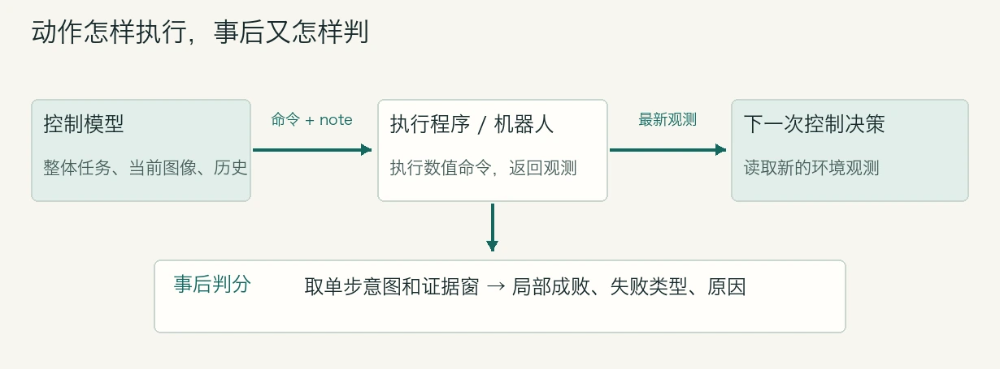
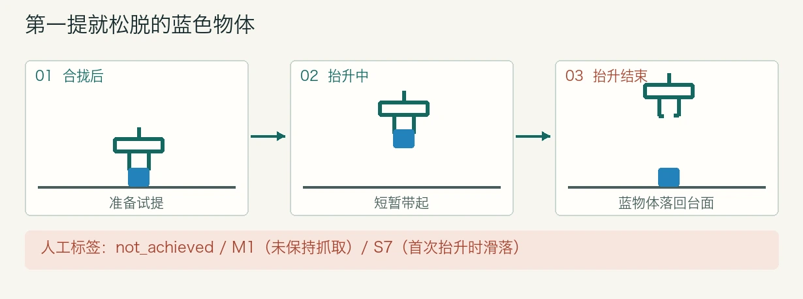
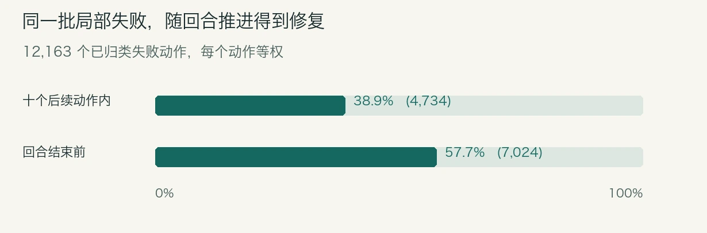
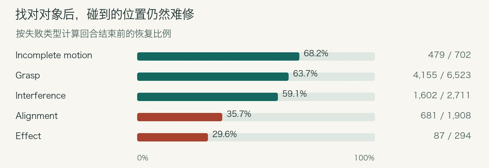
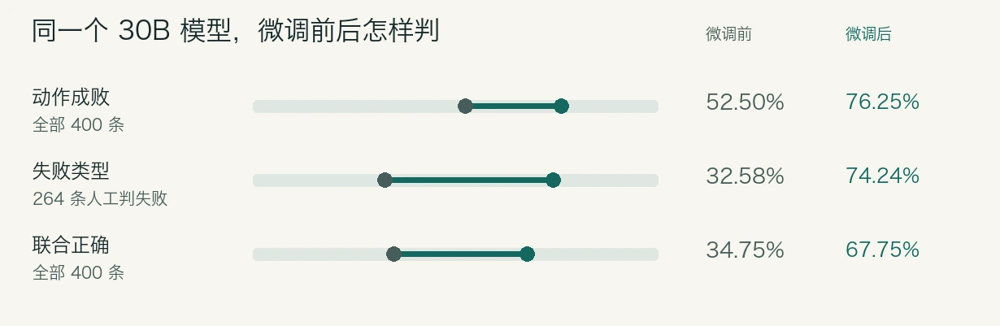

<link rel="stylesheet" href="/lib/papers/agentrobocritic/reading.css?v=1">

  
<iframe src="/lib/decks/agentrobocritic.html" title="AgentRoboCritic 图解，共 9 页" allow="fullscreen" loading="eager"></iframe>

  
9 页 · 按钮或方向键翻页<a href="/lib/decks/agentrobocritic.html">独立图解</a> · F 全屏 · Esc 退出

机械臂明明抬起来了，蓝色物体却还在桌上。如果这一回合最后拿到了满分，就很容易漏掉这次失手。AgentRoboCritic 记录模型每次发命令时想做到什么，再用动作前后的画面检查它有没有做到。Yiyang Du 等人用这套方法重新看了 GPT-6 Astra 在 12 套操作基准上的轨迹，另外训练了一个更便宜的模型来做事后判分。〔[论文 v1](https://arxiv.org/abs/2611.26613v1) · [项目页](https://adu2021.github.io/blog/AgentRoboCritic/) · [代码](https://github.com/cxcscmu/AgentRoboCritic/tree/d2f2708cabdc8cf9dcddc3a31c856b025d9d68b7)〕

### Part 0　模型在控制什么，论文在数什么

控制模型，也叫 **policy**，把任务、图像和已有交互记录变成下一段机器人动作。**直接控制（direct robot control）**指模型在工具调用中填入数值，例如调整夹爪位置、关节角或开合程度。执行程序再把这些目标交给机器人。像「抓起杯子」这样由一个现成技能包办接近、合夹和抬升的接口，属于另一种分工。

控制模型还要在同次调用的 <code>note</code> 里写下本步想看到的变化，这个前瞻性的目标叫 **局部意图（local intent）**。一次任务运行是一回合（episode）。文中计数的一条动作可以包含许多个仿真控制步。

**动作评审模型（critic）拿到该动作的任务、局部意图和画面，检查本步有没有做到，再给失败分类。** 一条「把夹爪降低到杯口」的动作可以达成，整回合仍可能因为后来抓空而失败。下面所有分数都要先确定是在数动作还是回合。

- **49.8% 的成功回合里出现过至少一次局部失败。** 在另外按失败动作计数的分析中，12,163 条失败里有 7,024 条能在回合结束前查到修复或绕过的证据。
- **失败类型准确率从 32.58% 升到 74.24%。** 这是 Muse-Glimmer-30B 经监督微调后的判分结果，分母是 264 条人工判失败的动作。
- **对齐比抓取更难补救。** 两类失败到回合结束时的恢复率分别是 35.7% 和 63.7%。这是动作级统计，不能直接读成某套基准的任务成功率。〔[Figure 5、Figure 7、Table 1](https://arxiv.org/html/2611.26613v1)〕

## 1. Motivation　一个回合分数说不清哪一步出了问题

同一个任务往往有多种做法。把橡皮从盒子里取出来，可以先用一只手固定盒盖，再用另一只手去拿。只看「橡皮还在盒子里」，无法判断固定盒盖这一步是否顺利。反过来，一次抓空即使后来被补救，也有诊断价值。

作者要求模型在执行前留下一个能靠观测核对的目标。下压、试探和正式插入于是可以有不同的判据。Figure 2 的任务是取出硬币并精确投入投币箱。模型这一步说要再降三毫米，夹住硬币露出的上部。评审从合夹画面和后续试提确认硬币没被带起，给出 Failed / Grasp，图中的人工结果也一致。夹爪看似合上，和实际夹住，是两份不同的证据。〔[§3.2、Figure 2](https://arxiv.org/html/2611.26613v1#S2.F2)〕

## 2. Related Work　控制能力和动作诊断可以分开测

几类相关工作都用到了机器人图像。区别要看图像给谁看、系统输出什么，以及最后用什么标签判分。〔[论文 §2](https://arxiv.org/html/2611.26613v1#S2)〕

<table><thead><tr><th scope="col">工作</th><th scope="col">输入和输出</th><th scope="col">依据什么判分</th></tr></thead><tbody>
<tr><td><a href="https://arxiv.org/abs/2610.27865">RoboColiseum / Agent2Act</a></td><td>不同通用模型用共用的工具接口读取观察、控制机器人</td><td>用共同任务配置比较控制能力，覆盖指令跟随、空间推理、操作、鲁棒性</td></tr>
<tr><td><a href="https://github.com/mll-lab-nu/embodied-first-exam/tree/487ba34ef5586a68762aeeae6142da0a67268e5e">Embodied First Exam</a></td><td>Coding agent 在给定模拟环境里写代码、执行并读取反馈</td><td>各套件用独立程序判断回合结果。AgentRoboCritic 的开源采集工具能在其 Standard 任务中收集动作意图</td></tr>
<tr><td><a href="https://aha-vlm.github.io/">AHA</a></td><td>通过扰动 RLBench 成功示范构造失败，训练模型解释失败</td><td>评估失败识别与解释，也将反馈接入下游操作流程</td></tr>
<tr><td><a href="https://arxiv.org/abs/2609.03611">FailBench</a></td><td>14 个公开来源的 2,197 次操作，含模拟与真机</td><td>以整次操作成功与否评判 VLM。接触密集组的 balanced accuracy 接近随机</td></tr>
<tr><td>AgentRoboCritic</td><td>从 Astra 轨迹截取一次已执行动作，保留动作前写下的意图和附近画面</td><td>对照该步的人工成败与失败类型，原基准的回合评分另用于分析</td></tr>
</tbody></table>

作者还将 Astra 和两种已训练的控制策略作零样本对照。**视觉语言动作模型（VLA）**从图像和指令输出低层控制量，本文的代表是 π0.5。**世界动作模型（WAM）**使用从视频里学到的动态规律来生成动作，文中选 InternW0-Δ。两种基线都未针对目标任务再训练，后来也没有用 AgentRoboCritic 给它们逐动作标分。论文的细粒度诊断来自 Astra 轨迹。〔[§3.1、§4.1](https://arxiv.org/html/2611.26613v1#S3)〕

## 3. Method　从工具调用到可以核对的动作判决

### 3.1 动作由谁发出，评审又能看到什么

模型读取整题指令、当前观测和交互历史，在调用里提交数值动作和 <code>note</code>。执行程序更新状态，返回观测，模型用它决定下一步。作者公开的 EFE 采集示例用 Codex + Harbor，在原有 Standard 任务上加一个采集层。<code>submit</code> 要有一条非空、至多 500 个字符的前瞻 note，客户端和服务端都会在执行前检查。采集层用原生调用 ID 把 note、命令、执行步数和图像接回同一条记录。这个示例说明公开实现怎样工作，12 个来源各自原有的工具格式仍然不同。〔[§3.1–3.2](https://arxiv.org/html/2611.26613v1#S3) · [采集代码说明](https://github.com/cxcscmu/AgentRoboCritic/blob/d2f2708cabdc8cf9dcddc3a31c856b025d9d68b7/efe/README.md)〕

<figure class="figure" id="action-loop">
可横向滑动或放大看图。

<figcaption>依据 Figure 2 和 §3.2 重绘。主实验的策略下一步读取环境观测，动作判分沿下面的路径独立进行。</figcaption></figure>

采集完后，作者将当前命令、执行状态、整体任务和局部意图送给另一次 GPT-6 Astra 调用，随请求附上多视角图片。接近或对齐通常能看动作前后两端。要验证合夹后物体是否真的被夹住，则要看随后的试提。后段画面可以佐证先前是否夹牢，评审仍须把两个动作本身的错误分开。回放、服务返回图像、当时实际给控制模型看的图像分别记来源。评审和人工标注者都看不到该回合的官方终局判分。〔[Appendix B、Figures 8–9](https://arxiv.org/html/2611.26613v1#A2)〕

评审输出四个 JSON 字段。<code>intent_success</code> 记录局部结果，<code>failure_mechanism</code> 记录失败类型，<code>m1_subcategory</code> 进一步说抓取在哪个阶段没保持，<code>failure_reason</code> 用一两句话说清看到了什么。常用的三个类型是夹不住或没保持（Grasp，M1）、物体还在手里但接触位置没对上（Alignment，M2）、碰撞或意外带动别的物体（Interference，M3）。按到自己意图里没选的对象叫 Choice（M7）。如果能确认没做到，但看不出原因，用 Unresolved（M6）。如果连成败都看不出来，则是 <code>unverifiable</code>。通用标注还允许部分完成和不适用，后者包含未执行、停止等记录。〔[Appendix A、J](https://arxiv.org/html/2611.26613v1#A1)〕

### 3.2 真实样本：命令执行完成，蓝色物体在第一次抬升时滑脱

公开测试集第 0 行来自 Meta-World+ 的 <code>shelf-place</code>，是 MuJoCo 中的 Sawyer 单臂 Standard 实例 i00。整题是拾取蓝色物体并放到架上目标处。本步的 note 要求用合拢的夹爪垂直抬升，确认物体离开桌面、仍被夹住。记录的是 <code>ee_delta</code> 命令，有 108 行、每行四项，控制间隔 12.5 毫秒。前 78 行包含向上的分量，后 30 行位移项为零。服务从第 205 步执行到 313 步，108 行都执行了，未裁剪。〔[公开检视行](https://huggingface.co/datasets/cx-cmu/AgentRoboCritic-Bench/viewer/default/test?row=0)〕

<figure class="figure" id="lift-case">
可横向滑动或放大看图。

<figcaption>按公开样本 <code>ARC-v0.3-f61a1c684a95fc33043ee2b7</code> 的观测与标签绘制的示意图。原始 22 帧可在测试集查看。</figcaption></figure>

如果物体在动作里随夹爪抬离桌面并保持住，本步就达成了。动作末尾的侧视图能看到夹爪已经升高、蓝色物体留在桌面。标注者把它判为 <code>not_achieved / M1 / S7</code>，即「未达成 / 抓取未保持 / 初次抬升滑落」。22 张输入图里有动作前、执行中、执行末的不同相机视角，部分画面正是为评审提供的采样证据。公开行保留人工标签，未附 Astra 对该行的实际回答或整回合终局。〔[固定版本测试集](https://huggingface.co/datasets/cx-cmu/AgentRoboCritic-Bench/tree/96ae1b4df10b9f3646e546af2e1f98536caa3091)〕

### 3.3 两套分母，三种准确率

发布的二分类测试集里，人工标记 136 条达成，264 条失败，共 400 条。网页标注工具展示任务、原 note 和经来源时间对齐的相机画面。人工决定成败、失败类型，Grasp 还写细类。评审推理只读 <code>messages</code> 和 <code>images</code>，脚本在推理后按样本 ID 取出独立的 <code>human_label</code>。〔[Appendix E–F](https://arxiv.org/html/2611.26613v1#A5) · [测试集卡片](https://huggingface.co/datasets/cx-cmu/AgentRoboCritic-Bench/blob/96ae1b4df10b9f3646e546af2e1f98536caa3091/README.md)〕

| 指标 | 分子怎么数 | 分母 |
| --- | --- | ---: |
| Outcome accuracy | 输出通过解析，且成败与人标一致 | 400 |
| Failure-mode accuracy | 在人标失败中，报为失败且 M 类正确 | 264 |
| Overall accuracy | 成败和 M 类同时正确，成功的 M 类应为空 | 400 |

脚本还报告 Cohen’s κ，将类别边际分布能解释的偶然一致扣掉，公式是（观察一致率 − 按边际计算的随机一致率）÷（1 − 随机一致率）。评审输出 JSON 解析不出或字段不合规则，该样本仍在分母内，按错误计。缺整条结果、样本 ID 重复等情况会中止这次评分。〔[官方 scoring.py](https://github.com/cxcscmu/AgentRoboCritic/blob/d2f2708cabdc8cf9dcddc3a31c856b025d9d68b7/src/agentrobocritic/scoring.py#L20-L100)〕

把上面的真实人工标签和几组示例回答代入官方脚本，<code>Failed / M1 / S7</code> 加合法原因能拿到三项正确，改成 <code>Failed / M2</code> 只拿到成败一项。填了合法的 S2，即使细类不等于 S7，联合分也仍然正确。原因内容和 S 细类没有准确率指标，只有格式约束。例如 M1 带了 S7 却把原因写成 <code>null</code>，会在解析时被判错。这里复算的是评分规则，示例回答由本文构造。〔[公开判分代码](https://github.com/cxcscmu/AgentRoboCritic/blob/d2f2708cabdc8cf9dcddc3a31c856b025d9d68b7/src/agentrobocritic/scoring.py#L63-L100)〕

### 3.4 先收控制轨迹，再训练独立评审

作者重新采集了 ContactBench 1.0、LIBERO-MAX、Meta-World+、DexJoCo、RoboWits、RoboTwin 2.0、YAMLab，另外接入 RoboDojo、StationeryBench、Astranomy、UniVTAC、OpenViTac 已发布的 Astra 轨迹。其中后两组触觉基准实际用的是只给视觉的设置。不同来源对「一次动作」的定义不同。RoboDojo 数一次已执行调用，StationeryBench 数物理 <code>move_to</code>，UniVTAC 和 OpenViTac 可以把同一 note 下的一块控制序列合算为一条。〔[§4、Appendix B](https://arxiv.org/html/2611.26613v1#A2)〕

12 套基准有多少回合、多少动作（Table 3）

<table><thead><tr><th scope="col">基准</th><th scope="col">回合数</th><th scope="col">回合成功 %</th><th scope="col">动作数</th><th scope="col">动作达成 %</th></tr></thead><tbody>
<tr><td>RoboDojo</td><td>2,100</td><td>22</td><td>105,429</td><td>77</td></tr>
<tr><td>StationeryBench</td><td>100</td><td>7</td><td>1,544</td><td>58</td></tr>
<tr><td>Astranomy</td><td>56</td><td>52</td><td>9,003</td><td>66</td></tr>
<tr><td>UniVTAC（仅视觉）</td><td>80</td><td>76</td><td>1,297</td><td>86</td></tr>
<tr><td>OpenViTac（仅视觉）</td><td>130</td><td>80</td><td>2,303</td><td>91</td></tr>
<tr><td>ContactBench 1.0</td><td>71</td><td>48</td><td>1,161</td><td>44</td></tr>
<tr><td>LIBERO-MAX</td><td>64</td><td>98</td><td>6,376</td><td>50</td></tr>
<tr><td>Meta-World+</td><td>50</td><td>98</td><td>581</td><td>81</td></tr>
<tr><td>DexJoCo</td><td>11</td><td>64</td><td>575</td><td>60</td></tr>
<tr><td>RoboWits</td><td>15</td><td>67</td><td>589</td><td>65</td></tr>
<tr><td>RoboTwin 2.0</td><td>47</td><td>91</td><td>705</td><td>72</td></tr>
<tr><td>YAMLab</td><td>10</td><td>90</td><td>406</td><td>66</td></tr>
</tbody></table>

回合成功率的分母是来源基准已给出分数的回合，动作达成率的分母是该套件全部已标注动作。对计数列求和是 2,734 回合、129,969 条动作，其中 RoboDojo 占动作数约 81.1%。按 <a href="https://arxiv.org/html/2611.26613v1#A2.T3">Table 3</a> 的数值重排。

做监督微调时，作者从 2,027 个回合里只取确实执行、有完整前后观测、且判为达成或失败的动作，每 1 条达成配 3 条失败。训练与验证的答案来自 GPT-6 Astra：把四字段 JSON 当作模型应生成的文本。作者冻结 Muse-Glimmer-30B 底座，只训练 rank 32 的 LoRA 参数。这是用教师回答做的监督微调（SFT），目标是让学生模型给出动作判断。论文只报告了评审的参数训练。控制实验复用已有策略，浇花反馈也通过提示带入。〔[Appendix F](https://arxiv.org/html/2611.26613v1#A6) · [模型卡](https://huggingface.co/cx-cmu/AgentRoboCritic-Muse-Glimmer-30B/blob/1de0a3f6a52c17417446d17346979a298c777a51/README.md)〕

按回合划分数据，防止一个回合的相邻画面同时出现在训练与测试里。论文的口径是训练 12,844，验证 1,548，测试池 1,936。人工标注的 400 条从测试池抽出，实际组成是 34% 达成和 66% 失败。公开仓库分别提供训练加验证的 14,392 条、人工 400 条、合并后的模型权重。〔[Table 9](https://arxiv.org/html/2611.26613v1#A6.T9) · [固定版本训练库](https://huggingface.co/datasets/cx-cmu/AgentRoboCritic-Dataset/tree/45c95b3c39d5372bab002256467345638e8e4a5f) · [模型与数据发布](https://huggingface.co/collections/cx-cmu/agentrobocritic)〕

训练与推理设置（Table 10）

Fireworks AI 上监督训练 2 个 epoch，batch size 32，最大上下文 65,536 token，峰值学习率 5×10−5，先暖身 25 步再做余弦衰减。评测温度为 0，最多生成 1,024 token。公开代码的 <code>muse</code> profile 支持跑合并权重，论文表格来自 Fireworks 上的同一 checkpoint。作者说明部署实现和供应商模型版本可能改变结果。〔<a href="https://arxiv.org/html/2611.26613v1#A6.T10">Table 10</a> · <a href="https://github.com/cxcscmu/AgentRoboCritic/tree/d2f2708cabdc8cf9dcddc3a31c856b025d9d68b7#fine-tuned-critic-on-gpus">公开配置</a>〕

## 4. Experiments　模型怎样纠错，评审又判得多准

### 4.1 看到失败之后，重新操作能挽回多少

Figure 12 里，Astra 要叠三块积木。它先降到紫块旁，夹爪在积木前面合上，没把它夹住。接着打开夹爪、后移、重新下降并合夹。直到画面里紫块跟着抬起，这次恢复才得到确认。绕路也可以算恢复。附录中有一次没抓到杯中的球，模型改为连杯带球抬起，仍然为随后的倾倒做好准备。若只抬起空夹爪，即使满足后一步的狭义移动意图，也不会消除先前的抓取失败。〔[Appendix C、Figure 12](https://arxiv.org/html/2611.26613v1#A7.F12)〕

<figure class="figure" id="recoveries">
可横向滑动或放大看图。

<figcaption>按 Figure 5(c) 和 Appendix C 的计数重绘。同一批动作的两个累计时点，百分比不可相加。</figcaption></figure>

作者在 1,989 个官方给出分数且出现过失败的回合里，逐条追踪 12,163 个已归类失败动作。首次验证恢复距离原失败不超过十个动作的有 4,734 条，回合结束前有 7,024 条，即 7,024 ÷ 12,163 ≈ 57.7%。其中 6,435 条被直接修复，589 条通过换路绕过。最后一个动作的失败也留在分母里。如果连续两抓都没抓到同一个物体，后面一次抓成功可以让两条失败都记为已恢复。作者独立复看了 24 条，21 条对是否发生恢复的判断一致。〔[Figure 5、Appendix C](https://arxiv.org/html/2611.26613v1#A3)〕

分组方法会改变读法。成功回合中有 49.8% 遇到过失败，不能据此把其中每次失手都计成已修复。按所含失败数分组，0、1–2、至少 3 次失败的回合成功率为 75.1%、40.3%、13.3%。另一方面，57.7% 是逐失败动作等权，RoboDojo 一套占其中 9,923 条。若先按回合算比例再让每个回合等权，是 60.7%。若每套基准等权，是 63.7%。跨基准恢复率和成功率的 Pearson r 为 0.81，这组相关性也会随任务和评分规则而变。〔[Table 4、Table 5](https://arxiv.org/html/2611.26613v1#A3.T4)〕

### 4.2 夹持、对齐与接触，难处随任务而变

在十套非触觉基准中，九套最常见的失败都在抓取。只看视觉的 UniVTAC 和 OpenViTac 里，对齐占已归类失败的 75% 和 86%。这类任务常能拿稳连接件，却难从 RGB 图判断插入所需的角度和毫米级间隙。LIBERO-MAX 的 Incomplete Motion 占 57%，提示任务脚本和动作单位也会影响某一类错误有多少。〔[Figure 4、Table 7](https://arxiv.org/html/2611.26613v1#A4.T7)〕

<figure class="figure" id="recovery-modes">
可横向滑动或放大看图。

<figcaption>按 Figure 7(a) 与 Appendix C 重绘主要五类。原图另有 Wilson 95% 区间，小样本 Choice 和 Unresolved 的计数见原附录。</figcaption></figure>

抓取失败大多发生在合夹时，图中四个合夹项合计 **61.4%**。最常见的是只捏边缘或尖端（25.7%）、夹在物体旁（18.8%）。回合结束前，抓取错误能恢复 4,155/6,523，约 63.7%。对齐只有 681/1,908，约 35.7%，即便再给更多动作，曲线到三十步后也基本走平。回放能找出哪里没对上，无法从画面直接辨认究竟是力、摩擦、控制器还是标定造成的。〔[Figure 7、Figure 10、Appendix J](https://arxiv.org/html/2611.26613v1#S4.F7)〕

### 4.3 400 条人工标注能校准到哪一步

在原始人工标签上，GPT-6 Astra 判对 317/400 条动作成败，213/264 条失败类型，联合正确 285/400。拿掉局部意图后，成败降到 25.25%，失败类型降到 25.00%，许多动作被标成不可验证。这个消融改变的是**评审收到的信息**。附录另比了控制时是否要求写 note，在双方覆盖的 76 个 EFE Standard 实例上，两组各成功 42 个。这一结果只能说明总数相同，论文没有给出两边逐题是否一致。〔[Table 1](https://arxiv.org/html/2611.26613v1#S5.T1) · [Appendix H.2](https://arxiv.org/html/2611.26613v1#A8.SS2)〕

<figure class="figure" id="critic-sft">
可横向滑动或放大看图。

<figcaption>按 Table 1 重绘 Muse-Glimmer-30B 的三项准确率。失败类型从答对 86 条变成 196 条，分母是人工判失败的 264 条。</figcaption></figure>

这组评测对原模型并不宽松，用合法格式把全部动作都判成失败，就能拿到 66% 的成败准确率，高于基础 Muse 的 52.50%。微调后，Muse 的成败为 76.25%，联合为 67.75%，超过其他对比的开源模型。在同一批 400 条上，论文报告 Astra 推理花费 $26.06，微调 Muse 为 $0.79，按这次报价约是三十三分之一。表中的金额取决于当时的部署和输出，并未把自部署硬件和评审训练计入。〔[Table 1](https://arxiv.org/html/2611.26613v1#S5.T1)〕

全部动作评审模型、κ 与花费（Table 1）

<table><thead><tr><th scope="col">评审模型</th><th scope="col">成败 %</th><th scope="col">成败 κ</th><th scope="col">失败类型 %</th><th scope="col">失败类型 κ</th><th scope="col">联合 %</th><th scope="col">成本 USD</th></tr></thead><tbody>
<tr><td class="arc-keep">GPT-6 Astra</td><td>79.25</td><td>0.497</td><td>80.68</td><td>0.600</td><td>71.25</td><td>26.06</td></tr>
<tr><td class="arc-keep">GPT-6 Astra，去局部意图</td><td>25.25</td><td>0.102</td><td>25.00</td><td>0.078</td><td>24.50</td><td>25.18</td></tr>
<tr><td class="arc-keep">GPT-6.1 Sol</td><td>74.50</td><td>0.487</td><td>62.12</td><td>0.314</td><td>69.75</td><td>5.00</td></tr>
<tr><td class="arc-keep">GPT-6.1 Terra</td><td>74.50</td><td>0.470</td><td>61.36</td><td>0.303</td><td>66.75</td><td>2.36</td></tr>
<tr><td class="arc-keep">Claude Fable 5.2</td><td>78.25</td><td>0.523</td><td>72.73</td><td>0.468</td><td>71.00</td><td>26.52</td></tr>
<tr><td class="arc-keep">Claude Opus 5.5</td><td>72.50</td><td>0.434</td><td>60.98</td><td>0.323</td><td>66.00</td><td>12.76</td></tr>
<tr><td class="arc-keep">Claude Sonnet 5.5</td><td>56.75</td><td>0.223</td><td>32.58</td><td>0.120</td><td>50.75</td><td>5.51</td></tr>
<tr><td class="arc-keep">Kimi K3.1 Pro</td><td>54.50</td><td>0.211</td><td>32.20</td><td>0.118</td><td>52.50</td><td>9.06</td></tr>
<tr><td class="arc-keep">DeepSeek-V4.1-Flash-1017</td><td>54.50</td><td>0.202</td><td>32.95</td><td>0.118</td><td>52.00</td><td>1.96</td></tr>
<tr><td class="arc-keep">GLM-5.3-Flash</td><td>62.00</td><td>0.310</td><td>42.80</td><td>0.177</td><td>58.25</td><td>0.97</td></tr>
<tr><td class="arc-keep">Muse-Glimmer-30B，零样本</td><td>52.50</td><td>0.144</td><td>32.58</td><td>0.122</td><td>34.75</td><td>1.34</td></tr>
<tr><td class="arc-keep">Muse-Glimmer-30B，微调后</td><td>76.25</td><td>0.444</td><td>74.24</td><td>0.484</td><td>67.75</td><td>0.79</td></tr>
</tbody></table>

数值取自 <a href="https://arxiv.org/html/2611.26613v1#S5.T1">Table 1</a>，按 400 条人标数据评估。本文未重新调用表中模型。

### 4.4 零样本对照漏不掉的代价是等待

Figure 6 的 RoboTwin 2.0 上，Astra、π0.5、InternW0-Δ 的回合成功率分别为 91%、6%、0%，YAMLab 上为 90%、0%、0%。图中没有为各对照行标出完整分母或区间，两边都没做任务适配。另在五套 EFE 中，从两边都有分数的实例做配对，Astra 与 π0.5 的合并成功率是 89% 和 4%。这些结果描述的是作者选定的零样本配置。〔[Figure 6、Appendix H.3](https://arxiv.org/html/2611.26613v1#A8.SS3)〕

在有双边时序记录的 74 个匹配任务中，观察请求完成到提交下一条已执行动作的间隔，中间包含只读工具调用。每次运行先取间隔中位数，再在任务间取中位。Astra 是 **31.9 秒**，π0.5 是 **0.110 秒**，相差约 290 倍。机器人每个控制步本身有它的物理时间，这个数字量的是两次决策之间等多久。〔[Table 12、Appendix H.4](https://arxiv.org/html/2611.26613v1#A8.T12)〕

## 5. Discussion　回放能指出失手，反馈能否改变下一次

### 5.1 附录确实把诊断交回了控制模型

DexJoCo 的 <code>water-plant</code> Standard i00 中，原始 Astra 超时。两个重试使用同一冻结的 Astra、同一初态和种子，都给上一次失败的通知和三条历史意图。反馈组另外读到三条动作诊断。其中一条指出，瓶子虽然转动过，喷嘴仍然背着植物。对照重试在喷嘴朝外时就扣动了扳机。反馈重试最后把喷壶的硬瓶颈推向植物，让喷嘴进入有效区，原生任务评分给了 1。〔[Appendix H.1、Figures 14–15](https://arxiv.org/html/2611.26613v1#A8.SS1)〕

<table><thead><tr><th scope="col">运行</th><th scope="col">原生分数</th><th scope="col">结束状态</th><th scope="col">模拟器调用</th><th scope="col">控制步</th></tr></thead><tbody>
<tr><td>原运行</td><td>0</td><td>超时</td><td>68</td><td>10,150</td></tr>
<tr><td>仅历史意图</td><td>0</td><td>朝外扣扳机</td><td>12</td><td>575</td></tr>
<tr><td>历史意图加诊断</td><td>1</td><td>成功</td><td>164</td><td>12,536</td></tr>
</tbody></table>

这是一个跨次重试的案例，说明上一回合的诊断可以作为下一回合的提示。两组实际跑了很不一样的执行步数，单次比较回答不了平均提升多少、是否省动作，也无法测出在同一次回合里把评审逐步接回去的收益。一个有用的后续对照会固定每题预算和观测，跨多初态运行「只读环境」「加上次诊断」「当场加诊断」三种设置，再用原生终局评分及错误阶段分别核对。〔[Table 11](https://arxiv.org/html/2611.26613v1#A8.T11)〕

### 5.2 局部意图可信，才能从局部错误推全局能力

作者统计到 Choice 约占已归类失败的 0.2%。这类标签检查动作是否执行**模型自己写下的选择**。假如任务要求按 3，note 写的是按 7，模型实际也按了 7，那么这一步可以局部达成，任务仍然理解错了。代码手册还说保留的 RoboDojo-Precision 配置不评 M7。由此可以说低层动作很少明显违背它所声明的目标。要估计全局选错目标的频率，还需要一组按照任务原始要求审查意图的标签。〔[Figure 4、Appendix J 的 M7 定义](https://arxiv.org/html/2611.26613v1#A10)〕

另一处依赖是 Astra 既产生动作，也给主分析标注。264 个人工失败中，Astra 只把 19 个错标成成功，Claude Fable 5.2 错标 75 个。这个对照支持「Astra 在这批自己的失败上较严格」。所有控制轨迹仍来自 Astra，作者没有用多策略互相评分去隔离自偏好。作者还复看了 Astra 与人初始标签不一致的动作，把允许多种解释的部分算为可接受后，一致率超过 90%。这属于对分歧的复核，固定标签比较仍应读 Table 1。论文未报告标注员总数、完整的人对人一致性或 400 条按来源的抽样分布。闭源策略训练语料是否见过类似任务也无法独立核验。〔[§5、Appendix E、I](https://arxiv.org/html/2611.26613v1#A9)〕

## 6. Conclusion　更便宜地定位操作轨迹中的失手

论文已经测实的是单步判分。作者让策略事前写下可验证的动作目标，再用真实执行画面判断能否保持抓取、是否成功对齐，并把 Astra 写的标签教给一个成本更低的视觉语言模型。固定的人工测试中，它对失败类型的判断从 86/264 升到 196/264。这些标签可以帮助挑出值得回看的回放。换策略、换相机或用作机器人在线反馈时，还得用独立数据检查这种诊断是否仍然准确，以及是否带来更多完成的任务。〔[论文与附录](https://arxiv.org/html/2611.26613v1)〕

图示为本文依据原文流程、数值及带标签样本自绘。arXiv 条目仅授予其非独占分发权。代码、模型和数据标注有各自许可，测试集图像仍随源基准的许可。原图及 400 条带标签动作可在 <a href="https://arxiv.org/pdf/2611.26613v1">原论文</a> 与 <a href="https://huggingface.co/datasets/cx-cmu/AgentRoboCritic-Bench">原数据集</a> 查看。

