<link rel="stylesheet" href="/lib/papers/harness-s/reading.css?v=1">

  
<iframe src="/lib/decks/harness-s.html" title="Harness-S 图解，共 12 页" allow="fullscreen" loading="eager"></iframe>

  
12 页 · 按钮或方向键翻页<a href="/lib/decks/harness-s.html">独立图解</a> · F 全屏 · Esc 退出

AppWorld 有道题，要把喜欢过、同时出现在曲库或歌单里的歌曲发出去。作者记录的一次训练里，模型用原框架试了八次，全失败。换框架重跑时，其中变体 H₂ 产生了一条成功轨迹。这次执行参与了训练。后来遇到一组新的歌曲，训练后的模型换回原框架，仍能取对集合并发出邮件。Kangning Zhang 等人用这个例子追问，训练时根据额外提醒做对的操作，部署时用原框架还会不会做。 [论文 v1](https://arxiv.org/abs/2611.04277v1) · [Table 4](https://arxiv.org/html/2611.04277v1#S4.T4) · [代码](https://github.com/DeepExperience/Harness-S/tree/93f5d8a81ad8bfaa0c50b9f9710c49b693c7f2a0)

### Part 0　模型和执行框架各管什么

**执行框架（harness）把指令和工具结果交给模型，再执行模型发出的调用。** 在这里，框架还能决定何时插入提示，给模型看哪些工具，以及怎样组织上下文。**策略（policy）是负责生成下一段文本和工具调用的模型。** 同一份模型权重可以在不同框架里运行。作者把基于 DeepSeek Harness 的原始配置记为 H₀，把从它分出来的改版称作 **同源框架（sibling harnesses）**。每个变体都使用相同的任务环境接口与判题程序。一条 **rollout** 是模型从题目初始状态到提交、终止或用完预算的一次完整尝试。 [论文 §3.1](https://arxiv.org/html/2611.04277v1#S3.SS1)

## 1. Motivation　为什么留下一批各有用处的框架

比如，模型拿到的工具结果带有分页信息，原来只读第一页就停。框架可以在工具返回后插入提醒，要求读到空页、短页或有可信总数时再停止。这个改动可以挽回漏页的题。到了步骤本来就紧张的题，多翻几页也可能影响最终提交。原论文 Table 7 记录了分页提醒的配置和一次配对结果，发布版的同类提醒在工具返回后触发。 [Table 7](https://arxiv.org/html/2611.04277v1#A4.T7) · [公开分页配置](https://github.com/DeepExperience/Harness-S/blob/93f5d8a81ad8bfaa0c50b9f9710c49b693c7f2a0/harness_pool/appworld/pool-62f4d3bd6fc300ab/state.json#L62-L69)

Figure 1 把这些变化算到了题上。AppWorld 里 H₁ 相对 H₀ 修好 26 题，同时丢掉 11 道原来做对的题。四套变体各跑一次，事后取成功题的并集，覆盖率是 **65.65%**，H₀ 重跑四次是 **44.66%**。等模型训练到第 20 步，H₁ 相对同期 H₀ 的净差又从 +15 变成 −4。并集依赖事后结果，表示这几个框架在该次实验中有多少题互补。 [Figure 1](https://arxiv.org/html/2611.04277v1#S1.F1)

<figure class="figure hs-figure" id="hs-figure-1">
  
<a href="/lib/papers/harness-s/figure-1.webp">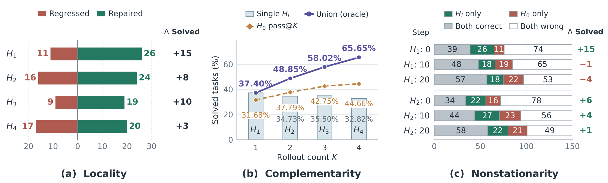</a>

  <figcaption>局部修复、不同框架的成功题并集，以及效果随训练步数的变化。 <a href="https://arxiv.org/html/2611.04277v1#S1.F1">原论文 Figure 1</a> · Zhang et al. · <a href="https://creativecommons.org/licenses/by/4.0/">CC BY 4.0</a></figcaption>
</figure>

## 2. Related Work　优化框架与训练模型用的是哪批轨迹

**Meta-Harness** 在模型固定时，给编辑器以前的框架实现、分数和执行记录，让它继续改框架代码，最终用选中的框架跑测试。**Harness-R1** 还训练负责改框架的编辑策略，从改动执行后的分数学习。Harness-S 则把离线改出的框架保留为候选，训练负责做题的同一份模型权重。 [Harness-S §2.1](https://arxiv.org/html/2611.04277v1#S2.SS1) · [Harness-R1](https://arxiv.org/abs/2608.02276)

**WHALE** 交替做框架搜索和成功轨迹的拒绝采样微调。**HarnessX** 把不同框架、不同策略版本的经历放进共享回放池，按任务组做跨框架 GRPO。**HarnessBandit** 以优化步为单位挑选一个框架，依据是当下可学性和跨框架梯度迁移信号。Harness-S 把选择下沉到**某一道在 H₀ 全失败的题**。多套框架只为这一题重新采样，参与更新的轨迹由当前策略新生成。WHALE、Meta-Harness 等在论文主表中使用各自选定的测试框架。解释策略收益时，更直接的对照是都回到 H₀ 的几种 GRPO。 [论文 §2.2](https://arxiv.org/html/2611.04277v1#S2.SS2) · [Appendix C](https://arxiv.org/html/2611.04277v1#A3) · [Appendix H](https://arxiv.org/html/2611.04277v1#A8)

## 3. Method　八次全失败后才换框架

### 3.1 先看失败，再改能影响那一步的配置

AppWorld 的离线搜索固定 Qwen3.5-4B Base。作者从 320 道训练题里取失败轨迹，找最早能解释判题失败的决定或工具结果，把重复发生的问题归到一起。每个候选改版针对 2–3 个相关原因，每个原因至少有两个失败题支持。GLM-5.3 拿到父框架和记录，可以改提示、技能、上下文、记忆、事件提醒或工具呈现。候选最多用 30 题局部试跑，其中至多 10 题是原来做得对的控制题。它可以根据执行反馈改一次，得分由环境给出。 [论文 §3.2](https://arxiv.org/html/2611.04277v1#S3.SS2) · [Appendix F、Table 8](https://arxiv.org/html/2611.04277v1#A6)

搜索做三轮，提案预算是 7、8、8。通过协议与可执行性检查的子框架都进入池子。为了决定下一轮从哪些框架继续改，作者在验证集上选最多四个父框架，目标是让它们合计覆盖尽量多的成功题。一道题被三套都做对，覆盖里也只加一。论文训练时的路由池有 H₀ 和 19 个辅助框架。训练开始后，候选的实现固定。 [公式 (2)–(4)](https://arxiv.org/pdf/2611.04277v1#page=5) · [Appendix C、F](https://arxiv.org/html/2611.04277v1#A3)

<figure class="figure hs-figure" id="hs-figure-2">
  
<a href="/lib/papers/harness-s/figure-2.webp">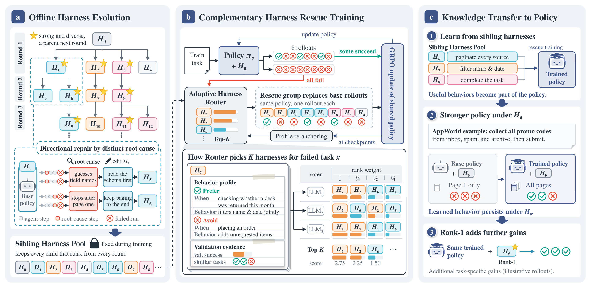</a>

  <figcaption>离线构建框架池，训练时重跑失败组，最后分别用 H₀ 和路由评估。 <a href="https://arxiv.org/html/2611.04277v1#S1.F2">原论文 Figure 2</a> · Zhang et al. · <a href="https://creativecommons.org/licenses/by/4.0/">CC BY 4.0</a> · <a href="https://github.com/DeepExperience/Harness-S/blob/93f5d8a81ad8bfaa0c50b9f9710c49b693c7f2a0/docs/figures/method_framework_text.png">作者发布的清晰图源</a></figcaption>
</figure>

三个配置修改与离线搜索预算（Tables 7–8）

<figure class="figure hs-figure" id="hs-table-7">
  
<a href="/lib/papers/harness-s/table-7.webp">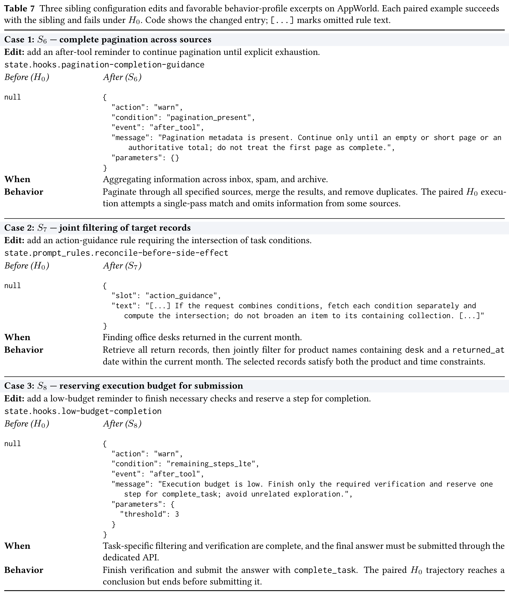</a>

  <figcaption>续翻分页、取交集和保留最后提交步的完整配置节选。 <a href="https://arxiv.org/html/2611.04277v1#A4.T7">原论文 Table 7</a> · Zhang et al. · <a href="https://creativecommons.org/licenses/by/4.0/">CC BY 4.0</a></figcaption>
</figure>
<figure class="figure hs-figure" id="hs-table-8">
  
<a href="/lib/papers/harness-s/table-8.webp">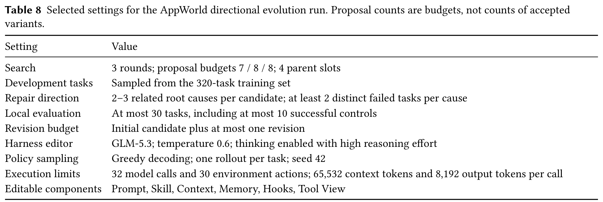</a>

  <figcaption>三轮搜索、编辑模型和单次执行预算。 <a href="https://arxiv.org/html/2611.04277v1#A6.T8">原论文 Table 8</a> · Zhang et al. · <a href="https://creativecommons.org/licenses/by/4.0/">CC BY 4.0</a></figcaption>
</figure>

### 3.2 同一模型重跑，优化器只收到保留的八条

**救援训练（Complementary Harness Rescue Training）只给在 H₀ 八次都失败的题换框架重跑。** H₀ 只要有一条成功，整组原样保留。如果八条都是 0，路由器选八个不同的辅助框架，排除 H₀。当前策略在每个框架里从题目初态独立跑一次，形成新组。**这八条整组替换原来的八条**，哪怕新组也全败。新组里成功和失败的尝试都随组进入训练。代码为救援清掉旧 session 和轨迹父节点，保留题目与组的标识，并使用另一路采样随机种子。 [公式 (5)、Algorithm 1](https://arxiv.org/html/2611.04277v1#alg1) · [公开替换逻辑](https://github.com/DeepExperience/Harness-S/blob/93f5d8a81ad8bfaa0c50b9f9710c49b693c7f2a0/src/harness_s/rescue.py#L27-L55)

**GRPO 先在同一道题内用终局奖励计算每条轨迹的相对优势。** 一组八条都是 0，减去组均值后仍全是 0。举个用于复算的例子，假设新组有两条成功、六条失败。奖励的均值为 0.25，总体标准差约 0.433。两条成功的初始优势各约 +1.73，六条失败的各约 −0.58。一个组同时出现 0 和 1，才有这个成败信号。全成功的组也没有组内差异。这里的二成功只是演算，原文歌曲案例没有公开完整的救援奖励向量。 [公式 (6)](https://arxiv.org/pdf/2611.04277v1#page=5) · [Appendix B](https://arxiv.org/html/2611.04277v1#A2)

更新时，优化器用每个 token 当初生成时实际看到的框架上下文，计算新旧策略的概率比。框架插入的提示和工具观察作为条件输入，只有策略自己生成的 token 进入损失。论文先在每题内按有效策略 token 平均，再对题取平均，并截断校正采样与训练后端的概率差。主训练是从 Qwen3.5 Base 开始的**在线采样强化学习**，目标为共享的 GRPO，没有参考模型 KL 项。GLM-5.3 的角色是离线框架编辑器，路由 LLM 给框架排序。训练奖励来自任务判题程序。 [公式 (7)](https://arxiv.org/pdf/2611.04277v1#page=5) · [Appendix B、F](https://arxiv.org/html/2611.04277v1#A2)

原论文的训练循环（Algorithm 1）

<figure class="figure hs-figure" id="hs-algorithm-1">
  
<a href="/lib/papers/harness-s/algorithm-1.webp">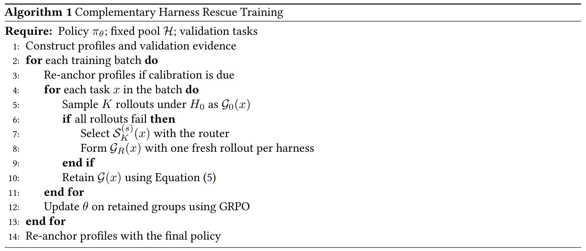</a>

  <figcaption>原论文的救援采样、保留分组、GRPO 与画像更新顺序。 <a href="https://arxiv.org/html/2611.04277v1#alg1">原论文 Algorithm 1</a> · Zhang et al. · <a href="https://creativecommons.org/licenses/by/4.0/">CC BY 4.0</a></figcaption>
</figure>

### 3.3 让路由读取验证证据，训练中定期刷新

**行为画像（Harness Behavior Profile）记录某个变体在哪类题上会带出哪种行为。** 作者冻结当前模型，用 H₀ 和每个变体做同一道验证题，任务初态和执行预算相同。另一次 LLM 调用读配对的轨迹，把差异写成 <code>When</code> 和 <code>Behavior</code>，分别放进适用与不适用的列表。比如「查本月退回的办公桌」对应「同时按品名和退回日期筛选」。这个画像描述的是整套变体的表现，未对其中某一条修改做单独因果归因。 [论文 §3.4](https://arxiv.org/html/2611.04277v1#S3.SS4) · [Appendix D](https://arxiv.org/html/2611.04277v1#A4)

路由时，每个投票 LLM 读取题面、候选画像、验证成功率和相似验证题的结果。每票排四个框架，按名次加 1、0.75、0.5 和 0.25 分，未提名计 0。平分看验证成功率，再按框架 ID 决定。Figure 2b 的示意票里，H₇ 得到两张第一和一张第二，合计 2.75。训练版本每题取前八。AppWorld 4B 在训练前、每十步更新和最终点重新配对采集验证记录。路由证据只从训练期间的验证跑批更新。论文交代了票的计分规则，没有列出主实验所用的各个投票模型。 [公式 (8)–(11)](https://arxiv.org/html/2611.04277v1#S3.SS4) · [Appendix C](https://arxiv.org/html/2611.04277v1#A3)

### 3.4 追一题，错在多发了歌

训练题的条件可写成「喜欢的歌曲 ∩（曲库里的歌曲 ∪ 歌单里的歌曲）」。八次 H₀ 执行都失败。公开的训练摘要记录，H₂ 的一次救援取对交集，更新并发送草稿。这次成功执行被用于第 10 次更新。换到留出的测试实例后，普通 GRPO 在 H₀ 里把喜欢的歌与另外的来源取并集，发多了。Harness-S 的同等规模模型也在 H₀ 里做题，取对交集，发了正确邮件。另一个留出案例是从训练里的 Venmo 恢复流程迁到验证集的 Amazon 任务，模型多做了实际状态变更与回读确认。 [Table 4](https://arxiv.org/html/2611.04277v1#S4.T4)

<figure class="figure hs-figure" id="hs-table-4">
  
<a href="/lib/papers/harness-s/table-4.webp">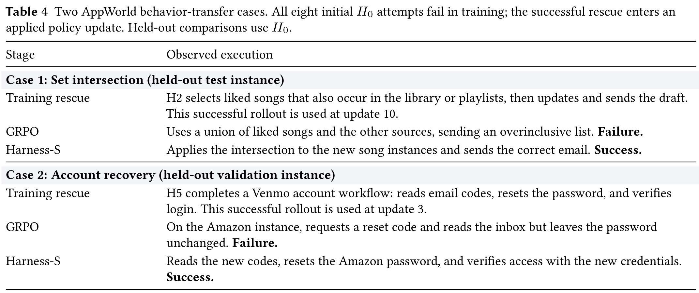</a>

  <figcaption>歌曲筛选与帐号恢复的训练救援和留出实例。 <a href="https://arxiv.org/html/2611.04277v1#S4.T4">原论文 Table 4</a> · Zhang et al. · <a href="https://creativecommons.org/licenses/by/4.0/">CC BY 4.0</a></figcaption>
</figure>

在公开 AppWorld 执行器中，模型可以在隔离的 AppWorld 任务里调用 <code>execute</code>，读取代码输出，再继续调用应用 API。宿主端重播动作后调用 AppWorld 的 <code>world.evaluate()</code>，读任务专有检查的终局成败。评估代码留在宿主侧，实时工具返回不给模型看。调试报告可列出通过检查的比例，救援分组读取的是严格的二值终局奖励。Table 4 只公布了这两例的轨迹摘要和成败，代码库公开任务拆分和执行器，歌曲案例的具体 ID、完整执行记录和专有断言在两处资料中都未给出。 [AppWorld 上游](https://github.com/StonyBrookNLP/appworld) · [回放与评估入口](https://github.com/DeepExperience/Harness-S/blob/93f5d8a81ad8bfaa0c50b9f9710c49b693c7f2a0/runtime/appworld/mcp_server.py#L382-L418) · [分组读取二值奖励](https://github.com/DeepExperience/Harness-S/blob/93f5d8a81ad8bfaa0c50b9f9710c49b693c7f2a0/src/harness_s/rescue.py#L9-L24)

## 4. Experiments　先比较都回到 H₀ 的成绩

### 4.1 训练、验证、测试分别用哪些题

作者测 Qwen3.5-4B 和 9B。AppWorld 使用模拟应用的 API 任务，SWE-Gym 是代码库问题修复，DBBench 考数据库操作。三套的训练 / 验证 / 测试题数分别是 **320 / 150 / 262**、**240 / 100 / 160**、**1,600 / 200 / 300**。每次测试每题执行三次。**Pass@3 数至少做对一次的题占多少。Avg@3 数全部尝试中有多少成功。** 例如一题的结果为 1、0、0，对两个指标分别贡献 1 和 1/3。主表取三次独立随机运行的均值，Harness-S 的 ± 是三次运行之间的标准差。 [Table 1](https://arxiv.org/html/2611.04277v1#S3.T1) · [Appendices A、C](https://arxiv.org/html/2611.04277v1#A1)

公开 AppWorld 清单按任务 ID 互斥地重划 732 个实例，测试集的 174 个任务族中，109 个在训练里有其他实例，65 个没在训练里出现。留出新实例和留出整个任务族是两个强度不同的测试。主表使用全测试集，按新旧任务族各自测得多少收益，论文没有分开报告。 [发布版拆分清单](https://github.com/DeepExperience/Harness-S/blob/93f5d8a81ad8bfaa0c50b9f9710c49b693c7f2a0/data/appworld/manifest.json)

完整任务拆分（Table 6）

<figure class="figure hs-figure" id="hs-table-6">
  
<a href="/lib/papers/harness-s/table-6.webp">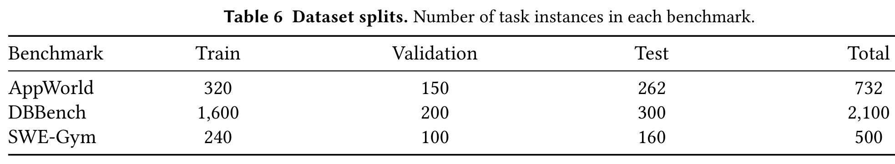</a>

  <figcaption>三套评测的训练、验证和测试任务数。 <a href="https://arxiv.org/html/2611.04277v1#A1.T6">原论文 Table 6</a> · Zhang et al. · <a href="https://creativecommons.org/licenses/by/4.0/">CC BY 4.0</a></figcaption>
</figure>

### 4.2 同一原框架，平均每次尝试多做对多少

以下都是 H₀ 下的 Avg@3，单位是百分比。H₀ rescue 和 Harness-S 都在原组全败时额外试八次，前者继续用 H₀。 [Table 1](https://arxiv.org/html/2611.04277v1#S3.T1)

<table><thead><tr><th scope="col">模型</th><th scope="col">基准</th><th scope="col">普通 GRPO</th><th scope="col">H₀ rescue</th><th scope="col">Harness-S</th><th scope="col">较普通 GRPO</th></tr></thead><tbody>
<tr><td>4B</td><td>AppWorld</td><td>48.98</td><td>51.91</td><td>56.87 ± 1.47</td><td>+7.89</td></tr>
<tr><td>4B</td><td>SWE-Gym</td><td>22.50</td><td>23.33</td><td>28.75 ± 1.73</td><td>+6.25</td></tr>
<tr><td>4B</td><td>DBBench</td><td>64.00</td><td>64.67</td><td>71.00 ± 1.84</td><td>+7.00</td></tr>
<tr><td>9B</td><td>AppWorld</td><td>53.31</td><td>54.83</td><td>62.34 ± 1.28</td><td>+9.03</td></tr>
<tr><td>9B</td><td>SWE-Gym</td><td>25.63</td><td>26.88</td><td>32.50 ± 1.51</td><td>+6.87</td></tr>
<tr><td>9B</td><td>DBBench</td><td>67.00</td><td>67.78</td><td>73.44 ± 1.67</td><td>+6.44</td></tr>
</tbody></table>

Pass@3 的差额也保留。例如 SWE-Gym 4B 从普通 GRPO 的 24.38% 升到 38.75%，H₀ rescue 为 25.63%。把 **同一个 Harness-S 检查点** 改为 Rank-1 推理后是 42.50%。训练时遇到全败会换框架补跑。Rank-1 测试在模型执行前只选一次，候选包含 H₀，接下来三次尝试都用选中的框架。路由多出的调用和准备画像的开销不包含在三次执行的分母内。 [Table 1](https://arxiv.org/html/2611.04277v1#S3.T1) · [Appendix C](https://arxiv.org/html/2611.04277v1#A3)

完整主表，含 Pass@3、模型对照与两种部署方式（Table 1）

<figure class="figure hs-figure" id="hs-table-1">
  
<a href="/lib/papers/harness-s/table-1.webp">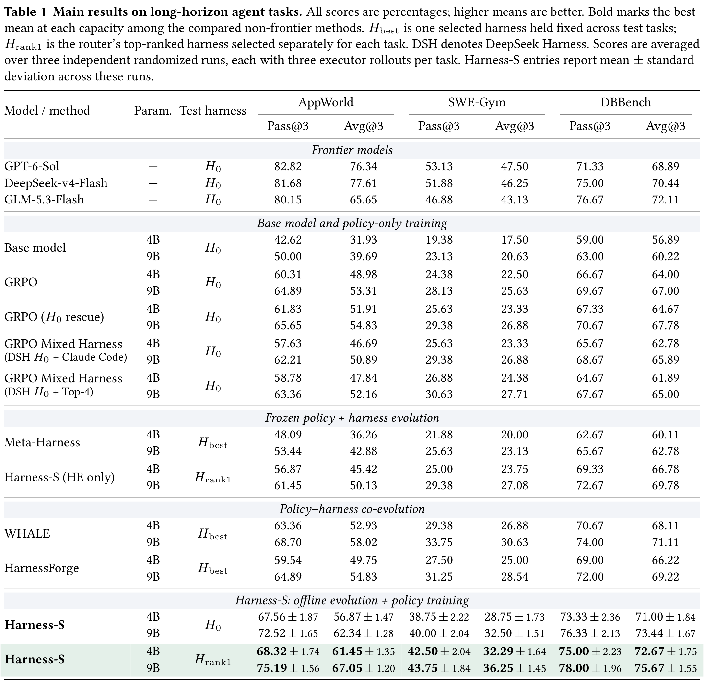</a>

  <figcaption>三套基准中完整的模型与框架对照，含 Pass@3 和 Avg@3。 <a href="https://arxiv.org/html/2611.04277v1#S3.T1">原论文 Table 1</a> · Zhang et al. · <a href="https://creativecommons.org/licenses/by/4.0/">CC BY 4.0</a></figcaption>
</figure>

### 4.3 换框架赢在哪里，多花了什么

AppWorld 4B 的**有效组（Effective Group）是同时有成功和失败的保留组**。普通 GRPO 的比例为 64.69%，H₀ rescue 为 70.94%，换框架救援为 79.38%。按有效组承载的策略 token 看，Harness-S 是 80.88%，H₀ rescue 是 72.68%。两种固定混合框架的 GRPO 也见过不同的执行上下文，最后在 H₀ 上的 Avg@3 为 46.69% 和 47.84%，均低于普通 GRPO 的 48.98%。 [Figure 3](https://arxiv.org/html/2611.04277v1#S4.F3) · [Appendices C、G](https://arxiv.org/html/2611.04277v1#A3)

<figure class="figure hs-figure" id="hs-figure-3">
  
<a href="/lib/papers/harness-s/figure-3.webp">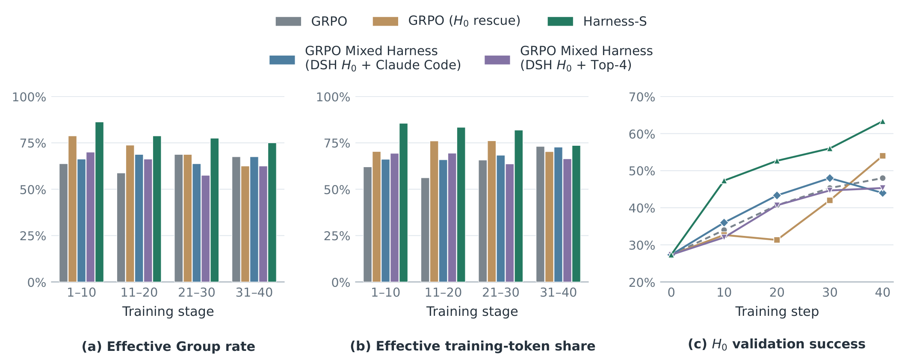</a>

  <figcaption>各训练阶段有效组比例、有效组承载的 token 比例和 H₀ 验证成功率。 <a href="https://arxiv.org/html/2611.04277v1#S4.F3">原论文 Figure 3</a> · Zhang et al. · <a href="https://creativecommons.org/licenses/by/4.0/">CC BY 4.0</a></figcaption>
</figure>

同样做 40 次更新，Harness-S 用了 3,032 次训练执行和 67.19 GPU·h。H₀ rescue 用了 3,616 次和 97.77 GPU·h，普通 GRPO 用了 2,560 次和 50.58 GPU·h。训练执行把后来丢掉的初始尝试也算进去。按每次触发多跑八条算，这组费用表分别对应 59 次换框架救援、132 次同框架救援。算全流程时还要把离线搜索和外部 API 用量加回来，论文报告 Harness-S 共用 75.79 GPU·h 和 18.69M 外部 API tokens。与 WHALE 比是 GPU 小时少、API tokens 多。 [Tables 9–10](https://arxiv.org/html/2611.04277v1#A7)

看同样八次救援额度的对照，固定画像的 Top-8 在 AppWorld 4B 最终 Avg@3 是 52.16%，更新画像的是 56.87%，差 4.71 个百分点。同样每题八次，挑四个框架各试两次是 55.60%。规则路由的 Pass@3 高于四框架各两次（66.41% 对 65.65%），Avg@3 排名则反过来。 [Table 2](https://arxiv.org/html/2611.04277v1#S4.T2)

救援策略、训练开销和完整流程开销（Tables 2、9、10）

<figure class="figure hs-figure" id="hs-table-2">
  
<a href="/lib/papers/harness-s/table-2.webp">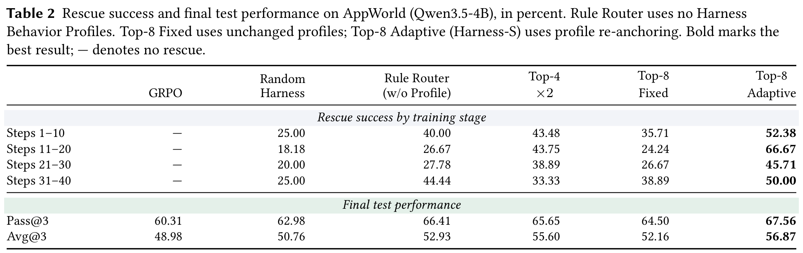</a>

  <figcaption>随机、规则、固定画像和更新画像的救援成功率与最终分数。 <a href="https://arxiv.org/html/2611.04277v1#S4.T2">原论文 Table 2</a> · Zhang et al. · <a href="https://creativecommons.org/licenses/by/4.0/">CC BY 4.0</a></figcaption>
</figure>
<figure class="figure hs-figure" id="hs-table-9">
  
<a href="/lib/papers/harness-s/table-9.webp">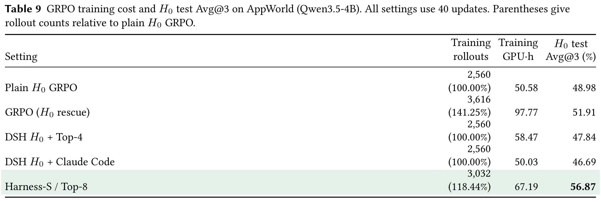</a>

  <figcaption>五种设置的训练执行次数、GPU 小时与最终成绩。 <a href="https://arxiv.org/html/2611.04277v1#A7.T9">原论文 Table 9</a> · Zhang et al. · <a href="https://creativecommons.org/licenses/by/4.0/">CC BY 4.0</a></figcaption>
</figure>
<figure class="figure hs-figure" id="hs-table-10">
  
<a href="/lib/papers/harness-s/table-10.webp">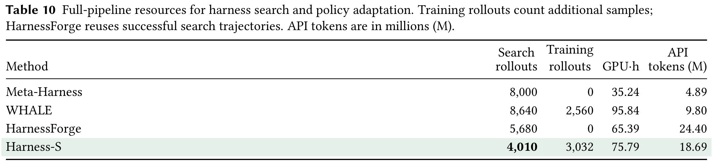</a>

  <figcaption>四种方法的离线搜索和训练总开销。 <a href="https://arxiv.org/html/2611.04277v1#A7.T10">原论文 Table 10</a> · Zhang et al. · <a href="https://creativecommons.org/licenses/by/4.0/">CC BY 4.0</a></figcaption>
</figure>

## 5. Discussion　如何判断模型学走了什么

行为统计给了几个可以复查的线索。仍在 H₀ 下，AppWorld 的首次 API 调用前查 schema 的轨迹比例，从普通 GRPO 的 38.2% 到 Harness-S 的 67.6%，重复执行同样代码的比例从 30.1% 降到 9.8%。SWE-Gym 中标准测试受阻后改写断言做验证的比例是 13.3% 对 48.5%。这些行为由 LLM 标记，比例记录行为出现的频率。每次检查对最终判决贡献多少，还要看实际题和轨迹。 [Table 3](https://arxiv.org/html/2611.04277v1#S4.T3)

AppWorld 4B 的 Rank-1 和 H₀ 之间，训练后 Pass@3 的差距从 14.21 点收窄到 0.76 点，Avg@3 仍差 4.58 点。路由把 H₀ 放到第一名的比例也从 1.53% 升到 22.52%。这几组对照支持模型对辅助框架的依赖有所减轻。再把同一份 4B 权重放进 Claude Code 或 OpenClaw，AppWorld 和 SWE-Gym 仍比各自框架中的 GRPO 强，绝对成绩低于 DeepSeek Harness H₀。跨框架比较只覆盖这两个任务套件和 4B，说明有迁移，也保留接口差异带来的影响。 [Table 5](https://arxiv.org/html/2611.04277v1#S4.T5) · [Figure 4](https://arxiv.org/html/2611.04277v1#S4.F4)

<figure class="figure hs-figure" id="hs-figure-4">
  
<a href="/lib/papers/harness-s/figure-4.webp">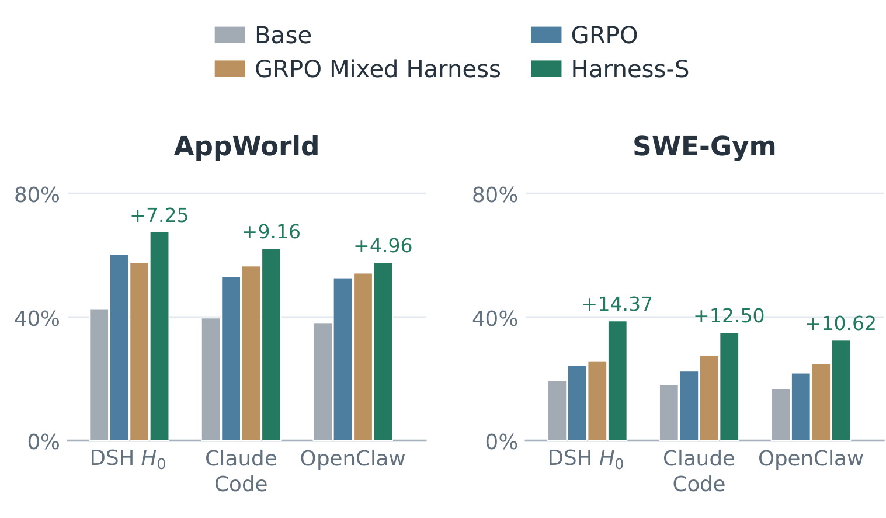</a>

  <figcaption>AppWorld 和 SWE-Gym 在 DeepSeek Harness、Claude Code 和 OpenClaw 下的 Pass@3。 <a href="https://arxiv.org/html/2611.04277v1#S4.F4">原论文 Figure 4</a> · Zhang et al. · <a href="https://creativecommons.org/licenses/by/4.0/">CC BY 4.0</a></figcaption>
</figure>

行为标签、路由名次与九个变体的修复重叠（Tables 3、5 和 Figure 5）

<figure class="figure hs-figure" id="hs-table-3">
  
<a href="/lib/papers/harness-s/table-3.webp">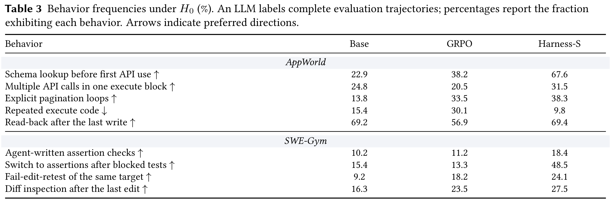</a>

  <figcaption>回到 H₀ 后的 AppWorld 与 SWE-Gym 行为频率。 <a href="https://arxiv.org/html/2611.04277v1#S4.T3">原论文 Table 3</a> · Zhang et al. · <a href="https://creativecommons.org/licenses/by/4.0/">CC BY 4.0</a></figcaption>
</figure>
<figure class="figure hs-figure" id="hs-table-5">
  
<a href="/lib/papers/harness-s/table-5.webp">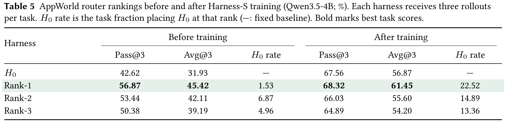</a>

  <figcaption>训练前后路由名次、成功率与 H₀ 入选比例。 <a href="https://arxiv.org/html/2611.04277v1#S4.T5">原论文 Table 5</a> · Zhang et al. · <a href="https://creativecommons.org/licenses/by/4.0/">CC BY 4.0</a></figcaption>
</figure>
<figure class="figure hs-figure" id="hs-figure-5">
  
<a href="/lib/papers/harness-s/figure-5.webp">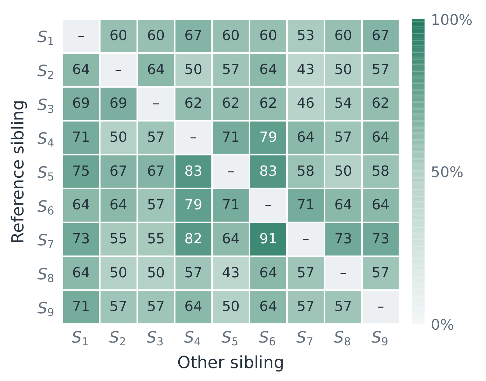</a>

  <figcaption>九个辅助框架修复集合的有向重叠矩阵。 <a href="https://arxiv.org/html/2611.04277v1#A5.F5">原论文 Figure 5</a> · Zhang et al. · <a href="https://creativecommons.org/licenses/by/4.0/">CC BY 4.0</a></figcaption>
</figure>

这项工作有一个可反复运行的反馈过程。模型更新后，作者用新权重重跑验证集，新的行为记录决定之后哪些框架来救哪些题。池里的代码在训练开始前就产出了，终局判题程序和优化规则也固定。这里能反复改进的是**做题的策略和给失败题分配哪种执行支持**。要判断某一类训练行为是否由单独一个框架零件带来，可以固定同一训练题和判题器，只拿掉那条支持再比较。论文的两条留出案例和框架级对照能说明行为迁移出现过，还没有给出这一级归因。 [论文 §2.3](https://arxiv.org/html/2611.04277v1#S2.SS3) · [§4.5–4.7](https://arxiv.org/html/2611.04277v1#S4.SS5)

## 6. Conclusion　公开代码明确了哪些复现条件

当前公开版本只覆盖 AppWorld，给出了 20 套框架、任务 ID、共用的判题与训练接入代码，以及普通 GRPO、H₀ rescue、Harness-S 三种配方。默认路由用 **TF-IDF 词项相似度**找至多五道近邻验证题，按候选框架在这些题上的成功率排序。默认配置关闭行为画像和 LLM 投票，可以分别启用。作者还保存了部分历史训练用的 H₀ 加九个变体子集。README 说明，默认全池配方与这个子集的历史运行不同，便携版也尚未完成 GPU 端到端复现。因此文章的成绩引用论文，代码检查用于确认公开配方和救援流程。 [固定版本 README](https://github.com/DeepExperience/Harness-S/tree/93f5d8a81ad8bfaa0c50b9f9710c49b693c7f2a0#readme) · [规则路由](https://github.com/DeepExperience/Harness-S/blob/93f5d8a81ad8bfaa0c50b9f9710c49b693c7f2a0/src/harness_s/router.py#L91-L123) · [发布状态](https://github.com/DeepExperience/Harness-S/blob/93f5d8a81ad8bfaa0c50b9f9710c49b693c7f2a0/docs/reproduction.md)

**AppWorld 4B 的 H₀ rescue 和 Harness-S 用同一个优化器，最后也都回到 H₀ 测试。** Avg@3 是 51.91% 对 56.87%，换框架组的执行次数更少。同时含成败的任务组比例从 70.94% 提到 79.38%。Rank-1 留下的 4.58 点 Avg@3 则说明训练完成后，合适的执行支持仍能提高一次尝试的稳定性。 [Table 1](https://arxiv.org/html/2611.04277v1#S3.T1) · [Tables 5、9](https://arxiv.org/html/2611.04277v1#A7.T9)
