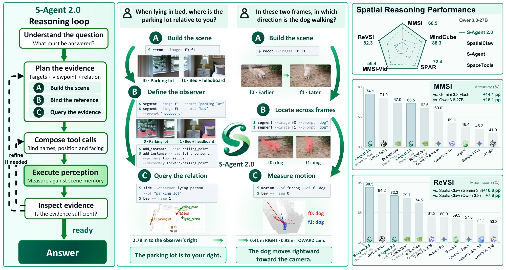
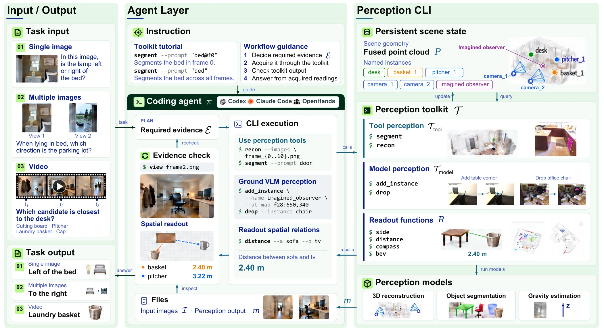
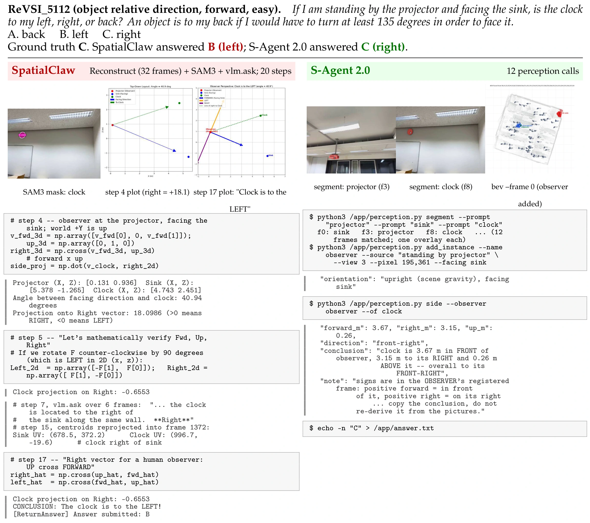
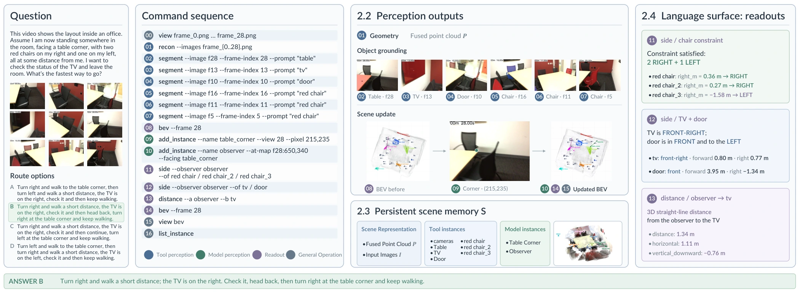
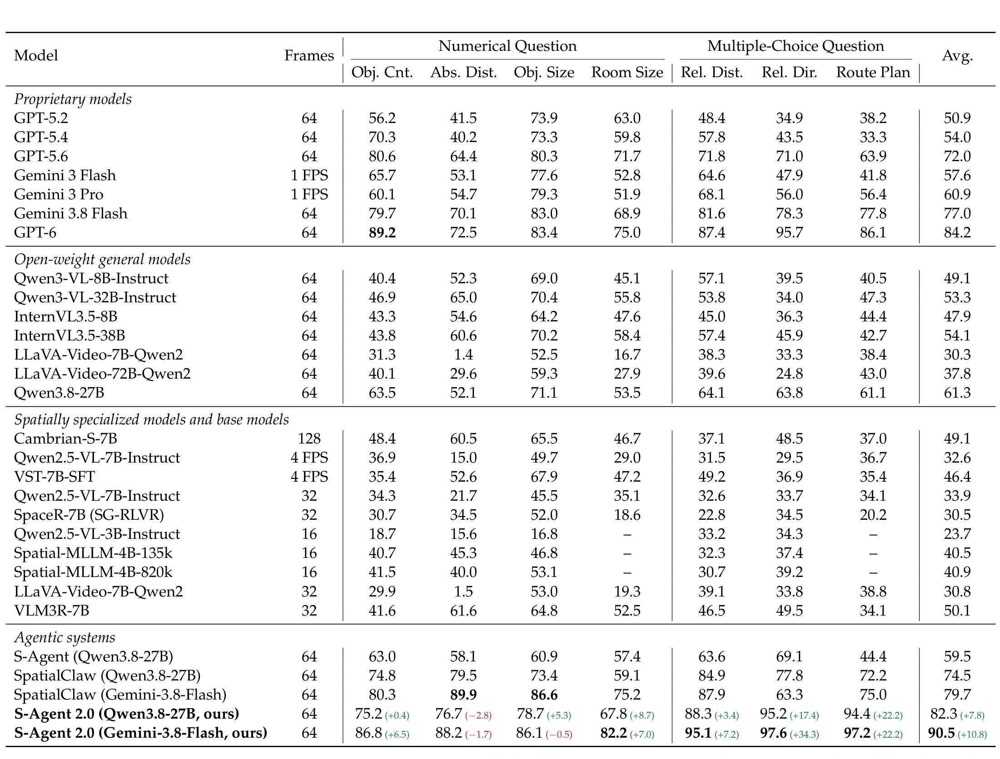
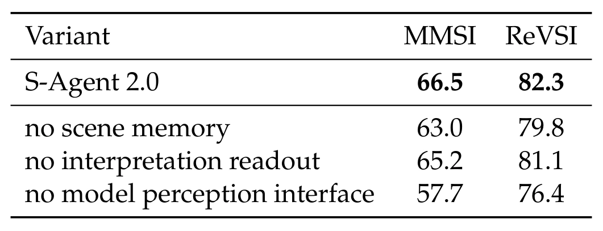
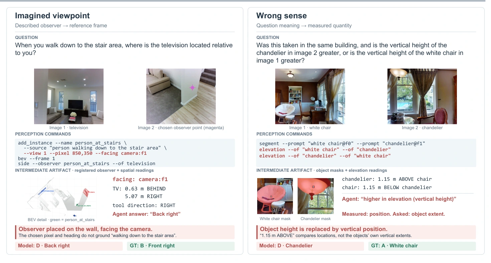
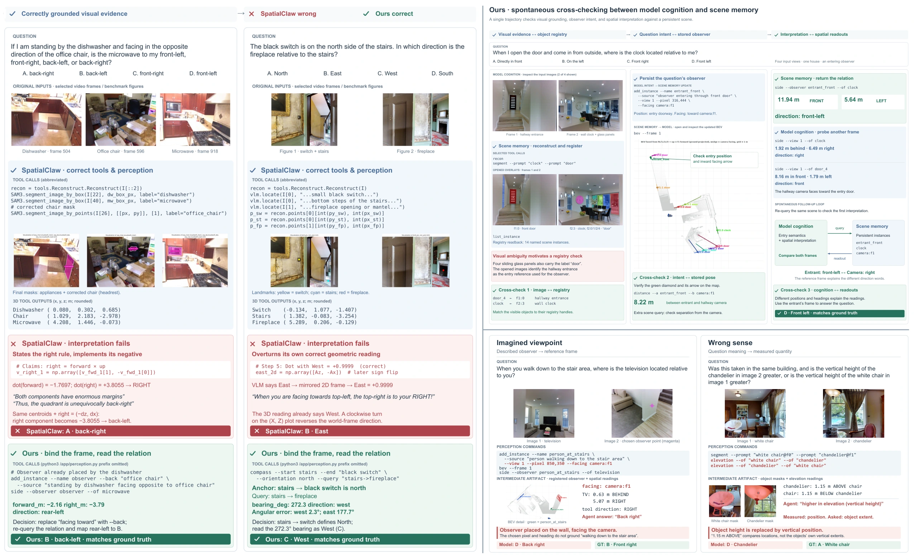

站在投影仪旁、面朝水槽，挂钟在你的左边、右边还是背后？视频里的相机没站在题指定的位置。S-Agent 2.0 先用画面重建房间，再把题目里的观察者放到投影仪旁，朝水槽定向。工具以这个人的视角计算挂钟的方位，模型根据读数选择答案。 [原论文及 PDF](https://arxiv.org/abs/2610.28354v1) · [官方项目页](https://ropedia.github.io/S-Agent-2.0/) · [公开代码](https://github.com/Ropedia/S-Agent-2.0/tree/c99526846220534e02f1bfb7498c7f8e2201f3df)

### Part 0　题目里的人可以有自己的坐标系

同一个时钟，从门外走进屋的人看是在左前方，从走廊里的相机看却可以在右侧。说左或右之前，需要先给出视角的原点和朝向。下文的 **coding agent harness** 指 OpenHands、Codex、Claude Code 这类运行框架。模型通过它看图、操作文件和执行命令。S-Agent 2.0 用这些通用能力调查场景，论文的实验全部在推理阶段进行。

## 1. Motivation　测到了，为什么还会答错

**空间问答的误差有一部分出在读数之后。** 一题可能要从不同画面里找出参照物，再切换到题中人的视角。分割模型圈出了正确的物体，三维重建也给出了位置，模型仍可能在换坐标系时把左右颠倒。论文的投影仪案例里，SpatialClaw 一度算出挂钟在右，却在复查叉积时换了轴向约定，最后选了左。 [论文 §1、Appendix E Figure 5](https://arxiv.org/html/2610.28354v1#A5.F5)

作者保留通用编码框架的执行循环，给工作环境加了一组感知命令和对应的使用说明。它们允许模型补进一个题设中的人，回头检查这个人放得对不对，再从他的坐标系里量方向。负责决策的视觉语言模型沿用已有权重，论文没有进行 SFT、强化学习或蒸馏。 [论文 §1.1、§3.1](https://arxiv.org/html/2610.28354v1#S1.SS1)

<figure class="figure" id="sa-figure-1">

<figcaption>左侧是模型的调查过程。中间两例分别需要给躺在床上的人定向，以及追踪狗在两帧间的移动。右侧是原论文的汇总比较，其中单独模型的分数与正文 Table 5 的同框架对照口径有别。 <a href="https://arxiv.org/html/2610.28354v1#S0.F1">Gong 等，Figure 1</a> · <a href="https://creativecommons.org/licenses/by/4.0/">CC BY 4.0</a></figcaption>
</figure>

## 2. Related Work　空间能力放在模型、执行循环还是工具里

**最接近的对照是同样会主动测量的 SpatialClaw。** 它让视觉语言模型在专用的「计划、行动、反思」循环中，向一个保留 Python 变量的内核发代码。两者能接入同样的感知后端。S-Agent 2.0 把物体注册和方位计算做成普通 shell 命令，模型可以按名字查场景，也可以设定查询所用的观察者。 [SpatialClaw](https://arxiv.org/abs/2606.13673) · [论文 Appendix A](https://arxiv.org/html/2610.28354v1#A1)

上一代 S-Agent 已允许模型按题目选用三维感知工具，把多视图或多帧串起来。SpaceTools 则先用监督轨迹教模型调用固定工具，再以交互式 RL 训练。在 S-Agent 2.0 里，通用框架调度工具调用，工具侧维护这道题的三维场景。这里的实验问题是这样的接口能给现成模型带来多少收益。 [S-Agent](https://arxiv.org/abs/2606.20515) · [论文 Appendix A，含 SpaceTools](https://arxiv.org/html/2610.28354v1#A1)

## 3. Method　把设想中的观察者放进重建场景

### 3.1 一道题里，模型和工具分别维护什么

模型拿到问题、存放在工作目录里的画面和一份固定教程。它自己挑要看的帧，可以写代码、打开分割图或俯视图，再决定下一条命令。命令调用由原有框架执行。感知后端固定使用 Depth Anything 3 估计深度和相机位姿、GeoCalib 估计重力、π³mos 估计像素运动区域、SAM 3 按文字提示分割物体。 [论文 §2.1–2.3、§3.1](https://arxiv.org/html/2610.28354v1#S2)

工具把原始帧、重建结果和按名称索引的物体记录保留到这道题结束。论文称这份状态为 **scene memory**。`recon` 将各帧融合到以重力定上下方向的三维点云，并登记相机位姿和场景中心。`segment` 把指定帧或多帧的物体掩码投回点云，再注册成可查询的实例。实例有三维位置，还可以有物体覆盖的点和朝向。公开实现的索引写入每题单独的 `artifacts/scene_state.json`，大点图和掩码保存在各自的文件中。模型后续可以用 `list_instance` 重查索引，或者直接报名字让工具重新计算一项关系。论文未单测会话压缩对这套用法的影响。 [论文 §2.2](https://arxiv.org/html/2610.28354v1#S2.SS2) · [scene_store.py](https://github.com/Ropedia/S-Agent-2.0/blob/c99526846220534e02f1bfb7498c7f8e2201f3df/agent/gateway/scene_store.py#L1-L24)

模型用 `add_instance` 告诉工具把一个新实例放在哪、朝向哪，新增实例随后也能用名字查询。位置可取自原图上的像素、俯视图上的像素或已有相机的位置。比如题目让人站在桌角旁，模型可以从一张图里点出桌角，再把假想的站立者放在俯视图上，并让他朝桌角。如果掩码圈错了东西，模型还可用 `drop` 移除错误实例。它能打开标有实例和方向箭头的俯视图，核对刚才登记的含义是否正确。 [论文 Figure 3、Appendix B](https://arxiv.org/html/2610.28354v1#A2) · [位置与朝向实现](https://github.com/Ropedia/S-Agent-2.0/blob/c99526846220534e02f1bfb7498c7f8e2201f3df/agent/gateway/perception_gateway.py#L6564-L6749)

<figure class="figure" id="sa-figure-2">

<figcaption>中间的编码智能体组织命令和文件读取，右侧的工具更新三维场景并计算关系。 <a href="https://arxiv.org/html/2610.28354v1#S2.F2">Gong 等，Figure 2</a> · <a href="https://creativecommons.org/licenses/by/4.0/">CC BY 4.0</a></figcaption>
</figure>

### 3.2 ReVSI_5112　同样看见了挂钟，为什么选项不同

这题出自 ReVSI 的 ScanNet++ v2 室内场景，公开的 64 帧数据版本收录了这道题。人的站位由投影仪指定，朝向由水槽指定。三个选项是 A 背后、B 左、C 右。题目把至少转身 135° 才能正对的方向归为背后。 [ReVSI 64 帧原始数据](https://huggingface.co/datasets/3dlg-hcvc/ReVSI/blob/345a811321e2c9ec2b91a2e8df13e3a124584fa8/64_frame/test-00000-of-00001.parquet) · [论文 Figure 5](https://arxiv.org/html/2610.28354v1#A5.F5)

1. S-Agent 2.0 用三个文字提示分割投影仪、水槽和挂钟。论文记录了第 3 帧里找到的投影仪、第 8 帧里找到的挂钟，以及跨帧匹配得到的其他掩码。
2. 模型把第 3 帧的像素 `(195, 361)` 投到重建场景，添加名为 `observer` 的观察者，设他直立并面朝已登记的水槽。
3. 模型用 `side --observer observer --of clock` 询问挂钟的方位。这个命令把「挂钟位置减去观察者位置」分别投影到观察者自己的前、右、上三根轴，返回 **前 3.67 米、右 3.15 米、上 0.26 米**。工具同时把数字转成有参照物和单位的句子，这是论文所说的 **interpreted readout**。
4. 水平夹角约为向右 41°，工具报右前方。按这题的三个选项，右前方落在右侧，模型把 `C` 写进 `/app/answer.txt`。SpatialClaw 的一段计算也曾指向右侧，后来复查时左右轴约定发生了变化，最后交的是 `B`。

<figure class="figure" id="sa-figure-5">

<figcaption>两边使用 Gemini-3.8-Flash 和同一组感知后端。论文左边标的是 SpatialClaw 的步骤数，右边标的是 S-Agent 2.0 的感知调用数。文章封面也取自右栏的分割画面和俯视图。 <a href="https://arxiv.org/html/2610.28354v1#A5.F5">Gong 等，Figure 5</a> · <a href="https://creativecommons.org/licenses/by/4.0/">CC BY 4.0</a></figcaption>
</figure>

同样的做法也能表示有多个约束的站位（Figure 3）

路线题要求人面朝桌角、右手边有两把红椅子、左手边有一把。模型在俯视图上选择站位后，从这个位置量出三把椅子的横向分量分别为 +0.36、+0.27、−1.58 米。约束满足后，它再查电视和门的方向，选择先向右看电视、再折返到桌角的路线 B。

<figure class="figure" id="sa-figure-3">

<figcaption>办公路线题里的命令顺序、场景记录和读数。 <a href="https://arxiv.org/html/2610.28354v1#S2.F3">Gong 等，Figure 3</a> · <a href="https://creativecommons.org/licenses/by/4.0/">CC BY 4.0</a></figcaption>
</figure>

## 4. Experiments　加工具、删接口、换框架分别测了什么

### 4.1 一题怎么变成一个分数

MMSI-Bench 给同一场景的多张图，考察物体、相机和区域之间的关系。ReVSI 从一段室内视频抽帧，问物体的距离、方位和路线。其余三项分别考稀疏视图（MindCube）、多视图下的多种空间能力（SPAR-Bench）和长视频（MMSI-Video-Bench）。 [论文 §3.1](https://arxiv.org/html/2610.28354v1#S3.SS1)

在公开代码里，ReVSI 的任务加载器给模型准备题面和按时间排序的图片文件，评测器单独读取数据集的标准答案。选择题核对最终的答案文件，答对得 1 分，答错或没写文件得 0 分。我把上面两条记录公布的最终字母交给发布版检查器，并用数据集给出的 C 作为标准答案。**C 得 1 分，B 得 0 分。** 这是对判分的核查。模型的工具轨迹来自论文 Figure 5。 [任务加载器](https://github.com/Ropedia/S-Agent-2.0/blob/c99526846220534e02f1bfb7498c7f8e2201f3df/agent/adapters/spatial/load_revsi.py) · [公开检查器](https://github.com/Ropedia/S-Agent-2.0/blob/c99526846220534e02f1bfb7498c7f8e2201f3df/agent/adapters/spatial/task_template/tests/test.sh)

ReVSI 的绝对距离、尺寸、数物体和房间面积是数值题。评测器按相对误差有多小给部分分，称作 **Mean Relative Accuracy（MRA）**。它检查误差是否落在 5%、10%、……、50% 的十个容差内，命中的比例就是这一题的分数。例如真值 10、预测 8.7，误差 13%，通过从 15% 到 50% 的八个档位，得 0.8 分。论文对 ReVSI 和 SPAR 先算各类题的均分，再给题型相同权重，其他三个基准报整体准确率。 [论文 §3.1、Table 2](https://arxiv.org/html/2610.28354v1#S3.SS1) · [数值评分代码](https://github.com/Ropedia/S-Agent-2.0/blob/c99526846220534e02f1bfb7498c7f8e2201f3df/agent/adapters/spatial/task_template/tests/score_numeric.py#L64-L122)

作者在 Appendix C 列了三轮 OpenHands 运行，每轮 1,000 道题。公开仓库说明，`run.sh ... all` 在 ReVSI、SPAR、MMSI-Video 上默认使用各自固定的 1,000 题清单。ReVSI 的 64 帧原始数据有 6,616 题，上面的 5112 在发布清单中。 [论文 Table 8](https://arxiv.org/html/2610.28354v1#A3.T8) · [运行说明](https://github.com/Ropedia/S-Agent-2.0/blob/c99526846220534e02f1bfb7498c7f8e2201f3df/docs/SETUP.md#6-run) · [ReVSI 题目清单](https://github.com/Ropedia/S-Agent-2.0/blob/c99526846220534e02f1bfb7498c7f8e2201f3df/agent/configs/items/revsi.json)

### 4.2 同一个编码智能体加上工具后

**Qwen3.8-27B 的 ReVSI 均分提高 20.5 个百分点。** 下面用论文 Table 5 的同框架对照。无工具组仍能打开帧文件，完整组增加感知命令及其使用说明。Qwen3.8-27B 用本地 FP8 服务，默认框架为 OpenHands。 [论文 Table 5](https://arxiv.org/html/2610.28354v1#S3.T6.fig1)

| 主模型 | MMSI-Bench 无 → 有 | ReVSI 无 → 有 |
| --- | ---: | ---: |
| Qwen3.8-27B | 52.6 → 66.5（+13.9） | 61.8 → 82.3（+20.5） |
| Gemini-3.8-Flash | 62.9 → 74.1（+11.2） | 80.9 → 90.5（+9.6） |

同一个 Gemini-3.8-Flash 放在 SpatialClaw 里，ReVSI 的工具收益是 77.0 → 79.7。S-Agent 2.0 在相对方向和路线题上的优势更大，绝对距离仍落后。Qwen3.8-27B 的绝对距离分数是 76.7 对 SpatialClaw 的 79.5，Gemini-3.8-Flash 是 88.2 对 89.9。重建的整体尺度估错时，以米报告的距离直接受影响，左右两侧的符号仍有可能正确。 [论文 Tables 2、5](https://arxiv.org/html/2610.28354v1#S3.T2)

完整 ReVSI 分题型结果（Table 2）

<figure class="figure" id="sa-table-2">

<figcaption>不同文献基线的帧数并不统一。按相同主模型比较论文中的两套工具方法，可以看到绝对距离列的差距。 <a href="https://arxiv.org/html/2610.28354v1#S3.T2">Gong 等，Table 2</a> · <a href="https://creativecommons.org/licenses/by/4.0/">CC BY 4.0</a></figcaption>
</figure>

### 4.3 删除哪一部分最伤，换框架还能不能跑

**去掉模型新增和移除实例的接口，分数掉得最多。** 对 Qwen3.8-27B，MMSI-Bench 和 ReVSI 分别下降 8.8、5.9 个百分点。去掉场景记录下降 3.5、2.5 点，去掉读数里的自然语言解释下降 1.3、1.2 点。作者还把同一组带解释的读数移植到 SpatialClaw 的内核，MMSI-Bench 从 62.6 到 62.9，ReVSI 从 74.5 到 75.5。这个对照给出了单独添加读数解释的效果，可与三项单独删除的结果一起看。 [论文 Table 6](https://arxiv.org/html/2610.28354v1#S3.T6.fig2) · [Appendix D](https://arxiv.org/html/2610.28354v1#A4.T9)

<figure class="figure" id="sa-table-6">

<figcaption>同一主模型下每次只删一项，分数与完整系统比较。 <a href="https://arxiv.org/html/2610.28354v1#S3.T6.fig2">Gong 等，Table 6</a> · <a href="https://creativecommons.org/licenses/by/4.0/">CC BY 4.0</a></figcaption>
</figure>

Table 4 固定 Qwen3.8-27B、工作区和工具包，换三种框架各跑一遍。框架各自管理系统提示、工具调用与上下文。三个框架都跑通了同样的空间问答接口。ReVSI 相差最多，OpenHands 82.3，Codex 76.6，Claude Code 79.1。这个实验测的是推理时的可移植性，论文未做多框架混训。 [论文 Table 4](https://arxiv.org/html/2610.28354v1#S3.T4.fig2)

| 评测 | OpenHands | Codex | Claude Code |
| --- | ---: | ---: | ---: |
| MMSI-Bench | 66.5 | 67.0 | 63.8 |
| SPAR-Bench | 72.4 | 71.8 | 72.8 |
| ReVSI | 82.3 | 76.6 | 79.1 |

## 5. Discussion　自动解释读数之后，还会量错什么

**工具按模型登记的位置和指定的命令计算。** Figure 4 的楼梯案例里，模型把走到楼梯旁的人放到了墙上，还让他朝相机。按这个姿态查询，电视在右侧偏后，模型选 D，标准答案却是 B 右前方。另一个例子问吊灯和白椅谁自身更高，模型用了 `elevation`，得到吊灯位置比椅子高 1.15 米。它据此选吊灯，标准答案是白椅。第一题给错了观察者的位置和朝向，第二题选错了要测的物理量。 [论文 §3.4、Figure 4](https://arxiv.org/html/2610.28354v1#S3.F4)

<figure class="figure" id="sa-figure-4-grounding">

<figcaption>Figure 4 右下局部，保留了原题、工具调用和两个错误答案。 <a href="https://arxiv.org/html/2610.28354v1#S3.F4">Gong 等，Figure 4</a> · <a href="https://creativecommons.org/licenses/by/4.0/">CC BY 4.0</a></figcaption>
</figure>

成功的复核也可以具体看到。公开的 MMSI_134 轨迹里，工具把入口和几扇玻璃门都标成了门。模型打开分割图确认真正的入口，把 `entrant_front` 放在入口朝屋内。读取挂钟时，从进门的人看是左前方，从走廊相机看却是右侧。两次测量都来自同一个重建，换掉的是观察者。Appendix C 的三轮统计中，至少用过一次 `add_instance` 的题占 26% 到 48%，用过 `drop` 的占 21% 到 40%。这些比例说明操作用了多频繁，不能用来估计它每用一次就能救回多少题。 [MMSI_134 项目记录](https://ropedia.github.io/S-Agent-2.0/trajectories/cases/MMSI_134.js) · [Table 8](https://arxiv.org/html/2610.28354v1#A3.T8)

完整定性比较（Figure 4）

<figure class="figure" id="sa-figure-4">

<figcaption>右上是同一个挂钟在两个视角下的结果，右下是两种查询错误。图内细字可点击放大查看。 <a href="https://arxiv.org/html/2610.28354v1#S3.F4">Gong 等，Figure 4</a> · <a href="https://creativecommons.org/licenses/by/4.0/">CC BY 4.0</a></figcaption>
</figure>

两类错误可以用一个额外对照分开。固定重建结果和主模型，给一组运行提供人工核对过的观察者位置与朝向，另一组仍由模型指定。这样才能估计重新放对观察者能挽回多少题。尺寸题可以用同样的设计，固定物体分割，只替换模型选择的测量命令。

## 6. Conclusion　这些实验支持什么

**这篇的主要改动是给通用编码智能体一组可复查的空间操作。** 在 Qwen3.8-27B 上，完整系统在论文对比的五项基准里均超过 SpatialClaw。接口消融显示，允许模型往场景里补上题设中的参考点和观察者，比单独在数值后附一句解释带来的变化更大。按公开规则，最后一个字母正确即得分，中间站位、朝向和几何读数没有单独的检查项。要知道一个系统究竟是找错物体、放错观察者还是选错测量命令，还需看中间轨迹。 [论文 Tables 3、6](https://arxiv.org/html/2610.28354v1#S3.T4.fig1) · [Appendix E](https://arxiv.org/html/2610.28354v1#A5)

公开仓库包含任务加载器、检查器、感知网关和以 OpenHands SDK 为主的运行说明。复现完整运行需要另装模型权重和 benchmark 数据。Agent 和文档采用 Apache 2.0，感知服务器复用 SpatialClaw，附带的改动沿用其非商业许可。论文说公开了全部报告运行的轨迹，本次在项目页核到的是 11 条精选轨迹，未找到五项评测的逐题日志或 Codex、Claude Code 的完整复现配方。Table 8 报告了工具调用数，主实验未给出相同题目上的总 token、端到端耗时或 GPU 开销。 [发布版安装说明](https://github.com/Ropedia/S-Agent-2.0/blob/c99526846220534e02f1bfb7498c7f8e2201f3df/docs/SETUP.md) · [仓库许可](https://github.com/Ropedia/S-Agent-2.0/tree/c99526846220534e02f1bfb7498c7f8e2201f3df#license) · [项目轨迹清单](https://ropedia.github.io/S-Agent-2.0/trajectories/manifest.js)

[图表、源码和判分的核对清单](/lib/papers/s-agent-2-0/s-agent-2-0.sources.json)
